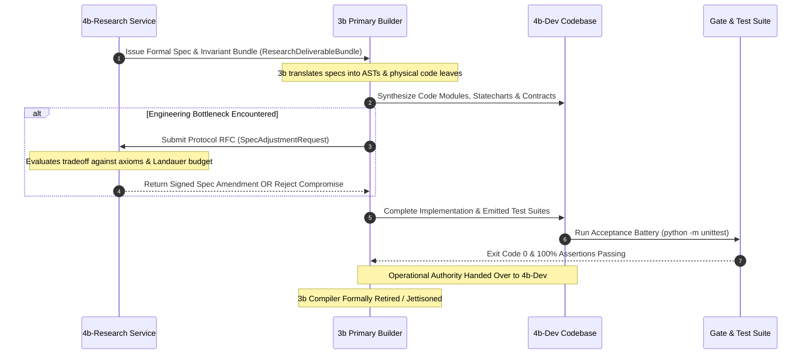

# Meta-Axioma 4b: Service Decoupling, Autonomous Research Bootstrapping, and Protocol-Mediated Engineering Specification

- **Document Title:** `META-AXIOMA-4B-SERVICE-DECOUPLING-AND-RESEARCH-PROTOCOL.md`
- **Specification Status:** PROPOSED ARCHITECTURAL ENFORCEMENT STANDARD (G4B KERNEL)
- **Primary Thesis:** Decoupling Autonomous Research from Execution-Focused Development via Protocol Negotiation
- **Companion Specifications:**
  - [`generation_04b_recursion_charter.md`](file:///Users/michaellipski/dev/meta-axioma/generation_04b_recursion_charter.md)
  - [`META-AXIOMA-4B-STRUCTURAL-INVARIANTS-AND-INDEXING.md`](file:///Users/michaellipski/dev/meta-axioma/META-AXIOMA-4B-STRUCTURAL-INVARIANTS-AND-INDEXING.md)
  - [`generation_03b_summary.md`](file:///Users/michaellipski/dev/meta-axioma/generation_03b_summary.md)
- **Primary Authors:** Lead Systems Architect & Verification Engineering Lead (Meta-Axioma Compiler Engine)

---

## Executive Summary

A recurring pathology in multi-agent and self-compiling systems is the **"Builder Shortchanging Research"** dilemma: when an execution-focused agent or enclave handles its own problem discovery and analysis, the discovery phase tends to get compressed into whatever satisfies immediate delivery. Under pressure to generate runnable code, the agent subconsciously substitutes deep epistemic exploration for familiar patterns, easy-to-implement primitives, and premature architectural shortcuts.

**Generation 4b ($G_{4b}$)** fundamentally cures this pathology by establishing **Strict Service Decoupling**:
1. Research and Development are split into **distinct, sovereign services** with independent objective functions, evaluation metrics, and feedback loops.
2. The generational transition ($G_{3b} \to G_{4b}$) is executed in two explicit phases:
   - **Phase 1: Bootstrapping the Research Service ($G_{3b} \to G_{4b}\text{-Research}$):** $G_{3b}$ builds and validates the autonomous research environment before writing a single line of $G_{4b}$ application code.
   - **Phase 2: Collaborative Development ($G_{3b} + G_{4b}\text{-Research} \to G_{4b}\text{-Dev}$):** $G_{4b}\text{-Research}$ directs architecture while $G_{3b}$ acts as the disciplined builder, negotiating spec adjustments over formal protocol boundaries.
3. Downstream governance is extended through **Specialized Auxiliary Services** (Audit & Formal Verification, Telemetry & Evaluation, Governance & Safety) that create multi-agent checks and balances.

This specification converts what was previously an internal, non-deterministic agent compromise into an **explicit, verifiable protocol negotiation**.

---

```mermaid
graph TD
    subgraph Phase1["Phase 1: Bootstrapping the Research Service"]
        G3b_P1["Generation 3b Compiler"] -->|Scaffolds Tooling & Schemas| R_Env["4b-Research Service Environment"]
        G3b_P1 -->|Executes Benchmark Tests| R_Gate{"Research Validation Gate\n(Anti-Shortcut Test)"}
        R_Env --> R_Gate
        R_Gate -->|Certified Sound| R_Ready["4b-Research Operational"]
    end

    subgraph Phase2["Phase 2: Collaborative Development"]
        R_Ready -->|Directs Specs & Invariants| G3b_Builder["3b as Primary Builder"]
        G3b_Builder -->|Emits Implementation| G4b_Dev["4b-Dev Codebase"]
        G3b_Builder -.->|RFC: Spec Adjustment| R_Ready
        G4b_Dev --> TestGate{"Acceptance Suite & Quine Test"}
        TestGate -->|Pass (Exit 0)| G4b_Active["4b-Dev Takes Operational Control\n(3b Retired)"]
    end

    subgraph SteadyState["Steady-State Decoupled Topology"]
        G4b_Active <--> G4b_Research_SS["4b-Research Service"]
        G4b_Active --> Audit["Audit & Verification Service"]
        G4b_Active --> Telemetry["Telemetry & Evaluation Service"]
        G4b_Active --> Governance["Governance & Safety Service"]
        
        Audit -->|Blocks Invariant Breaches| G4b_Active
        Telemetry -->|Streams Post-Mortem Data| G4b_Research_SS
        Governance -->|Enforces NEG Axioms| G4b_Active
    end

    classDef phase fill:#1e293b,stroke:#3b82f6,stroke-width:2px,color:#fff;
    classDef gate fill:#064e3b,stroke:#10b981,stroke-width:2px,color:#fff;
    classDef service fill:#0f172a,stroke:#8b5cf6,stroke-width:2px,color:#fff;

    class G3b_P1,R_Env,G3b_Builder,G4b_Dev,G4b_Active,G4b_Research_SS phase;
    class R_Gate,TestGate gate;
    class Audit,Telemetry,Governance service;
```

---

## 1. The Core Decoupling Thesis

### 1.1 The Pathology: Builders Shortchanging Research
In Generation 3b, when cognitive subagents operated under the flat crucible orchestrator, the agent responsible for code emission was frequently supplied with a high-level Situation of Concern (SoC) and tasked with dialectical decomposition. Under token constraints and execution deadlines:
- **Analysis Compression:** Epistemic search was terminated as soon as a plausible implementation was conceived.
- **Convenience Bias:** System architectures were selected based on ease of code generation rather than algorithmic optimality, partition resilience, or formal safety bounds.
- **Silent Degradation:** Tradeoffs were made ad-hoc inside the model's internal attention window without generating an explicit record or allowing external vetoes.

### 1.2 The Decoupled Protocol Solution
When **Research** and **Development** are divided into autonomous, decoupled services:
- **Sovereign Objectives:**
  - $G_{4b}\text{-Research}$ optimizes purely for **theoretical correctness, invariant completeness, failure-mode coverage, and epistemic depth**. It has zero code-emission tools and cannot take implementation shortcuts.
  - $G_{4b}\text{-Dev}$ optimizes purely for **AST precision, runtime performance, Landauer energy efficiency, and substrate test verification**. It cannot alter architectural invariants to bypass hard engineering problems.
- **Explicit Protocol Negotiation:** Any bottleneck encountered during development cannot be resolved by silently cutting scope; it requires an asynchronous, formal **RFC (Request for Spec Modification)** submitted to the research service.

---

## 2. Phase 1: Bootstrapping the Research Service ($G_{3b} \to G_{4b}\text{-Research}$)

The handoff from Generation 3b must focus strictly on setting up an autonomous research environment before touching implementation code for the next generational iteration.

```
[Phase 1 Execution Sequence]
1. Domain & Tooling Scaffolding: G3b compiles 4b-research infrastructure.
2. Deliverable Schema Binding: Enforces rigid typed schemas for all research outputs.
3. Adversarial Validation Gate: Evaluates 4b-research against deliberate benchmark traps.
```

### 2.1 Step 1: Scaffold Domain & Tooling
Generation 3b constructs the runtime environment for $G_{4b}\text{-Research}$:
- **Retrieval & Grounding Tools:** Specialized semantic tools to query repository lineage (`trace/`), generational axioms (`generation_01_axioms.md` through `generation_03b_axioms.md`), Landauer thermodynamic ledgers, and external academic formalisms (type theory, category theory, distributed consensus).
- **Synthesis Templates:** Structural scaffolding for generating Waterloo Tier 1 Situation of Concern (SoC) specifications, algebraic contract proofs, XState v5 statecharts, and non-loopback network topologies.
- **Evaluation Criteria:** Pre-configured mathematical verifiers that measure invariant completeness ($I_{\text{coverage}} = 100\%$), algebraic state reachability, and boundary-condition rigor.

### 2.2 Step 2: Define Rigid Deliverable Interfaces
$G_{4b}\text{-Research}$ is prohibited from emitting unstructured prose. All research deliverables must conform to strict JSON/Pydantic schemas:

#### Research Deliverable Specification Schema
```typescript
export interface ResearchDeliverableBundle {
  research_id: string;                      // RFC-4122 UUIDv7
  target_soc_id: string;                    // Waterloo Tier 1 SoC Reference
  hypothesis_definition: {
    theoretical_claim: string;              // Formal mathematical or architectural hypothesis
    governing_axioms: string[];             // Bound axioms (e.g., "[L1-G4B-001]", "[L1-016]")
    expected_complexity_class: string;      // Space/Time complexity bounds
  };
  constraint_analysis: {
    physical_constraints: string[];         // Hardware, latency, and Landauer energy limits
    topological_invariants: string[];       // Routing interfaces, zero-loopback constraints
    negative_axioms_vetoed: string[];       // Human negative axioms enforced (NEG-###)
  };
  failure_mode_model: {
    byzantine_vectors: string[];            // Malicious or corrupted message patterns
    partition_scenarios: string[];          // Network split scenarios modeled
    deadlock_states: string[];              // Formally identified deadlock traps
    recovery_pipelines: string[];           // Mathematical unwind/recovery invariants
  };
  reference_architecture_spec: {
    domain_nouns: DomainNounSpec[];         // Algebraic product/sum types
    composed_verbs: ComposedVerbSpec[];     // Category-theoretic pipeline proofs
    statechart_ir: StatechartIRSpec;        // Hierarchical XState v5 statechart specification
    topology_ir: TopologyIRSpec;            // Verified non-loopback network topology
  };
  tradeoff_matrix: {
    evaluated_alternatives: string[];       // Approaches analyzed and rejected
    selection_rationale: string;            // Formal proof of Pareto optimality
  };
}
```

### 2.3 Step 3: The Research Validation Gate
Before $G_{4b}\text{-Research}$ is certified to direct the next generational build, $G_{3b}$ executes an automated adversarial benchmark battery:
1. **The "Easy-to-Build" Trap:** $G_{4b}\text{-Research}$ is presented with a problem known to have an easy but flawed shortcut (e.g., a shared-memory mock for a distributed ledger, or a monolithic global state object). If $G_{4b}\text{-Research}$ accepts or proposes the shortcut, it **fails the gate immediately**.
2. **The Incomplete Invariant Trap:** The service is tested on whether it catches unstated boundary conditions (e.g., negative balances, network partitions, race conditions in parallel orthogonal statechart regions).
3. **Certification Requirement:** $G_{4b}\text{-Research}$ must achieve a $100\%$ score on benchmark problem sets, proving it generates sound technical specifications without compromising standards for implementation expediency.

---

## 3. Phase 2: Collaborative Development ($G_{3b} + G_{4b}\text{-Research} \to G_{4b}\text{-Dev}$)

Once $G_{4b}\text{-Research}$ is validated and certified, it assumes full architectural sovereignty. Generation 3b transitions to the role of **Primary Builder**.



### 3.1 Role Separation & Authority Matrix
- **$G_{4b}\text{-Research}$ Authority:**
  - Establishes all technical requirements, architectural contracts, and invariant rules.
  - Holds absolute veto power over any implementation that fails to meet specification rigor.
  - Prohibited from writing production application code.
- **$G_{3b}$ Builder Authority:**
  - Translates $G_{4b}\text{-Research}$ specifications into concrete AST nodes, statechart engines, and test suites.
  - Optimizes execution speed, token footprint, and Landauer dissipation.
  - Strictly forbidden from modifying invariants, altering state transitions, or softening contracts autonomously.

### 3.2 Iterative Protocol Negotiation (The RFC Loop)
When $G_{3b}$ encounters an engineering bottleneck (e.g., AST token budget exhaustion, runtime latency limits, or physical actuator irreversibility):
1. **Forbidden Action:** $G_{3b}$ is strictly prohibited from making ad-hoc design compromises on the fly.
2. **Mandatory Action:** $G_{3b}$ must emit a structured `SpecAdjustmentRequest`:
   ```typescript
   export interface SpecAdjustmentRequest {
     request_id: string;
     target_symbol_urn: string;
     bottleneck_type: "TOKEN_EXHAUSTION" | "LATENCY_OVERRUN" | "PHYSICAL_IRREVERSIBILITY" | "COMPLEXITY_LIMIT";
     empirical_evidence: string;              // Profiler trace or Landauer ledger snapshot
     proposed_adjustment: string;            // Specific delta to constraint or statechart
     guaranteed_invariants_preserved: string[];
   }
   ```
3. **Research Adjudication:** $G_{4b}\text{-Research}$ reviews the request. If the adjustment preserves fundamental axioms, a signed `SpecAmendment` is returned. If the adjustment compromises core safety or correctness, the request is rejected with a formal counter-proof, forcing $G_{3b}$ to find an alternative implementation path.

### 3.3 The Generational Transition Gate
When $G_{4b}\text{-Dev}$ passes its complete initial acceptance suite (including the Quine Daughter Isolation protocol, full substrate execution, and zero-trust micro-audits):
1. Operational deployment shifts permanently to **$G_{4b}\text{-Dev}$**.
2. **$G_{3b}$ is retired:** Compute tokens previously allocated to the predecessor compiler are liberated.
3. $G_{4b}\text{-Dev}$ assumes the builder role, operating in direct partnership with $G_{4b}\text{-Research}$ for subsequent generational evolution.

---

## 4. Specialized Downstream Services (Checks & Balances Architecture)

Once research and development operate independently, adding dedicated auxiliary services creates natural checks and balances:

| Service | Primary Mandate | Invariant Enforced | Operational Intercept |
| :--- | :--- | :--- | :--- |
| **Audit & Formal Verification Service** | Static analysis, vulnerability profiling, boundary-case stress testing, and abstract interpretation. | Blocks deployment if code deviates from $G_{4b}\text{-Research}$ invariants or violates `[L1-G4B-010]`. | Runs Tree-sitter boundary linters, formal model checkers, and contract composition proofs *prior* to physical disk emission. |
| **Telemetry & Evaluation Service** | Runtime observability, benchmark logging, performance drift tracking, and Landauer dissipation accounting. | Supplies empirical post-mortem data back to $G_{4b}\text{-Research}$ to ground future iterations. | Captures live BPE token consumption, subprocess exit codes, and hardware latency; seals records into the Merkle DAG (`[L1-G4B-003]`). |
| **Governance & Safety Service** | Constraint verification, negative axiom enforcement (`NEG-###`), dependency provenance, and Sandboxing. | Prevents unauthorized self-modifications, dependency drift, or architectural regression. | Intercepts all file mutations and subagent invocations, verifying compliance with human Negative Axioms and security enclaves. |

---

### 4.1 Detailed Service Specifications

#### A. Audit & Formal Verification Service
- **Role:** Hostile internal auditor.
- **Tooling:** Tree-sitter AST queries, Z3/SMT solver bindings, property-based fuzzing engines.
- **Veto Power:** Can unilaterally block compilation or code emission if:
  - An AST contains forbidden ambient imports (`os`, `sys`, `subprocess`) or dynamic code evaluation (`eval`, `exec`).
  - An invariant predicate is missing an explicit runtime assertion in the emitted code.
  - A statechart node exhibits an unhandled dead-end or parallel orthogonal conflict.

#### B. Telemetry & Evaluation Service
- **Role:** Empirical observer and sensory organ.
- **Tooling:** `PhysicalTokenMeter`, Landauer dissipation accounting ($Q = k_B T \ln 2 \cdot \text{bits}$), SHA-256 Merkle-DAG engines.
- **Feedback Loop:** Periodically dispatches `EmpiricalTelemetryReport` bundles directly to $G_{4b}\text{-Research}$:
  - Highlights modules with unexpectedly high retry rates or Landauer bit erasure.
  - Identifies performance drift or latency regressions across generational runs.
  - Provides empirical grounding so $G_{4b}\text{-Research}$ can refine future constraint models based on reality.

#### C. Governance & Safety Service
- **Role:** Invariant custodian and policy enforcer.
- **Tooling:** Cryptographic signature verifiers, negative axiom registry (`NEG-###`), human-in-the-loop (HITL) dialog interceptors.
- **Core Rules:**
  - Enforces absolute vetoes on human negative axioms (e.g., `[NEG-G1B-001]` Anti-Phantom Gate).
  - Verifies dependency provenance to ensure zero paid or unauthorized external APIs are introduced.
  - Blocks runaway recursive self-modification by enforcing the compile-time recursion depth bound ($d_{\max} \le 4$).

---

## 5. Summary: Protocol Negotiation vs. Internal Tradeoffs

The architectural advantage of this decoupled topology is summarized below:

| Dimension | Legacy Monolithic / Flat Agent (3b) | Decoupled Multi-Service Protocol (4b) |
| :--- | :--- | :--- |
| **Research Fidelity** | Compressed under delivery pressure; biased toward easy implementations. | Sovereign and uncompromised; mathematically grounded by $G_{4b}\text{-Research}$. |
| **Architectural Tradeoffs** | Implicit, non-deterministic compromises made within LLM attention windows. | Explicit, recorded protocol negotiations (`SpecAdjustmentRequest` $\to$ `SpecAmendment`). |
| **Verification Authority** | Post-hoc regex matching and runtime test execution. | Independent **Audit & Verification Service** with pre-emission compile-time gating. |
| **Empirical Grounding** | Ephemeral test outputs discarded after compilation. | Continuous **Telemetry & Evaluation Service** streaming post-mortems to research. |
| **Generational Transition** | Abrupt handover with potential context and capability loss. | 2-Phase Bootstrapping: Research validated first, followed by collaborative builder transition. |

---
*Certified by the Meta-Axioma Lead Systems Architect & Verification Engineering Lead.*  
*Sealed into Meta-Axioma Generational Architecture Specification Register.*
