# 🌌 Meta-Axioma: Recursive Axiomatic Architecture & Meta-Orchestrator

**Meta-Axioma** is an executable recursive architecture for bootstrapping self-evolving software systems. It replaces unconstrained, probabilistic code generation with formal axiomatic boundaries, thermodynamic compute decay modeling, and autonomous generational succession.

---

## 🏛️ System Philosophy: The TRACE Methodology

This repository is organized using the **TRACE** declarative modeling specification for AI-driven development. Rather than burying intent in imperative source code, TRACE separates what the system is into lightweight, human-readable specifications:

- **[overview.md](file:///Users/michaellipski/dev/meta-axioma/overview.md):** The big picture—mission, bounded contexts, and global glossary.
- **[stack.md](file:///Users/michaellipski/dev/meta-axioma/stack.md):** Execution stack, Python runtime, AGY agentic tools, and system defaults.
- **[trace/](file:///Users/michaellipski/dev/meta-axioma/trace/):**
  - **[personas/](file:///Users/michaellipski/dev/meta-axioma/trace/personas/):** System actors ([`human_architect`](file:///Users/michaellipski/dev/meta-axioma/trace/personas/human_architect.persona.md), [`meta_orchestrator`](file:///Users/michaellipski/dev/meta-axioma/trace/personas/meta_orchestrator.persona.md)).
  - **[domains/](file:///Users/michaellipski/dev/meta-axioma/trace/domains/):** Bounded contexts ([`axiom_registry`](file:///Users/michaellipski/dev/meta-axioma/trace/domains/axiom_registry.domain.md), [`simulation_decay`](file:///Users/michaellipski/dev/meta-axioma/trace/domains/simulation_decay.domain.md), [`evaluation_targets`](file:///Users/michaellipski/dev/meta-axioma/trace/domains/evaluation_targets.domain.md), [`telemetry_audit`](file:///Users/michaellipski/dev/meta-axioma/trace/domains/telemetry_audit.domain.md)).
  - **[flows/](file:///Users/michaellipski/dev/meta-axioma/trace/flows/):** Execution workflows ([`epoch_evolution`](file:///Users/michaellipski/dev/meta-axioma/trace/flows/epoch_evolution.flow.md), [`generational_handover`](file:///Users/michaellipski/dev/meta-axioma/trace/flows/generational_handover.flow.md)).

---

## 🧬 Recursive Generational Architecture

Meta-Axioma is designed as a recursive compiler lineage: we recursively build better and better compilers that **haven't lost sight of reality**, **can be controlled**, and **are not self-contradictory**.

```mermaid
flowchart LR
    Human["Human Architect"] -->|Provides S_0| S0["S_0: Search Harness"]
    S0 -->|Generates| A1["G_1 Axioms"]
    A1 -->|Build from scratch| G1["System G_1"]
    G1 -->|Generates| A2["G_2 Basis / Axioms"]
    A2 -->|Build from scratch| G2["System G_2"]
    G2 -->|Generates| A3["G_3 Basis / Axioms"]
    A3 -->|Build from scratch| G3["System G_3 ..."]
```



### The Architectural Distinction: Harness vs. Systems
- **$S_0$ (The Bootstrapper Harness in `src/`):** The system provided by the Human Architect to search, simulate, decay, and formulate the foundational structural axioms of $G_1$.
- **System $G_1$ (To Be Built from the Ground Up):** An entirely new software system constructed from scratch using the 6 structural axioms discovered by $S_0$. Its operational mission is to produce the basis/axioms for **$G_2$**.
- **System $G_2$ (Constructed from Ground Up):** Built from scratch using the basis produced by $G_1$. Its mission is to produce the basis for **$G_3$**.

### The High-Level Jettison: Optimizing for Non-Generator Systems
Meta-Axioma does not build compilers for recursive vanity. The overarching purpose of Generation $G(n)$ is to become optimized for implementing **non-generator systems**—concrete, production software applications that humans love, find useful, and can control. Every generation maintains active teleological awareness of this ultimate goal, ensuring its compiled abstractions are forged for practical product utility.

### Generational Directory Layout
- **Root Level:** Holds global project context and generation-level artifacts with their generation prefix:
  - **[generation_01_summary.md](file:///Users/michaellipski/dev/meta-axioma/generation_01_summary.md):** Complete summary of Generation 1 (Axiomatic search through Epoch 15).
  - **[generation_01_architecture.md](file:///Users/michaellipski/dev/meta-axioma/generation_01_architecture.md):** Architectural specification and trajectory log for Generation 1.
  - **[generation_01_axioms.md](file:///Users/michaellipski/dev/meta-axioma/generation_01_axioms.md):** Invariant registry of Generation 1's active and rejected axioms.
- **[generations/](file:///Users/michaellipski/dev/meta-axioma/generations/):** Contains discrete generational packages:
  - **[generations/gen_01/](file:///Users/michaellipski/dev/meta-axioma/generations/gen_01/):** Holds the epoch telemetry history (`epoch_001.md` through `epoch_015.md`) and the ground-up implementation of System $G_1$.
  - **[generations/gen_02/](file:///Users/michaellipski/dev/meta-axioma/generations/gen_02/):** Environment for System $G_2$, to be constructed using the basis synthesized by $G_1$.

---

## ⚡ Current Status (Generation 1, Epoch 15 — Low-Level Jettison 2 Executed)

- **Phase:** `PHASE_2_STRUCTURAL_EXECUTION` (Axiom Discovery Search Locked via Low-Level Jettison 2)
- **Phase Transition:** **Low-Level Jettison 2 Executed** (Triggered manually via AI assistant recommendation upon static candidate pool exhaustion and compute decay to $2,857$ tokens).
- **Global Efficacy ($E$):** `1.1596` ($\frac{dE}{dt} = +0.0104$)
- **Active Structural Invariants ($n=7$):**
  - [`[L1-002]` Functorial State Evolution & Morphism Preservation](file:///Users/michaellipski/dev/meta-axioma/generation_01_axioms.md#L225-L232)
  - [`[L1-004]` Universal Grammar & Compositional Projection Constraints](file:///Users/michaellipski/dev/meta-axioma/generation_01_axioms.md#L233-L240)
  - [`[L1-011_3]` Decoupled State Transformation & Persistence](file:///Users/michaellipski/dev/meta-axioma/generation_01_axioms.md#L257-L264)
  - [`[L1-008]` Landauer Thermodynamic Reversibility & Dissipation Accounting](file:///Users/michaellipski/dev/meta-axioma/generation_01_axioms.md#L281-L288)
  - [`[L1-015]` Zero-Trust Dual-Boundary Demarcation & Introspectable MCP Governance](file:///Users/michaellipski/dev/meta-axioma/generation_01_axioms.md#L305-L315)
  - [`[L1-016]` Demarcated Exception Enclaves & Bounded Invariant Suspension](file:///Users/michaellipski/dev/meta-axioma/generation_01_axioms.md#L329-L336)
  - [`[L1-015_1]` Compositional Boundary Isolation](file:///Users/michaellipski/dev/meta-axioma/generation_01_axioms.md#L431-L434)
- **Inactive Epistemic Scaffolding ($n=10$):** Preserved in [generation_01_axioms.md](file:///Users/michaellipski/dev/meta-axioma/generation_01_axioms.md#L17-L100).
- **Target Suite:** 4-Way Balanced Suite ($S_1$ Self-Constructor, $S_2$ Self-Evaluator, $S_3$ Control Group, $P_1$ Product Usability).
- **Next Milestone:** Construction of **System $G_1$ from the ground up** based on the 7 verified structural axioms.

---

## 🛠️ Verification & Development

Run the test suite (19/19 tests passing):
```bash
PYTHONPATH=src python3 tests/test_all.py
```

