# 🌌 Meta-Axioma: Recursive Axiomatic Architecture & Meta-Orchestrator

**Meta-Axioma** is an executable recursive architecture for bootstrapping self-evolving software systems. It replaces unconstrained, probabilistic code generation with formal axiomatic boundaries, thermodynamic compute decay modeling, and autonomous generational succession.

---

## 🏛️ System Philosophy: The TRACE Methodology

This repository is organized using the **TRACE** declarative modeling specification for AI-driven development. Rather than burying intent in imperative source code, TRACE separates what the system is into lightweight, human-readable specifications:

- **[overview.md](overview.md):** The big picture—mission, bounded contexts, and global glossary.
- **[stack.md](stack.md):** Execution stack, Python runtime, AGY agentic tools, and system defaults.
- **[trace/](trace/):**
  - **[personas/](trace/personas/):** System actors ([`human_architect`](trace/personas/human_architect.persona.md), [`meta_orchestrator`](trace/personas/meta_orchestrator.persona.md)).
  - **[domains/](trace/domains/):** Bounded contexts ([`axiom_registry`](trace/domains/axiom_registry.domain.md), [`simulation_decay`](trace/domains/simulation_decay.domain.md), [`evaluation_targets`](trace/domains/evaluation_targets.domain.md), [`telemetry_audit`](trace/domains/telemetry_audit.domain.md)).
  - **[flows/](trace/flows/):** Execution workflows ([`epoch_evolution`](trace/flows/epoch_evolution.flow.md), [`generational_handover`](trace/flows/generational_handover.flow.md)).

---

## 🧬 Recursive Generational Architecture

Meta-Axioma is designed as a recursive compiler lineage: we recursively build better and better compilers that **haven't lost sight of reality**, **can be controlled**, and **are not self-contradictory**.

```mermaid
flowchart LR
    Human["Human Architect"] -->|Provides S_0| S0["S_0: Search Harness"]
    S0 -->|Generates| A1["G_1 Axioms"]
    A1 -->|Build from scratch| G1["System G_1"]
    G1 -->|Generates| A2["G_2 Basis / Axioms"]
    A2 -->|Build from scratch| G2["System G_2"]
    G2 -->|Generates| A3["G_3 Basis / Axioms"]
    A3 -->|Build from scratch| G3["System G_3 ..."]
```



### The Architectural Distinction: Harness vs. Systems
- **$S_0$ (The Bootstrapper Harness in `src/`):** The system provided by the Human Architect to search, simulate, decay, and formulate the foundational structural axioms of $G_1$.
- **System $G_1$ (To Be Built from the Ground Up):** An entirely new software system constructed from scratch using the 6 structural axioms discovered by $S_0$. Its operational mission is to produce the basis/axioms for **$G_2$**.
- **System $G_2$ (Constructed from Ground Up):** Built from scratch using the basis produced by $G_1$. Its mission is to produce the basis for **$G_3$**.

### The High-Level Jettison: Optimizing for Non-Generator Systems
Meta-Axioma does not build compilers for recursive vanity. The overarching purpose of Generation $G(n)$ is to become optimized for implementing **non-generator systems**—concrete, production software applications that humans love, find useful, and can control. Every generation maintains active teleological awareness of this ultimate goal, ensuring its compiled abstractions are forged for practical product utility.

### Generational Directory Layout
- **Root Level:** Holds global project context and generation-level artifacts with their generation prefix:
  - **[generation_02_summary.md](generation_02_summary.md):** Complete summary of Generation 2 (Autonomous Domain Compiler).
  - **[generation_02_architecture.md](generation_02_architecture.md):** Architectural specification and trajectory log for Generation 2.
  - **[generation_02_axioms.md](generation_02_axioms.md):** Invariant registry of Generation 2's active structural axioms.
  - **[generation_01_summary.md](generation_01_summary.md):** Complete summary of Generation 1 (Axiomatic search through Epoch 15).
  - **[generation_01_architecture.md](generation_01_architecture.md):** Architectural specification for Generation 1.
  - **[generation_01_axioms.md](generation_01_axioms.md):** Invariant registry of Generation 1.
- **[generations/](generations/):** Contains discrete generational packages:
  - **[generations/gen_01/](generations/gen_01/):** Holds the epoch telemetry history (`epoch_001.md` through `epoch_015.md`) and the ground-up implementation of System $G_1$.
  - **[generations/gen_02/](generations/gen_02/):** Environment for System $G_2$, constructed from the ground up to embody multi-substrate Galois compilation, self-healing, cognitive ergonomics, zero-trust tokens, and intent grounding.

---

## ⚡ Current Status (Generation 2, Epoch 4 — Production Applications Active)

- **Generation:** $G_2$ (Autonomous Domain Compiler)
- **Phase:** `PHASE_2_PORTFOLIO_CONVERGENCE`
- **Global Efficacy Baseline ($E_{G2}$):** `3.1386` (Epoch 4 Cumulative)
- **Active Structural Invariants ($n=7$):**
  - [`[L1-G2-001]` Adjoint Galois Substrate Connection & Multi-Target Preservation](generation_02_axioms.md#l1-g2-001-adjoint-galois-substrate-connection--multi-target-preservation)
  - [`[L1-G2-002]` Ephemeral Self-Healing Invariant Restoration Loop](generation_02_axioms.md#l1-g2-002-ephemeral-self-healing-invariant-restoration-loop)
  - [`[L1-G2-003]` Cognitive Ergonomics & Persona Alignment Invariance](generation_02_axioms.md#l1-g2-003-cognitive-ergonomics--persona-alignment-invariance)
  - [`[L1-G2-004]` Introspectable Zero-Trust Capability Scoping](generation_02_axioms.md#l1-g2-004-introspectable-zero-trust-capability-scoping)
  - [`[L1-G2-005]` Mandatory Human Intent Elicitation & Grounding Boundary](generation_02_axioms.md#l1-g2-005-mandatory-human-intent-elicitation--grounding-boundary)
  - [`[L1-G2-006]` Phenomenological Tool-Being & Zuhandenheit Attunement Invariant](generation_02_axioms.md#l1-g2-006-phenomenological-tool-being--zuhandenheit-attunement-invariant)
  - [`[L1-G2-007]` Kinetic Chaining & Semantic Momentum Propagation](generation_02_axioms.md#l1-g2-007-kinetic-chaining--semantic-momentum-propagation)
- **Active Non-Generator Systems:**
  - **Axioma Sentinel (Port 8100):** Zero-Trust Security Mesh & Enclave Auto-Repair Console.
  - **Axioma Lexis (Port 8092):** Adaptive Spaced Repetition Vocabulary Studio (PWA + Android Native Shell).
  - **Axioma Crossword (Port 8094):** Cruciverbalist Studio, AC-3 Constraint Solver, and Universal Grammar Cryptic Clue AST.
- **Thermodynamic Compute Budget:** $T_2(8) = 2,000$ tokens / Depth 3.
- **Successor Formulation:** Generation 3 ($G_3$) handover targets certified.

---

## 🛠️ Verification & Development

Run the test suite (19/19 tests passing):
```bash
PYTHONPATH=src python3 tests/test_all.py
```

