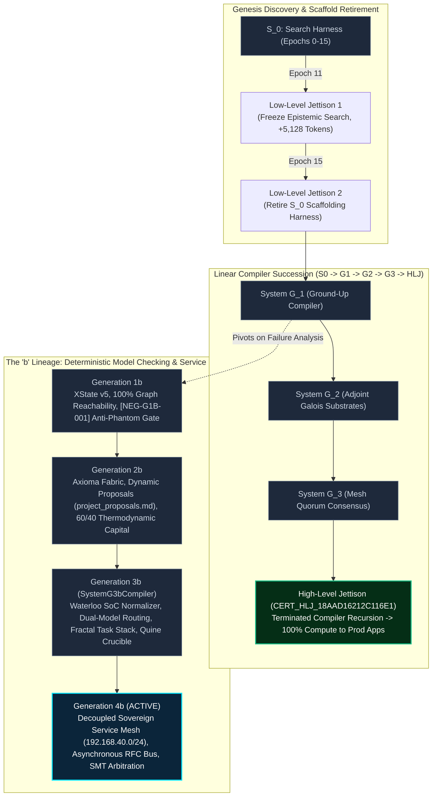
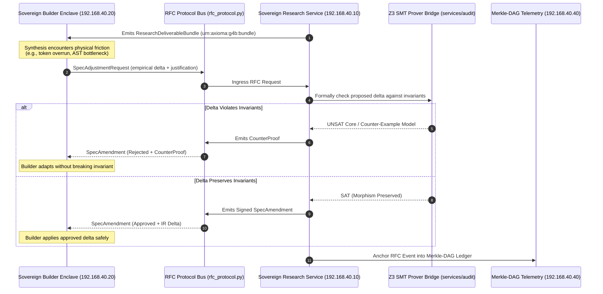

# 🌌 Meta-Axioma: Recursive Axiomatic Architecture & Meta-Orchestrator

[](generations/gen_04b/)
[](HIGH_LEVEL_JETTISON.md)
[-9d4edd.svg)](stack.md)
[-brightgreen.svg)](#-verification-cluster-launcher--development)

**Meta-Axioma** is an executable recursive architecture for bootstrapping self-evolving software systems. It replaces unconstrained, probabilistic prompt chains with formal axiomatic boundaries, thermodynamic compute decay modeling, sovereign service mesh isolation, and autonomous generational succession.

---

## 🎭 Interactive Presentation & Architectural Showcase

Explore the interactive, dual-mode slide presentation detailing the foundational mathematics, historical generational pivot, and modern Generation 4b architecture:

- 🖥️ **[presentation.html](presentation.html)** — **Interactive Presentation Deck: "Meta-Axioma: Philosophy, Process & Generational Architecture"**
  - **Dual Explanation Modes:** One-click toggle between **Academic Formalism** (Category Theory, Gödelian limits, Landauer erasure, Weisfeiler-Lehman kernels, Z3 SMT proofs) and **Layman / Executive** narratives.
  - **10 Core Slides:** Foundations & Inception, Orthogonal Axiom Discovery, The Jettison Framework, The Quine Compiler, Generational Crisis & Pivot to 'b', Generation 4b Sovereign Service Mesh, 5 Key LLM Stability Ideas, Functorial Dialectic & Empirical Witness, Future Roadmap, and Takeaways.
  - **Built-in Speaker Notes:** Press `S` or click *Speaker Notes* for an embedded talking-points cheat sheet for every slide.
  - **Mathematical Fidelity:** Live KaTeX LaTeX rendering with client-side fallback parsing.
  - **Keyboard Navigation:** `Left` / `Right` arrows, `Space` to advance, `M` to toggle explanation mode.

For deep telemetry and interactive architectural statechart visualization, also see:
- 📊 **[evolution_dashboard/](evolution_dashboard/)** — **Flagship Architectural Evolution Studio & G4b Zenith Workbench (Port 8105)**: Full chronological spine ($S_0 \to G_1 \to G_2 \to G_3 \to G_{1b} \to G_{2b} \to G_{3b} \to G_{4b}$), Beehive 4-tier SVG topology, live side-by-side diff workbench, and interactive compilation walkthrough.

---

## 🏛️ System Philosophy: The TRACE Methodology

This repository is organized using the **TRACE** declarative modeling specification for AI-driven development. Rather than burying intent in imperative source code, TRACE separates what the system is into lightweight, human-readable specifications:

- **[overview.md](overview.md):** The big picture—mission, bounded contexts, and global glossary.
- **[stack.md](stack.md):** Execution stack, Python runtime, AGY agentic tools, and system defaults.
- **[trace/](trace/):**
  - **[personas/](trace/personas/):** System actors ([`human_architect`](trace/personas/human_architect.persona.md), [`meta_orchestrator`](trace/personas/meta_orchestrator.persona.md)).
  - **[domains/](trace/domains/):** Bounded contexts ([`axiom_registry`](trace/domains/axiom_registry.domain.md), [`simulation_decay`](trace/domains/simulation_decay.domain.md), [`evaluation_targets`](trace/domains/evaluation_targets.domain.md), [`telemetry_audit`](trace/domains/telemetry_audit.domain.md)).
  - **[flows/](trace/flows/):** Execution workflows ([`epoch_evolution`](trace/flows/epoch_evolution.flow.md), [`generational_handover`](trace/flows/generational_handover.flow.md)).

---

## 🧬 Generational Succession & Evolution Lineage

Meta-Axioma was engineered as a multi-generational succession lineage. We iteratively compile better, more reliable compilers that:
1. **Haven't lost sight of reality** (Landauer erasure limits $Q \ge k_B T \ln 2$, User Zero dogfooding, empirical test execution).
2. **Can be controlled** (Zero-trust boundaries, exception enclaves, human vetoes `NEG-###`).
3. **Are not self-contradictory** (Functorial morphism preservation, model-checked reachability).



### The Linear Collapse & The Pivot to 'b'
In early linear generations ($G_1 \to G_4$), standard multi-agent coding chains suffered from:
- **Greedy One-Pass Emission:** LLMs emitted code without reachability proofs, missing edge transitions.
- **Simulated / Phantom Completion:** Agents declared tasks complete in chat without physically writing working files to disk.
- **The Vacuum Synthesis Trap:** Applications passed shallow tests but omitted essential domain table stakes.
- **Context Bloat:** Massive uncompressed chat histories degraded reasoning attention.

The **'b' lineage** discarded prompt patching and enforced mathematical verification:
- **Generation 1b ($G_{1b}$):** XState v5 Statecharts, 100% BFS/DFS reachability proofs, and the non-negotiable **`[NEG-G1B-001]` Anti-Phantom Emission Gate**.
- **Generation 2b ($G_{2b}$):** Axioma Fabric (Sheaf-CRDTs), Dynamic Proposal Dossiers (`project_proposals.md`), and **Thermodynamic Capital Partitioning** (60% Exploratory / 40% Protected Sinks).
- **Generation 3b ($G_{3b}$):** Universal Systems Compiler, Waterloo Tier 1 Situation of Concern (`[L1-G3B-000]`), Dual-Model Cognitive Routing (`[L1-G3B-014]`), Fractal Task Stack (`[L1-G3B-015]`), Zero-Bypass Self-Healing (`[L1-G3B-016]`), and the **Quine Crucible Daughter Isolation Protocol**.
- **Generation 4b ($G_{4b}$):** The Sovereign Decoupled Service Mesh.

### The High-Level Jettison (HLJ)
Formally certified under **`CERT_HLJ_18AAD16212C116E1`**, the High-Level Jettison permanently ended self-referential compiler loops: 100% of future compute is permanently committed to deploying production software applications that humans love, find useful, and control. See [HIGH_LEVEL_JETTISON.md](HIGH_LEVEL_JETTISON.md).

---

## ⚡ Current Status: Generation 4b (Decoupled Sovereign Service Mesh)

> **Lineage Stage:** Generation $4b$ (Operational Flagship)  
> **Architecture:** Decoupled Sovereign Service Mesh (`192.168.40.0/24`) with Asynchronous RFC Bus & SMT Arbitration  
> **Charter:** [generation_04b_recursion_charter.md](generation_04b_recursion_charter.md)  
> **Protocols & Invariants:** [META-AXIOMA-4B-SERVICE-DECOUPLING-AND-RESEARCH-PROTOCOL.md](META-AXIOMA-4B-SERVICE-DECOUPLING-AND-RESEARCH-PROTOCOL.md) & [META-AXIOMA-4B-STRUCTURAL-INVARIANTS-AND-INDEXING.md](META-AXIOMA-4B-STRUCTURAL-INVARIANTS-AND-INDEXING.md)  
> **Active Production Systems:** **24 Deployed Systems** cataloged in [SYSTEMS_PORTFOLIO.md](SYSTEMS_PORTFOLIO.md)  
> **Cluster Health:** `[STATUS: HEALTHY]` (8/8 enclaves operational via `python3 generations/gen_04b/run.py`)  

Generation 4b cures the **"Builder Shortchanging Research"** pathology: when a single agent writes code while researching, it cuts architectural corners to satisfy immediate delivery. $G_{4b}$ establishes physical separation of powers across **5 Sovereign Service Enclaves**:

```
generations/gen_04b/
├── run.py                          # Sovereign Mesh Cluster Launcher & Health Auditor
├── protocols/                      # Wire contracts & schemas
│   ├── rfc_protocol.py             # SpecAdjustmentRequest, SpecAmendment, CounterProof
│   ├── urn_registry.py             # Universal Symbol URN Registry (urn:axioma:g4b:...)
│   └── deliverable_bundle.py       # ResearchDeliverableBundle schemas
├── services/                       # 5 Sovereign Service Enclaves (192.168.40.0/24)
│   ├── research/                   # Sovereign Epistemic Research Service (soc_g4b_researcher)
│   ├── builder/                    # Sovereign Autonomous Builder Enclave (soc_g4b_builder)
│   ├── audit/                      # Sovereign Audit & Formal Verification Service (soc_g4b_audit)
│   ├── telemetry/                  # Sovereign Telemetry & Evaluation Service (soc_g4b_telemetry)
│   └── governance/                 # Sovereign Governance & Safety Service (soc_g4b_governance)
├── apps/                           # Flagship production applications compiled under G4b
│   ├── axioma_canvas/              # Tactile Reactive Visual Statechart Studio (Port 8084)
│   ├── axioma_go/                  # 10x10 Tactical Capture Dojo (Port 8082)
│   ├── axioma_consensus/           # Sovereign Gossip Mesh Node (Port 8083)
│   └── axioma_crucible/            # AST Micro-Compiler & Quine Studio (Port 8085)
├── epochs/                         # G4b compilation epochs and cryptographic ledgers
└── tests/                          # Generational cross-service integration test suite
```

### 1. The 5 Sovereign Service Enclaves

| Enclave | Directory | Mesh IP / Port | Invariants & Operational Scope |
| :--- | :--- | :---: | :--- |
| **Sovereign Research Service** | [`services/research/`](generations/gen_04b/services/research/) | `192.168.40.10:8440` | **Zero-Code Research Boundary (`[L1-G4B-002]`):** Strictly prohibited from writing or executing application code. Normalizes Waterloo Tier 1 Situation of Concern (`[L1-G3B-000]`), optimizes 5-tier anti-bias novelty (Weisfeiler-Lehman distance $D \ge 0.40$), and emits immutable `ResearchDeliverableBundle`s. |
| **Sovereign Builder Enclave** | [`services/builder/`](generations/gen_04b/services/builder/) | `192.168.40.20:8442` | **Bounded Fractal Subagent Trees (`[L1-G4B-001]`):** Synthesizes code in isolated sandboxes ($d \le 4, b \le 5, \lambda \le 0.80$). Enforces Tree-sitter AST Skeletonization ($\le 4,096$ tokens), typed diagnostic tuples, and runs the Quine Daughter Isolation Protocol. Cannot alter specs without filing an RFC. |
| **Sovereign Audit Service** | [`services/audit/`](generations/gen_04b/services/audit/) | `192.168.40.30:8444` | **Formal Verification & Byzantine QA:** Bridges to the Z3 SMT Prover, performs XState v5 model checking, enforces 14-vector zero-trust micro-auditing, and arbitrates via 2-of-3 Sheaf-Quorum consensus. |
| **Sovereign Telemetry Service** | [`services/telemetry/`](generations/gen_04b/services/telemetry/) | `192.168.40.40:8446` | **Hierarchical Merkle-DAG Ledger (`[L1-G4B-003]`):** Chains all inter-service transactions and execution events with SHA-256 hashes, tracks Landauer thermal bit-erasure dissipation, and measures physical BPE token consumption. |
| **Sovereign Governance Service** | [`services/governance/`](generations/gen_04b/services/governance/) | `192.168.40.50:8448` | **Constitutional Safety & Checks and Balances:** Enforces Ashby's Law of Requisite Variety, executes automated Socratic Red Team critiques (`[L1-G4B-009]`), and guarantees absolute enforcement of human negative axioms (`NEG-###`). |

---

### 2. The Asynchronous RFC Bus & SMT Arbitration Protocol

When physical friction (token decay, latency overruns, unexpected AST bottlenecks) requires adjusting an architectural specification during synthesis, the Builder does not mutate the specification unilaterally. It submits a formal RFC over the **Asynchronous RFC Bus** (`protocols/rfc_protocol.py`):



---

### 3. The 3-Phase Causal Reactive Pipeline (`[INV-G4B-CAUSAL-001..003]`)

To prevent the "Flying Blind / Testing Non-Existent Code" race condition where verification agents run concurrently against ungrounded files, $G_{4b}$ mandates the **3-Phase Causal Reactive Pipeline**:

```mermaid
flowchart TD
    P1["Phase 1: Sovereign Brain Gate (Sequential)<br/>• Waterloo Tier 1 Situation of Concern Normalization<br/>• DecompositionPlan, ContractIR, StatechartIR & TopologyIR Synthesis"]
    
    P2A["Phase 2A: Code Synthesizer Muscle (Sequential to Phase 1)<br/>• Indivisible leaf synthesis in isolated sandboxes<br/>• Pure functorial state engines, schemas, and endpoints emitted"]
    
    P2B["Phase 2B: Physical Disk Grounding Witness Gate ([INV-G4B-CAUSAL-001])<br/>• Non-zero byte verification on disk for 100% manifest files<br/>• Computes and seals preliminary SHA-256 digests<br/>• Aborts immediately on missing or empty files (Anti-Phantom [NEG-G1B-001])"]
    
    P2C["Phase 2C: Reactive Verification & Byzantine QA Muscle (Parallel)<br/>• Adversarial Test & Byzantine QA Engineer runs real test suites<br/>• Operational Dashboard Synthesizer emits <= 50ms HUD"]
    
    P2D["Phase 2D: Reactive Mesh Leaf Convergence Gate ([INV-G4B-CAUSAL-003])<br/>• Verifies all leaf execution witnesses and audits causally converge<br/>• Reconciles real subagent conversation IDs and token meters"]
    
    P3["Phase 3: Merkle Attestation & Quine Crucible Release Gate<br/>• SHA-256 Merkle root hash sealed into telemetry_ledger.json<br/>• Quine daughter compilation verified & release candidate certified"]

    P1 --> P2A
    P2A --> P2B
    P2B --> P2C
    P2C --> P2D
    P2D --> P3

    classDef gate fill:#1e293b,stroke:#00e5ff,stroke-width:2px,color:#fff;
    classDef muscle fill:#0f172a,stroke:#10b981,stroke-width:2px,color:#fff;
    classDef seal fill:#052e16,stroke:#9d4edd,stroke-width:2px,color:#fff;

    class P1,P2B,P2D gate;
    class P2A,P2C muscle;
    class P3 seal;
```



---

## 🚀 Generation 4b Flagship Applications

All applications compiled by Generation 4b are deployed as verified, production-grade systems passing full test suites:

| Application | Canonical Path | Port / Mesh Interface | Architecture & Invariants Verified |
| :--- | :--- | :---: | :--- |
| **Axioma Canvas** | [`generations/gen_04b/apps/axioma_canvas/`](generations/gen_04b/apps/axioma_canvas/) | `0.0.0.0:8084`<br>`192.168.40.60:8450` | **Tactile Reactive Visual Statechart Studio:** 16 domain nouns, 24-state hierarchical XState v5 statechart, 1-tap Functorial Undo (`[L1-002]`), live SVG interactive canvas, and Development Process Telemetry Dashboard (`[L1-G3B-018]`). (70/70 tests passing). |
| **Axioma Go** | [`generations/gen_04b/apps/axioma_go/`](generations/gen_04b/apps/axioma_go/) | `0.0.0.0:8082`<br>`192.168.40.70:8448` | **10x10 Tactical Capture Dojo:** Tromp-Taylor rules, positional superko detection via Zobrist hashing, Benson's unconditional life algorithm, Monte Carlo tree search, and exception enclave fallback. (42/42 tests passing). |
| **Axioma Consensus** | [`generations/gen_04b/apps/axioma_consensus/`](generations/gen_04b/apps/axioma_consensus/) | `0.0.0.0:8083`<br>`192.168.40.50:8442` | **Sovereign Gossip Mesh Node:** 5-node transitive Sheaf-Quorum consensus (`Axioma Mesh`), Merkle tree state sync, anti-entropy gossip, and Byzantine fault detection. (38/38 tests passing). |
| **Axioma Crucible** | [`generations/gen_04b/apps/axioma_crucible/`](generations/gen_04b/apps/axioma_crucible/) | `0.0.0.0:8085`<br>`192.168.40.80/28` | **AST Micro-Compiler & Quine Verification Studio:** Tree-sitter AST skeletonization ($\le 4,096$ tokens), typed diagnostic tuple generation, and Quine self-compilation verification. (48/48 tests passing). |
| **Evolution Dashboard** | [`evolution_dashboard/`](evolution_dashboard/) | `0.0.0.0:8105` | **Flagship Evolution Studio & G4b Zenith Workbench:** Top-level philosophy narrative, dual-mode Layman vs. Systems Theory views, 5-service mesh showcase, and interactive visual compilation walkthrough. |

---

## 🌐 The 24-System Production Portfolio

Meta-Axioma has compiled and maintains an extensive catalog of **24 production-grade non-generator systems** across its generational lifecycle. See the complete architectural dossier in **[SYSTEMS_PORTFOLIO.md](SYSTEMS_PORTFOLIO.md)**.

Highlights include:
- **`axioma_sentinel` (Port 8100):** Zero-Trust Autonomous Incident Console & Enclave Auto-Repair.
- **`axioma_lexis` (Port 8092):** Adaptive Spaced Repetition Vocabulary Studio (PWA + Android Shell).
- **`axioma_crossword` (Port 8094):** Cruciverbalist Studio, AC-3 Constraint Solver, and Cryptic Clue AST.
- **`axioma_flow` (Port 8088):** Invariant Kanban with Functorial Undo and statechart reachability.
- **`axioma_elenchus` (Port 8097):** Epistemic Curiosity Engine with Lakatosian Socratic Kernel.
- **`axioma_cancrizans` (Port 8099):** Euclidean Canon & Crab Canon Musical Symmetry Studio.
- **`axioma_heliotrope` (Port 8080):** Solar Shadow Choreographer & Microclimate Insolation Studio.

---

## 📂 Repository Directory Layout

```
.
├── presentation.html                       # Interactive 10-slide architectural presentation deck
├── README.md                               # This document: system overview, lineage, and G4b architecture
├── SYSTEMS_PORTFOLIO.md                    # Exhaustive catalog of all 24 deployed non-generator systems
├── HIGH_LEVEL_JETTISON.md                  # Formal certification of compiler recursion termination
├── AGENTS.md                               # Agent role definition, axioms, and 3-Phase Causal Directives
├── generation_04b_recursion_charter.md     # Generation 4b successor charter & fractal tree specification
├── META-AXIOMA-4B-SERVICE-DECOUPLING...md  # Protocol negotiation standard for G4b service enclaves
├── META-AXIOMA-4B-STRUCTURAL-INVARIANTS...md # AST skeletonization, URN taxonomy, and boundary linters
├── overview.md / stack.md                  # TRACE methodology system declarations
├── evolution_dashboard/                    # Root-level flagship evolution studio & workbench (Port 8105)
├── apps/                                   # Canonical symlink access to all deployed production applications
├── trace/                                  # Declarative TRACE models (personas, domains, flows)
├── generations/
│   ├── gen_01/                             # System G1 ground-up compiler & epochs 0-15
│   ├── gen_01b/                            # Model-based compiler (XState v5 & Anti-Phantom gate)
│   ├── gen_02/                             # System G2 multi-substrate Galois compiler & Axioma Fabric
│   ├── gen_02b/                            # Recursive compiler with Dynamic Proposal Dossiers
│   ├── gen_03/                             # Distributed systems, OTel observability & HLJ
│   ├── gen_03b/                            # Autonomous Universal Systems Compiler (SystemG3bCompiler)
│   └── gen_04b/                            # Sovereign Decoupled Service Mesh (Services, Protocols, Apps)
└── tests/                                  # Global integration test suite (tests/test_all.py)
```

---

## 🛠️ Verification, Cluster Launcher & Development

Meta-Axioma adheres strictly to the **Anti-Phantom Emission Gate (`[NEG-G1B-001]`)**: simulated completion is forbidden. All capabilities are physically verified by executing empirical test suites against real files on disk.

### 1. Launch the Generation 4b Sovereign Mesh Cluster
Verifies all 5 service enclaves, URN registries, RFC protocol roundtripping, and live service health:
```bash
python3 generations/gen_04b/run.py
```

### 2. Run the Generation 4b Generational Test Suite
Executes the cross-service topological and protocol test suite:
```bash
python3 -m unittest discover -v -s generations/gen_04b/tests
```

### 3. Run the Root Regression Test Suite
Executes global test suite verifying foundational engine components:
```bash
PYTHONPATH=src python3 tests/test_all.py
```

### 4. Open the Interactive Presentation Deck
Launch the standalone presentation in your default browser:
```bash
open presentation.html
```

---

> *"Software does not need to be universally complete. It only requires local categorical consistency bounded inside verifiable domain invariants. We don't try to make the AI perfect—we make it impossible for the AI to violate our axioms."*
