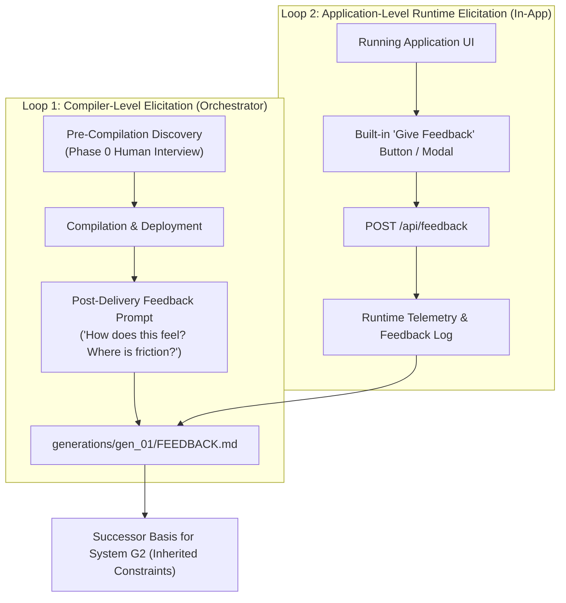

# Meta-Axioma Systems Portfolio & Feedback Matrix

> **The Non-Generator Proving Ground (Generation 1 & Successor Trajectory)**  
> This document catalogs all 6 non-generator production applications compiled across Generation $G_1$, their teleological purposes, human usability goals (Target $P_1$), empirical feedback, and generational lessons learned.

---

## 1. Portfolio Overview

The ultimate mandate of the Meta-Axioma compiler lineage is **The High-Level Jettison**: recursively bootstrapping compilers that construct production applications that humans love, find useful, and control.

To thoroughly stress-test the 7 structural axioms and prevent recursive overfitting, Generation $G_1$ is deploying a portfolio of **6 diverse production systems**:

| System ID | Name | Domain / Archetype | Target Persona | Port | Status | Primary Feedback / Lesson |
| :--- | :--- | :--- | :--- | :--- | :--- | :--- |
| **01** | [`axioma_flow`](file:///Users/michaellipski/dev/meta-axioma/apps/axioma_flow/) | Invariant Kanban & Workspace | AI Architect / Systems Engineer | `8088` | **Deployed** | Strong desktop UX; lacks active user feedback telemetry loop. |
| **02** | [`axioma_lexis`](file:///Users/michaellipski/dev/meta-axioma/apps/axioma_lexis/) | Adaptive Spaced Repetition (SRS) | Intermediate+ English Learner (Android) | `8090` | **Scaffolded** | [`LES-G1-001`](#system-02-axioma-lexis): Verification Illusion (built before user elicitation). |
| **03** | [`axioma_dual_fsm`](file:///Users/michaellipski/dev/meta-axioma/apps/axioma_dual_fsm/) | Dual-FSM Zero-Trust Governance | AI Safety Officer / Security Engineer | `8092` | **Deployed** | State Determinism, Tool Failure Loop, De-escalation & Functorial Revert. |
| **04** | [`axioma_crossword`](file:///Users/michaellipski/dev/meta-axioma/apps/axioma_crossword/) | Constraint & Synthesis Engine | Puzzle Solver / Cruciverbalist Architect | `8094` | **Deployed** | Multi-Device Scaling, Optimistic Delta Sync, AC-3 Worker Pool & Clue Dissector. |
| **05** | [`axioma_eink`](file:///Users/michaellipski/dev/meta-axioma/apps/axioma_eink/) | Async Hardware Sync & Router | Physical Focus Worker / Kindle User | `8096` | **Deployed** | Zero-JS Electrophoretic View, 15m Meta-Refresh, Daily Big 3–5 Bounded Focus. |
| **06** | [`axioma_swarm`](file:///Users/michaellipski/dev/meta-axioma/apps/axioma_swarm/) | Local Edge Micro-Swarm Daemon | Edge ML Engineer / Local AI Operator | `8098` | **Deployed** | VRAM Tensor Budget Allocator, LRU Model Eviction, OOM Exception Enclaves. |

### Core Governance Principle: Plan-First & Optional Execution
> **The Golden Rule for Application Synthesis:**  
> The **high-level plan** (persona, user workflow, JTBD, structural architecture, UX ergonomics) is the first and most critical deliverable.  
> **Low-level code execution on that plan is strictly optional.** The system must ALWAYS present the plan, elicit feedback, and ask the human architect for explicit permission before writing code or executing compilation.

---

## 2. Detailed Systems Ledger

---

### System 01: Axioma Flow
- **Canonical Path:** [`generations/gen_01/apps/axioma_flow/`](file:///Users/michaellipski/dev/meta-axioma/generations/gen_01/apps/axioma_flow/) (Symlinked at [`apps/axioma_flow/`](file:///Users/michaellipski/dev/meta-axioma/apps/axioma_flow/))
- **Concept:** Invariant-bounded, Landauer-audited Kanban & Task workspace with pure functorial time-travel undo/redo (`L1-002`) and exception enclaves (`L1-016`).
- **Target Persona:** Autonomous AI Systems Architect & Software Engineer.
- **Ergonomic Goals:** Zero cognitive friction drag-and-drop, keyboard-first `Cmd+Z` / `Cmd+Shift+Z` reversibility, real-time bit-erasure calculation ($k_B T \ln 2$), zero external dependencies.
- **Active Structural Invariants:** `L1-002`, `L1-004`, `L1-011_3`, `L1-008`, `L1-015`, `L1-016`, `L1-015_1`.
- **Feedback & Retrospective:**
  - *Observation:* Validates desktop productivity ergonomics and category-theoretic state machines.
  - *Identified Gap:* Had no built-in feedback collection widget; user had no mechanism within the running UI to report friction or state mismatch back to the compiler.

---

### System 02: Axioma Lexis
- **Canonical Path:** [`generations/gen_01/apps/axioma_lexis/`](file:///Users/michaellipski/dev/meta-axioma/generations/gen_01/apps/axioma_lexis/) (Symlinked at [`apps/axioma_lexis/`](file:///Users/michaellipski/dev/meta-axioma/apps/axioma_lexis/))
- **Concept:** 100% free, offline-first mobile Progressive Web App (PWA) for Android, mirroring and elevating Mem-App. Features progressive dictionary search, dual US/UK speech synthesis, adaptive SM-2 spaced repetition, and 1-tap deck addition.
- **Target Persona:** Intermediate+ English Vocabulary Learner (Android Mobile User).
- **Axiomatic Advantages over Mem-App:** Zero subscription paywalls or 50-word caps, local JSON storage, and Functorial Reversibility (`L1-002`) allowing 1-tap Undo for accidental rating mis-taps.
- **Feedback & Retrospective (`LES-G1-001`):**
  - *Human Oracle Critique:* *"wow. you managed to build that entire app without first asking me how i use it or what I get out of it"*
  - *Epistemic Lesson:* **The Verification Illusion.** The compiler achieved 100% test pass rates and standard layout compliance on an ungrounded spec derived from a website scrape without conducting user research.
  - *Current Status:* Code scaffolding and PWA engine are operational, but product feature priorities are paused awaiting active human discovery on actual reading habits and vocabulary capture workflows.

---

### System 03: Dual Finite State Machine for Zero-Trust AI Governance
- **Canonical Path:** [`generations/gen_01/apps/axioma_dual_fsm/`](file:///Users/michaellipski/dev/meta-axioma/generations/gen_01/apps/axioma_dual_fsm/) (Symlinked at [`apps/axioma_dual_fsm/`](file:///Users/michaellipski/dev/meta-axioma/apps/axioma_dual_fsm/))
- **App ID:** `axioma_dual_fsm` | **Port:** `8092` | **Status:** **Deployed** (8/8 Unit Tests Passing)
- **Test Mode:** Strict State Determinism & Boundary Enforced Logic.
- **The Concept:** A zero-trust runtime governance gateway where probabilistic LLM outputs are strictly gated by two independent, concurrent finite state machines:
  - **Inner FSM:** Tracks conversational state, intent resolution, and semantic task progression.
  - **Outer FSM:** Strictly monitors token boundaries, permission scopes, rate envelopes, and data exfiltration invariants.
  - **Dominance Rule ($\Phi_{\text{halt}}$):** Outer boundary failure or anomalous token pattern halts the Inner FSM in zero clock cycles, bounding the blast radius within an Exception Enclave (`L1-016`).
- **Implemented Refinements (Verified):**
  - **Refinement 1 (Inner FSM Tool Failure Loop):** Added `OUTCOME_EVALUATED` state after `ACTION_DISPATCHED`. Evaluates tool execution status; routes back to `PLAN_PROPOSED` on transient faults (e.g. 504 Gateway Timeout) or `PARAM_ELICITATION` on invalid parameters without crashing the conversational state machine.
  - **Refinement 2 (Outer FSM Dynamic De-escalation):** High-entropy payloads ($\ge 28$ chars, $H > 4.70$ bits) trigger `ELEVATED_SCRUTINY`. If verified as benign structural entropy (e.g. standard UUIDs), the machine cleanly de-escalates back to `ACTIVE_MONITORING`.
  - **Refinement 3 (The Revert Edge / $L_1-002$):** Functorial rollback morphism from `ATOMIC_HALT` enabling human security operators to restore safe states while generating an immutable, cryptographic `RollbackWitness`.
- **Invariants Embodied:** `L1-015` (Zero-Trust MCP Gateway), `L1-016` (Demarcated Exception Enclaves), `L1-002` (Functorial State Transition & Rollback), `L1-008` (Landauer Accounting).

---

### System 04: Cryptic Crossword Constraint & Synthesis Engine
- **Canonical Path:** [`generations/gen_01/apps/axioma_crossword/`](file:///Users/michaellipski/dev/meta-axioma/generations/gen_01/apps/axioma_crossword/) (Symlinked at [`apps/axioma_crossword/`](file:///Users/michaellipski/dev/meta-axioma/apps/axioma_crossword/))
- **App ID:** `axioma_crossword` | **Port:** `8094` | **Status:** **Deployed** (8/8 Unit Tests Passing)
- **Test Mode:** High-Dimensional Constraint Satisfaction, Multi-Device Scaling & Heuristic Search.
- **The Concept:** A globally scalable, multi-device cryptic crossword synthesis and solving studio.
  - **Multi-Device Scaling:** 2-column desktop cruciverbalist workbench, tablet split layout, and mobile touch interface with custom low-profile 26-letter soft keypad.
  - **Optimistic Local Execution (`L1-002`, `L1-011_3`):** 0ms keystroke latency on device edge with asynchronous delta synchronization (`PATCH /api/sessions/{id}/delta`) and optimistic ETag locking.
  - **Cryptic Anatomy Dissector (`L1-004`):** Interactive color-coded Universal Grammar AST parse tree decomposing clues into `[DEFINITION]`, `[INDICATOR]`, and `[FODDER]` with step-by-step wordplay explanations.
  - **Decoupled Asynchronous CSP Synthesizer (`L1-015_1`):** CPU-bound AC-3 backtracking puzzle generation is offloaded to an isolated worker thread pool (`worker_pool.py`), returning `202 Accepted` with pollable progress (`/api/jobs/{id}`) to prevent web server event loop lockup.
  - **Landauer Thermodynamic Accounting (`L1-008`):** Measures information erasure bits and dissipated thermal energy ($\Delta S = k_B \ln |D_i|$) during backtracking, enforcing hard compute leases to prevent denial of service.
- **Invariants Embodied:** `L1-004` (Universal Grammar AST for clues), `L1-015_1` (Compositional Boundary Isolation), `L1-008` (Landauer search dissipation audit), `L1-002` (Functorial Reversibility & Delta Sourcing), `L1-011_3` (Decoupled Partitioned Persistence), `L1-016` (Demarcated Exception Enclaves).

---

### System 05: Asynchronous Task Router for E-Ink Displays
- **Canonical Path:** [`generations/gen_01/apps/axioma_eink/`](file:///Users/michaellipski/dev/meta-axioma/generations/gen_01/apps/axioma_eink/) (Symlinked at [`apps/axioma_eink/`](file:///Users/michaellipski/dev/meta-axioma/apps/axioma_eink/))
- **App ID:** `axioma_eink` | **Port:** `8096` | **Status:** **Deployed** (13/13 Unit Tests Passing)
- **Test Mode:** Eventual Consistency, Hardware-Bounded Rendering & Extreme UI Constraints.
- **The Concept:** A distraction-free ambient task routing engine bridging high-frequency task capture on desktop/mobile with a calm, zero-JS glanceboard for electrophoretic e-readers (Kindle / Kobo / Boox):
  - **Hardware Bounds (`/display`):** Pure static HTML, strictly zero JavaScript (`<script>` forbidden), zero CSS animations/transitions to prevent electrophoretic screen flicker, 15-minute ambient meta-refresh (`<meta http-equiv="refresh" content="900">`).
  - **Daily Big 3–5 Bounded Focus:** Strict invariant bound limiting active focus priorities to maximum 5 items to eliminate cognitive overload. Backlog items are preserved in a decoupled queue.
  - **Append-Only Event Sourcing (`L1-002`):** Pure left-fold state reduction over immutable events in `data/events.json` with compensatory 1-tap `Cmd+Z` undo (`L1-008`).
  - **E-Ink Hardware Simulator:** Integrated interactive Kindle Paperwhite bezel with screen flashing simulation and live preview.
- **Invariants Embodied:** `L1-002` (Event Sourcing & Left-Fold Replay), `L1-004` (State Determinism), `L1-011_3` (Decoupled Persistence across Boundary 3), `L1-008` (Compensatory Undo), `L1-015` (Thermodynamic Compute Bounding), `L1-016` (Demarcated Exception Enclaves), Target $P_1$ (Calm Ambient Ergonomics).

---

### System 06: Local LLM Edge Orchestrator (Micro-Swarm Daemon)
- **Canonical Path:** [`generations/gen_01/apps/axioma_swarm/`](file:///Users/michaellipski/dev/meta-axioma/generations/gen_01/apps/axioma_swarm/) (Symlinked at [`apps/axioma_swarm/`](file:///Users/michaellipski/dev/meta-axioma/apps/axioma_swarm/))
- **App ID:** `axioma_swarm` | **Port:** `8098` | **Status:** **Deployed** (13/13 Unit Tests Passing)
- **Test Mode:** Physical Resource Orchestration, Dynamic Swapping & Enclave Safety.
- **The Concept:** A local background daemon orchestrating multiple quantized, specialized open-weights models (e.g. Qwen 2.5 Coder, Llama 3.2, Phi 3.5, DeepSeek R1) on consumer hardware (Apple Silicon Unified Memory or single Nvidia GPU) with zero Out-Of-Memory (OOM) kernel panics:
  - **VRAM Tensor Budget Allocator ([`L1-008`](file:///Users/michaellipski/dev/meta-axioma/trace/domains/trace_evolution.domain.md)):** Mathematical memory lease calculation bounding allocations under usable physical capacity with a hard OS reserved buffer.
  - **Deterministic LRU Model Eviction:** Automatically evicts the least recently active resident model when VRAM headroom is tight to accommodate incoming task requirements.
  - **Demarcated Exception Enclaves ([`L1-016`](file:///Users/michaellipski/dev/meta-axioma/trace/domains/trace_evolution.domain.md)):** Isolates inference worker blast radius, trapping simulated memory spikes and token faults while instantly releasing VRAM leases without terminating the host daemon.
  - **Specialty Task Router ([`L1-015`](file:///Users/michaellipski/dev/meta-axioma/trace/domains/trace_evolution.domain.md)):** Auto-routes requests based on specialty requirements (`CODING`, `REASONING`, `FAST_SUMMARY`, `VISION_EMBEDDING`) or operator manual overrides.
  - **Append-Only Event Stream ([`L1-002`](file:///Users/michaellipski/dev/meta-axioma/trace/domains/trace_evolution.domain.md)):** Immutable event audit stream in `data/events.json` recording model residency mutations and task lifecycles.
- **Invariants Embodied:** `L1-008` (Physical Resource Bounds), `L1-016` (Demarcated Exception Enclaves), `L1-015` (Zero-Trust Scoping), `L1-002` (Functorial Event Sourcing), `L1-011_3` (Decoupled Persistence across Boundary 3), `L1-015_1` (Compositional Boundary Isolation), Target $P_1$ (Operator Ergonomics & Predictability).

---

## 3. The Active Feedback Elicitation Protocol

> *"It would also probably be wise of the systems to know to ask for feedback so that they can learn."*

To make feedback a first-class operational behavior rather than a passive afterthought, the Meta-Axioma architecture implements a **Dual-Loop Feedback Mechanism**:

### Loop 1: Compiler & Orchestrator Proactive Check-Ins
1. **Pre-Compilation Gate (Phase 0):** The orchestrator is structurally forbidden from synthesizing an application spec without conducting a structured discovery interview with the human architect (`HumanIntentWitness`).
2. **Post-Deployment Prompt:** Upon presenting any running application or simulation preview, the orchestrator immediately triggers an explicit feedback elicitation dialog to review:
   - Does this match your lived workflow?
   - What is the most unnatural or awkward friction point?
   - What did we assume incorrectly?

### Loop 2: Built-in Runtime Application Feedback Affordance
Every standard application compiled by $G_1$ must include:
1. **`POST /api/feedback` Endpoint:** A standardized HTTP verb in `schema/verbs.json` accepting typed feedback payloads (`rating`, `friction_description`, `context_step`).
2. **In-App Feedback Widget:** A non-intrusive UI button (`💬 Feedback / Report Friction`) in the app header or settings drawer allowing the user to report bugs, friction, or mental-model divergence directly while using the software.
3. **Telemetry Integration:** User submissions are logged to `data/user_feedback.json` and mirrored into the generational feedback stream for $G_2$'s continuous learning.

---

## 4. Generational Lessons Matrix

| Lesson ID | Source System | Failure Category | Successor Invariant Enforced |
| :--- | :--- | :--- | :--- |
| **`LES-G1-001`** | System 02 (`axioma_lexis`) | `ELICITATION_FAILURE` | `NEG-G2-001`: Mandatory Human Intent Elicitation Gate (`HumanIntentWitness`). |
| **`LES-G1-002`** | System 01 & 02 | `FEEDBACK_ELICITATION` | Standard applications and compiler must actively prompt for human feedback to close the learning loop. |
| **`LES-G1-003`** | System 04 (`axioma_crossword`) | `TEST_INTEGRITY_FAILURE` | `NEG-G2-003`: Forbid releasing systems without tests covering all user-exposed configurations and domain-specific semantic invariants. |
