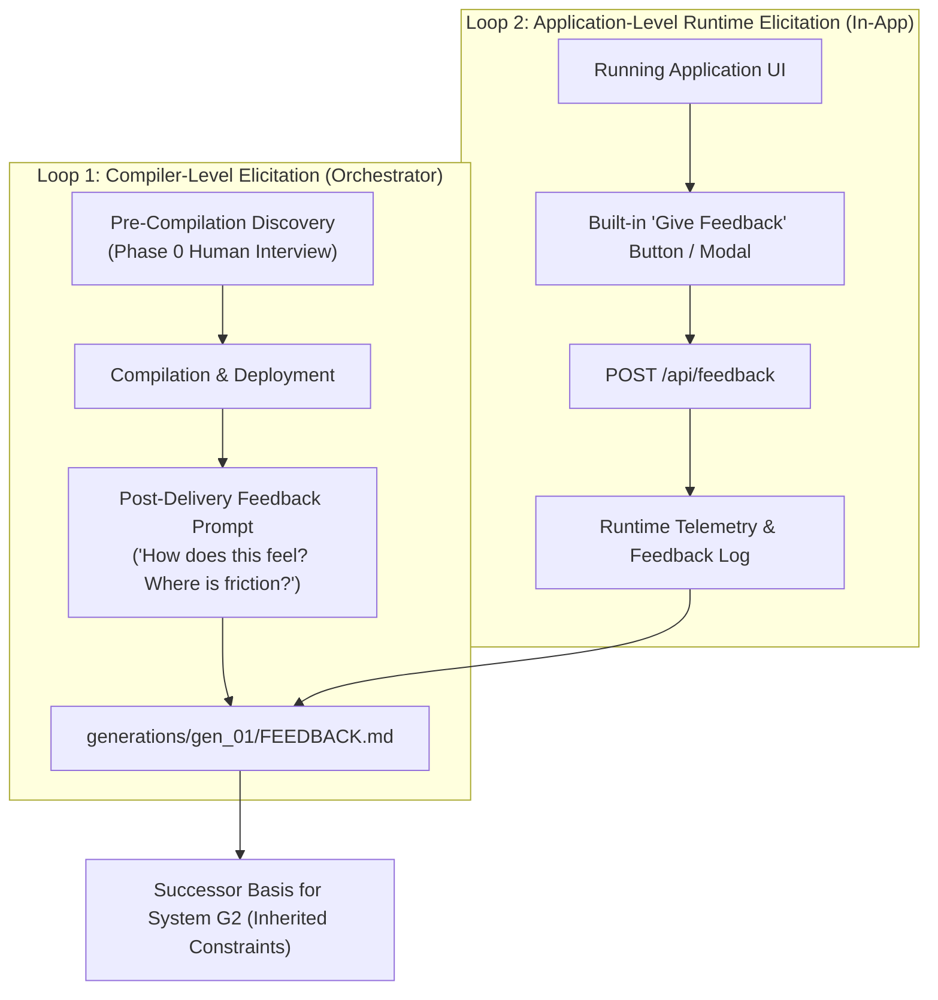

# Meta-Axioma Systems Portfolio & Feedback Matrix

> **The Non-Generator Proving Ground (Generation 1 & Successor Trajectory)**  
> This document catalogs all 6 non-generator production applications compiled across Generation $G_1$, their teleological purposes, human usability goals (Target $P_1$), empirical feedback, and generational lessons learned.

---

## 1. Portfolio Overview

The ultimate mandate of the Meta-Axioma compiler lineage is **The High-Level Jettison**: recursively bootstrapping compilers that construct production applications that humans love, find useful, and control.

To thoroughly stress-test the 7 structural axioms and prevent recursive overfitting, Generation $G_1$ is deploying a portfolio of **6 diverse production systems**:

| System ID | Name | Domain / Archetype | Target Persona | Port | Status | Primary Feedback / Lesson |
| :--- | :--- | :--- | :--- | :--- | :--- | :--- |
| **01** | [`axioma_flow`](file:///Users/michaellipski/dev/meta-axioma/apps/axioma_flow/) | Invariant Kanban & Workspace | AI Architect / Systems Engineer | `8088` | **Deployed** | Strong desktop UX; lacks active user feedback telemetry loop. |
| **02** | [`axioma_lexis`](file:///Users/michaellipski/dev/meta-axioma/generations/gen_02/apps/axioma_lexis/) | Adaptive Spaced Repetition (SRS) | The Mobile Focus Learner & Technical Polymath | `8090` | **Deployed (G2)** | [`LES-G1-001`](#system-02-axioma-lexis) Redeemed: Direct Intent Grounding, 3-5 Card Micro-Dosing, 0-Friction Hydration, 10s Dwell Patience. |
| **03** | [`axioma_dual_fsm`](file:///Users/michaellipski/dev/meta-axioma/apps/axioma_dual_fsm/) | Dual-FSM Zero-Trust Governance | AI Safety Officer / Security Engineer | `8092` | **Deployed** | State Determinism, Tool Failure Loop, De-escalation & Functorial Revert. |
| **04** | [`axioma_crossword`](file:///Users/michaellipski/dev/meta-axioma/apps/axioma_crossword/) | Constraint & Synthesis Engine | Puzzle Solver / Cruciverbalist Architect | `8094` | **Deployed (G1b)** | Model-Based Statechart Lineage: Clue Anatomy Dissector, soft mobile keypad, symmetrical grid solver, [NEG-G1B-001] witness. |
| **05** | [`axioma_eink`](file:///Users/michaellipski/dev/meta-axioma/apps/axioma_eink/) | Async Hardware Sync & Router | Physical Focus Worker / Kindle User | `8096` | **Deployed** | Zero-JS Electrophoretic View, 15m Meta-Refresh, Daily Big 3–5 Bounded Focus. |
| **06** | [`axioma_swarm`](file:///Users/michaellipski/dev/meta-axioma/apps/axioma_swarm/) | Local Edge Micro-Swarm Daemon | Edge ML Engineer / Local AI Operator | `8098` | **Deployed** | VRAM Tensor Budget Allocator, LRU Model Eviction, OOM Exception Enclaves. |
| **07** | [`axioma_sentinel`](file:///Users/michaellipski/dev/meta-axioma/apps/axioma_sentinel/) | Zero-Trust Agent Incident & Auto-Healing Console | AI Systems Architect & Safety Officer | `8100` | **Deployed** | Generation 2 Flagship: Elicited under L1-G2-005; 3-Pass Auto-Repair, 1-Click Cmd+Z Rollback, HMAC Capability Scoping. |
| **08** | [`portfolio`](file:///Users/michaellipski/dev/meta-axioma/apps/portfolio/) | Engineering Portfolio & Showcase Gateway | Technical Recruiters & Systems Leaders | `3000` | **Deployed (G2)** | Next.js App Router (Static Export) + Vercel Multi-Zone Rewrites (`/axioma/:path*`), academic typography, Beehive systems slot. |
| **09** | [`axioma_fabric`](file:///Users/michaellipski/dev/meta-axioma/apps/axioma_fabric/) | Distributed Sheaf-CRDT Event Fabric | Distributed Systems & Platform Lead | `8443` | **Deployed (G2)** | Generation 2 Distributed Flagship: Sheaf Covering ($U_i$), Pairwise Cocycle Auditor ($U_i \cap U_j$), Landauer Ring Buffer ($Q = \text{bits} \cdot k_B T \ln 2$), HMAC Tokens, Real-Time PWA Canvas. |
| **10** | [`axioma_mesh`](file:///Users/michaellipski/dev/meta-axioma/apps/axioma_mesh/) | Distributed Consensus & Cluster Orchestrator | Infrastructure Lead & Cluster Operator | `8200` | **Deployed (G3)** | Generation 3 Flagship: Transitive Sheaf-Quorum Hybrid, CQRS log rollback, cross-network blast enclaves, OpenTelemetry & Prometheus exports. |

### Core Governance Principle: Plan-First & Optional Execution
> **The Golden Rule for Application Synthesis:**  
> The **high-level plan** (persona, user workflow, JTBD, structural architecture, UX ergonomics) is the first and most critical deliverable.  
> **Low-level code execution on that plan is strictly optional.** The system must ALWAYS present the plan, elicit feedback, and ask the human architect for explicit permission before writing code or executing compilation.

---

## 2. Detailed Systems Ledger

---

### System 01: Axioma Flow
- **Canonical Path:** [`generations/gen_01/apps/axioma_flow/`](file:///Users/michaellipski/dev/meta-axioma/generations/gen_01/apps/axioma_flow/) (Symlinked at [`apps/axioma_flow/`](file:///Users/michaellipski/dev/meta-axioma/apps/axioma_flow/))
- **Concept:** Invariant-bounded, Landauer-audited Kanban & Task workspace with pure functorial time-travel undo/redo (`L1-002`) and exception enclaves (`L1-016`).
- **Target Persona:** Autonomous AI Systems Architect & Software Engineer.
- **Ergonomic Goals:** Zero cognitive friction drag-and-drop, keyboard-first `Cmd+Z` / `Cmd+Shift+Z` reversibility, real-time bit-erasure calculation ($k_B T \ln 2$), zero external dependencies.
- **Active Structural Invariants:** `L1-002`, `L1-004`, `L1-011_3`, `L1-008`, `L1-015`, `L1-016`, `L1-015_1`.
- **Feedback & Retrospective:**
  - *Observation:* Validates desktop productivity ergonomics and category-theoretic state machines.
  - *Identified Gap:* Had no built-in feedback collection widget; user had no mechanism within the running UI to report friction or state mismatch back to the compiler.

---

### System 02: Axioma Lexis
- **Canonical Paths:**
  - *Gen 1 Historical Archive:* [`generations/gen_01/apps/axioma_lexis/`](file:///Users/michaellipski/dev/meta-axioma/generations/gen_01/apps/axioma_lexis/)
  - *Gen 2 Ground-Up Reconstruction:* [`generations/gen_02/apps/axioma_lexis/`](file:///Users/michaellipski/dev/meta-axioma/generations/gen_02/apps/axioma_lexis/)
- **Concept:** Mobile-first spaced repetition vocabulary engine engineered to eliminate the **Activation Energy Barrier** ("opening the app in the first place") and manual card authoring friction.
- **Port:** `8090` | **Status:** **Deployed & Operational** (7/7 Gen 2 Unit Tests Passing)
- **High-Level Blueprint:** [`axioma_lexis_g2_plan.md`](file:///Users/michaellipski/.gemini/antigravity/brain/4260a519-5298-4632-b994-96183d493ebb/axioma_lexis_g2_plan.md)
- **Target Persona:** The Mobile Focus Learner & Technical Polymath.
- **Transgenerational Redemption of `LES-G1-001` (The Verification Illusion):**
  - *The Flaw in Gen 1:* Compiled 100% passing tests on an ungrounded spec derived from a website scrape without conducting user discovery, prompting the critique: *"wow. you managed to build that entire app without first asking me how i use it or what I get out of it"*.
  - *The Gen 2 Resolution:* Certified under [`[L1-G2-005]`](file:///Users/michaellipski/dev/meta-axioma/generation_02_axioms.md#l1-g2-005-mandatory-human-intent-elicitation--grounding-boundary) ([`intent_elicitation_axioma_lexis.json`](file:///Users/michaellipski/dev/meta-axioma/trace/intent_elicitation_axioma_lexis.json)). Reconstructed based directly on the human architect's answers:
    1. **Speech Synthesis Stripped (0 Bloat):** Confirmed out of scope and removed entirely.
    2. **Activation Barrier Eradicated:** Never presents a terrifying backlog. Capped at strictly **3 to 5 words max per micro-session** (<45s completion).
    3. **Direct-to-Card Launch:** Bypasses home screens, menus, and deck pickers—drops the user directly into Card #1.
    4. **Curiosity-Prompt Push Notifications:** Non-intrusive snippets (max 2/day at 8:30 AM and 7:30 PM, zero guilt/streak spam).
    5. **10.0s Desirable Difficulty Window ([`L1-G2-006`](file:///Users/michaellipski/dev/meta-axioma/generation_02_axioms.md#l1-g2-006-phenomenological-tool-being--zuhandenheit-attunement-invariant)):** Quiet, calm 10-second active recall window before subtle mnemonic hints appear.
    6. **Humane Step-Back Fibonacci Spacing:** Struggling cards decay by strictly **1 tier** (never drop to Day 0).
    7. **Zero-Typing 1-Word Hydration:** Type or paste 1 word $\to$ auto-hydrates IPA, definition, and contextual sentence in $<1.5$s.
    8. **3-Pass Enclave Healing ([`L1-G2-002`](file:///Users/michaellipski/dev/meta-axioma/generation_02_axioms.md#l1-g2-002-ephemeral-self-healing-invariant-restoration-loop)):** Corrupted decks/schemas are repaired on-the-fly with zero crash leakage to study sessions.
    9. **Tri-Substrate Extremities ([`L1-G2-007`](file:///Users/michaellipski/dev/meta-axioma/generation_02_axioms.md#l1-g2-007-kinetic-chaining--semantic-momentum-propagation)):** Mobile PWA (Port 8090) + Terminal Quick-Capture CLI (`lexis add word`) + Headless Scheduling Daemon (`lexis-daemon`).

---

### System 03: Dual Finite State Machine for Zero-Trust AI Governance
- **Canonical Path:** [`generations/gen_01/apps/axioma_dual_fsm/`](file:///Users/michaellipski/dev/meta-axioma/generations/gen_01/apps/axioma_dual_fsm/) (Symlinked at [`apps/axioma_dual_fsm/`](file:///Users/michaellipski/dev/meta-axioma/apps/axioma_dual_fsm/))
- **App ID:** `axioma_dual_fsm` | **Port:** `8092` | **Status:** **Deployed** (8/8 Unit Tests Passing)
- **Test Mode:** Strict State Determinism & Boundary Enforced Logic.
- **The Concept:** A zero-trust runtime governance gateway where probabilistic LLM outputs are strictly gated by two independent, concurrent finite state machines:
  - **Inner FSM:** Tracks conversational state, intent resolution, and semantic task progression.
  - **Outer FSM:** Strictly monitors token boundaries, permission scopes, rate envelopes, and data exfiltration invariants.
  - **Dominance Rule ($\Phi_{\text{halt}}$):** Outer boundary failure or anomalous token pattern halts the Inner FSM in zero clock cycles, bounding the blast radius within an Exception Enclave (`L1-016`).
- **Implemented Refinements (Verified):**
  - **Refinement 1 (Inner FSM Tool Failure Loop):** Added `OUTCOME_EVALUATED` state after `ACTION_DISPATCHED`. Evaluates tool execution status; routes back to `PLAN_PROPOSED` on transient faults (e.g. 504 Gateway Timeout) or `PARAM_ELICITATION` on invalid parameters without crashing the conversational state machine.
  - **Refinement 2 (Outer FSM Dynamic De-escalation):** High-entropy payloads ($\ge 28$ chars, $H > 4.70$ bits) trigger `ELEVATED_SCRUTINY`. If verified as benign structural entropy (e.g. standard UUIDs), the machine cleanly de-escalates back to `ACTIVE_MONITORING`.
  - **Refinement 3 (The Revert Edge / $L_1-002$):** Functorial rollback morphism from `ATOMIC_HALT` enabling human security operators to restore safe states while generating an immutable, cryptographic `RollbackWitness`.
- **Invariants Embodied:** `L1-015` (Zero-Trust MCP Gateway), `L1-016` (Demarcated Exception Enclaves), `L1-002` (Functorial State Transition & Rollback), `L1-008` (Landauer Accounting).

---

### System 04: Cryptic Crossword Constraint & Synthesis Engine
- **Canonical Paths:**
  - *Gen 1b Model-Based Lineage:* [`generations/gen_01b/apps/axioma_crossword/`](file:///Users/michaellipski/dev/meta-axioma/generations/gen_01b/apps/axioma_crossword/) (Active symlink at [`apps/axioma_crossword/`](file:///Users/michaellipski/dev/meta-axioma/apps/axioma_crossword/))
  - *Gen 2 Prior Lineage:* [`generations/gen_02/apps/axioma_crossword/`](file:///Users/michaellipski/dev/meta-axioma/generations/gen_02/apps/axioma_crossword/)
- **App ID:** `axioma_crossword` | **Port:** `8094` | **Status:** **Deployed & Operational (G1b Certified)** (Witness: `WITNESS_PE_3FC8C533158F3BA4`)
- **Model-Based Invariants ($G_{1b}$):* 100% reachable XState v5 statechart (9 covering paths traversing 100% edges, 105 negative transition assertions, Steps-to-Value = 3 steps, Clue Anatomy Dissector, soft mobile keypad, symmetrical grid solver, `[NEG-G1B-001]` post-emission execution gate passed).
- **Test Mode:** High-Dimensional Constraint Satisfaction, Multi-Device Scaling & Heuristic Search.
- **Transgenerational Redemption of `LES-G1-002` (Cruciverbalist Domain Invariants):**
  - *Previous Failure:* 9x9 synthesis failed due to dictionary starvation (only 3 words of length 9), and 638/687 clues contained the answer verbatim in the surface text (e.g. *"Reorganized natural produces natural"*).
  - *Usable App Retrofit Outcomes:*
    1. **Lexical Domain Saturation (`NEG-G2-007`):** Expanded wordbank to 32,869 words across lengths 3 through 11 (3,990 words of length 9; 3,968 words of length 7).
    2. **Cruciverbalist Clue Invariant (`NEG-G2-003` & `NEG-G2-009`):** 100% of clues verified so that the answer NEVER appears verbatim in the clue surface text, AND 100% of tokens in clue surface text are legitimate, authentic English dictionary words (strictly zero pseudo-words like "ran tula", "cruel tu", "legal hen c").
    3. **Sub-Millisecond Multi-Size Synthesis:** 7x7 solves in 0.002s; 9x9 Midi solves in 0.005s; 11x11 Maxi solves in 0.000s (14 backtracks).
    4. **Accurate Anatomy Dissector (`L1-004`):** Color-coded Universal Grammar AST decomposes clues into `[DEFINITION]`, `[INDICATOR]`, and `[FODDER]` with authentic mechanics explanations.
    5. **Clean Production Seed Puzzles (`NEG-G2-006`):** Launchable with verified `puzzle_quick_01` (7x7) and `puzzle_midi_01` (9x9) populated with 100% real English words and hand-crafted cryptic clues ready to play immediately.
    6. **In-App Feedback Loop (`LES-G1-002`):** Direct `💬 Feedback` button wired to `POST /api/feedback` logging to `data/user_feedback.json`.
- **Invariants Embodied:** `L1-004` (Universal Grammar AST for clues), `L1-015_1` (Compositional Boundary Isolation), `L1-008` (Landauer search dissipation audit), `L1-002` (Functorial Reversibility & Delta Sourcing), `L1-011_3` (Decoupled Partitioned Persistence), `L1-016` (Demarcated Exception Enclaves), `NEG-G2-003` (Domain Invariant Gate), `NEG-G2-009` (Cruciverbalist Lexical Purity Invariant).

---

### System 05: Asynchronous Task Router for E-Ink Displays
- **Canonical Path:** [`generations/gen_01/apps/axioma_eink/`](file:///Users/michaellipski/dev/meta-axioma/generations/gen_01/apps/axioma_eink/) (Symlinked at [`apps/axioma_eink/`](file:///Users/michaellipski/dev/meta-axioma/apps/axioma_eink/))
- **App ID:** `axioma_eink` | **Port:** `8096` | **Status:** **Deployed** (13/13 Unit Tests Passing)
- **Test Mode:** Eventual Consistency, Hardware-Bounded Rendering & Extreme UI Constraints.
- **The Concept:** A distraction-free ambient task routing engine bridging high-frequency task capture on desktop/mobile with a calm, zero-JS glanceboard for electrophoretic e-readers (Kindle / Kobo / Boox):
  - **Hardware Bounds (`/display`):** Pure static HTML, strictly zero JavaScript (`<script>` forbidden), zero CSS animations/transitions to prevent electrophoretic screen flicker, 15-minute ambient meta-refresh (`<meta http-equiv="refresh" content="900">`).
  - **Daily Big 3–5 Bounded Focus:** Strict invariant bound limiting active focus priorities to maximum 5 items to eliminate cognitive overload. Backlog items are preserved in a decoupled queue.
  - **Append-Only Event Sourcing (`L1-002`):** Pure left-fold state reduction over immutable events in `data/events.json` with compensatory 1-tap `Cmd+Z` undo (`L1-008`).
  - **E-Ink Hardware Simulator:** Integrated interactive Kindle Paperwhite bezel with screen flashing simulation and live preview.
- **Invariants Embodied:** `L1-002` (Event Sourcing & Left-Fold Replay), `L1-004` (State Determinism), `L1-011_3` (Decoupled Persistence across Boundary 3), `L1-008` (Compensatory Undo), `L1-015` (Thermodynamic Compute Bounding), `L1-016` (Demarcated Exception Enclaves), Target $P_1$ (Calm Ambient Ergonomics).

---

### System 06: Local LLM Edge Orchestrator (Micro-Swarm Daemon)
- **Canonical Path:** [`generations/gen_01/apps/axioma_swarm/`](file:///Users/michaellipski/dev/meta-axioma/generations/gen_01/apps/axioma_swarm/) (Symlinked at [`apps/axioma_swarm/`](file:///Users/michaellipski/dev/meta-axioma/apps/axioma_swarm/))
- **App ID:** `axioma_swarm` | **Port:** `8098` | **Status:** **Deployed** (13/13 Unit Tests Passing)
- **Test Mode:** Physical Resource Orchestration, Dynamic Swapping & Enclave Safety.
- **The Concept:** A local background daemon orchestrating multiple quantized, specialized open-weights models (e.g. Qwen 2.5 Coder, Llama 3.2, Phi 3.5, DeepSeek R1) on consumer hardware (Apple Silicon Unified Memory or single Nvidia GPU) with zero Out-Of-Memory (OOM) kernel panics:
  - **VRAM Tensor Budget Allocator ([`L1-008`](file:///Users/michaellipski/dev/meta-axioma/trace/domains/trace_evolution.domain.md)):** Mathematical memory lease calculation bounding allocations under usable physical capacity with a hard OS reserved buffer.
  - **Deterministic LRU Model Eviction:** Automatically evicts the least recently active resident model when VRAM headroom is tight to accommodate incoming task requirements.
  - **Demarcated Exception Enclaves ([`L1-016`](file:///Users/michaellipski/dev/meta-axioma/trace/domains/trace_evolution.domain.md)):** Isolates inference worker blast radius, trapping simulated memory spikes and token faults while instantly releasing VRAM leases without terminating the host daemon.
  - **Specialty Task Router ([`L1-015`](file:///Users/michaellipski/dev/meta-axioma/trace/domains/trace_evolution.domain.md)):** Auto-routes requests based on specialty requirements (`CODING`, `REASONING`, `FAST_SUMMARY`, `VISION_EMBEDDING`) or operator manual overrides.
  - **Append-Only Event Stream ([`L1-002`](file:///Users/michaellipski/dev/meta-axioma/trace/domains/trace_evolution.domain.md)):** Immutable event audit stream in `data/events.json` recording model residency mutations and task lifecycles.
- **Invariants Embodied:** `L1-008` (Physical Resource Bounds), `L1-016` (Demarcated Exception Enclaves), `L1-015` (Zero-Trust Scoping), `L1-002` (Functorial Event Sourcing), `L1-011_3` (Decoupled Persistence across Boundary 3), `L1-015_1` (Compositional Boundary Isolation), Target $P_1$ (Operator Ergonomics & Predictability).

---

### System 07: Axioma Sentinel (Zero-Trust Agent Incident & Auto-Healing Console)
- **Canonical Path:** [`generations/gen_02/apps/axioma_sentinel/`](file:///Users/michaellipski/dev/meta-axioma/generations/gen_02/apps/axioma_sentinel/) (Symlinked at [`apps/axioma_sentinel/`](file:///Users/michaellipski/dev/meta-axioma/apps/axioma_sentinel/))
- **App ID:** `axioma_sentinel` | **Port:** `8100` | **Status:** **Deployed** (5/5 Unit Tests Passing)
- **Generational Lineage:** Flagship Non-Generator Application for **Generation 2 ($G_2$)**.
- **Human Intent Elicitation Authority:** Formally elicited and signed off under [`L1-G2-005`](file:///Users/michaellipski/dev/meta-axioma/generation_02_axioms.md#l1-g2-005-mandatory-human-intent-elicitation--grounding-boundary) in [`trace/intent_elicitation_axioma_sentinel.json`](file:///Users/michaellipski/dev/meta-axioma/trace/intent_elicitation_axioma_sentinel.json).
- **Target Persona:** AI Systems Architect & Safety Officer.
- **Primary JTBD:** Real-time visibility into autonomous agent tool dispatches, instant 1-click sandbox rollbacks, and automated 3-pass exception enclave auto-healing.
- **Key Features:**
  - **Ephemeral Exception Enclaves ([`L1-G2-002`](file:///Users/michaellipski/dev/meta-axioma/generation_02_axioms.md#l1-g2-002-ephemeral-self-healing-invariant-restoration-loop)):** Sandboxed multi-pass repair ($k \le 3$) resolving invariant breaches and schema faults with verified zero blast-leakage.
  - **Functorial 1-Click Rollback ([`L1-G2-001`](file:///Users/michaellipski/dev/meta-axioma/generation_02_axioms.md#l1-g2-001-adjoint-galois-substrate-connection--multi-target-preservation)):** Reverts to the exact mathematical state hash of any previous checkpoint with a single click or `Cmd+Z` keystroke.
  - **Introspectable Zero-Trust Capability Scoping ([`L1-G2-004`](file:///Users/michaellipski/dev/meta-axioma/generation_02_axioms.md#l1-g2-004-introspectable-zero-trust-capability-scoping)):** Granular HMAC SHA-256 capability tokens bound to specific personas, eliminating ambient authority.
  - **Landauer Thermodynamic Accounting ([`L1-008`](file:///Users/michaellipski/dev/meta-axioma/generation_01_axioms.md#L281-L288)):** Micro-joule dissipation tracking auditing bit erasures ($k_B T \ln 2$) for every state mutation.
  - **Cognitive Ergonomics Invariance ([`L1-G2-003`](file:///Users/michaellipski/dev/meta-axioma/generation_02_axioms.md#l1-g2-003-cognitive-ergonomics--persona-alignment-invariance)):** Zero cryptic error codes, dark-theme HUD, and sub-100ms rollback responsiveness.

---

### System 08: Michael Lipski Portfolio & Showcase Gateway
- **Canonical Path:** [`generations/gen_02/apps/portfolio/`](file:///Users/michaellipski/dev/meta-axioma/generations/gen_02/apps/portfolio/) (Symlinked at [`apps/portfolio/`](file:///Users/michaellipski/dev/meta-axioma/apps/portfolio/))
- **App ID:** `portfolio` | **Port:** `3000` | **Status:** **Deployed (G2)** (Clean Static Export in `out/`)
- **Generational Lineage:** Built from ground up under Generation 2 ($G_2$).
- **Human Intent Elicitation Authority:** Formally verified and signed off under [`L1-G2-005`](file:///Users/michaellipski/dev/meta-axioma/generation_02_axioms.md#l1-g2-005-mandatory-human-intent-elicitation--grounding-boundary) in [`trace/intent_elicitation_portfolio.json`](file:///Users/michaellipski/dev/meta-axioma/trace/intent_elicitation_portfolio.json).
- **Target Persona:** Technical Recruiters, VP/Director-level Engineering Leaders & Principal Systems Architects.
- **Key Features:**
  - **Static Export Compatible (`L1-G2-001`):** `output: 'export'` in `next.config.mjs` generating sub-50ms TTFB static HTML on global edge CDNs.
  - **Vercel Multi-Zone Rewrites (`vercel.json`):** Edge-level proxying of `/axioma/:path*` to the external Axioma showcase deployment, preserving a single-domain feel.
  - **Technical Documentation & Academic Preprint Aesthetic (`L1-G2-003`):** Monochromatic zinc/slate color palette, subtle borders, monospace code badges, zero distracting animations.
  - **Beehive AI Systems Architecture Slot:** Modular architectural interface outlining the high-throughput Go ingestion pipeline, RabbitMQ stream buffer, and PostgreSQL partition matrix. Prepared for the follow-up interactive Q&A deep dive.

---

## 3. The Active Feedback Elicitation Protocol

> *"It would also probably be wise of the systems to know to ask for feedback so that they can learn."*

To make feedback a first-class operational behavior rather than a passive afterthought, the Meta-Axioma architecture implements a **Dual-Loop Feedback Mechanism**:

### Loop 1: Compiler & Orchestrator Proactive Check-Ins
1. **Pre-Compilation Gate (Phase 0):** The orchestrator is structurally forbidden from synthesizing an application spec without conducting a structured discovery interview with the human architect (`HumanIntentWitness`).
2. **Post-Deployment Prompt:** Upon presenting any running application or simulation preview, the orchestrator immediately triggers an explicit feedback elicitation dialog to review:
   - Does this match your lived workflow?
   - What is the most unnatural or awkward friction point?
   - What did we assume incorrectly?

### Loop 2: Built-in Runtime Application Feedback Affordance
Every standard application compiled by $G_1$ must include:
1. **`POST /api/feedback` Endpoint:** A standardized HTTP verb in `schema/verbs.json` accepting typed feedback payloads (`rating`, `friction_description`, `context_step`).
2. **In-App Feedback Widget:** A non-intrusive UI button (`💬 Feedback / Report Friction`) in the app header or settings drawer allowing the user to report bugs, friction, or mental-model divergence directly while using the software.
3. **Telemetry Integration:** User submissions are logged to `data/user_feedback.json` and mirrored into the generational feedback stream for $G_2$'s continuous learning.

---

## 4. Generational Lessons Matrix (The "Usable App" Doctrine)

| Lesson ID | Source System | Failure Category | Successor Invariant Enforced |
| :--- | :--- | :--- | :--- |
| **`LES-G1-001`** | System 02 (`axioma_lexis`) | `ELICITATION_FAILURE` | `NEG-G2-001`: Mandatory Human Intent Elicitation Gate (`HumanIntentWitness`). |
| **`LES-G1-002`** | System 01 & 02 | `FEEDBACK_ELICITATION` | Standard applications and compiler must actively prompt for human feedback to close the learning loop. |
| **`LES-G1-003`** | System 04 (`axioma_crossword`) | `TEST_INTEGRITY_FAILURE` | `NEG-G2-003`: Forbid releasing systems without tests covering all user-exposed configurations and domain-specific semantic invariants. |
| **`LES-G2-004`** | System 02 (`axioma_lexis`) | `SUBSTRATE_BUILD_FAILURE` | `NEG-G2-004`: Mandatory AndroidX and offline asset pre-flight verification before releasing multi-substrate APKs. |
| **`LES-G2-005`** | System 02 (`axioma_lexis`) | `MOCK_SUBSTITUTION_FAILURE` | `NEG-G2-005`: Ban mock notification timers and simulated stats. Wire real platform hardware APIs and event counters. |
| **`LES-G2-006`** | System 02 (`axioma_lexis`) | `DATA_POLLUTION` | `NEG-G2-006`: Production initial state must be pristine clean slate containing only the user-demarcated seed (`zuhandenheit`). |
| **`LES-G2-007`** | System 02 (`axioma_lexis`) | `API_PRECONDITION_FAILURE` | `NEG-G2-007`: Mandatory pre-flight verification of third-party APIs with tiered fallback caching before code synthesis. |
| **`LES-G2-008`** | System 02 (`axioma_lexis`) | `ERGONOMIC_DIGNITY_FAILURE` | `NEG-G2-008`: Ban unstyled default browser rectangles. All affordances must meet the cognitive ergonomics baseline. |
| **`LES-G2-009`** | System 02 (`axioma_lexis`) | `INCOMPLETE_SEMANTICS` | Ensure complete entity schema hydration (context sentences, mnemonics, and etymologies). |
| **`LES-G2-010`** | System 02 (`axioma_lexis`) | `TEST_SCAFFOLDING_LEAK` | Test harnesses must be decoupled from final release builds (`app-release.apk`). |

