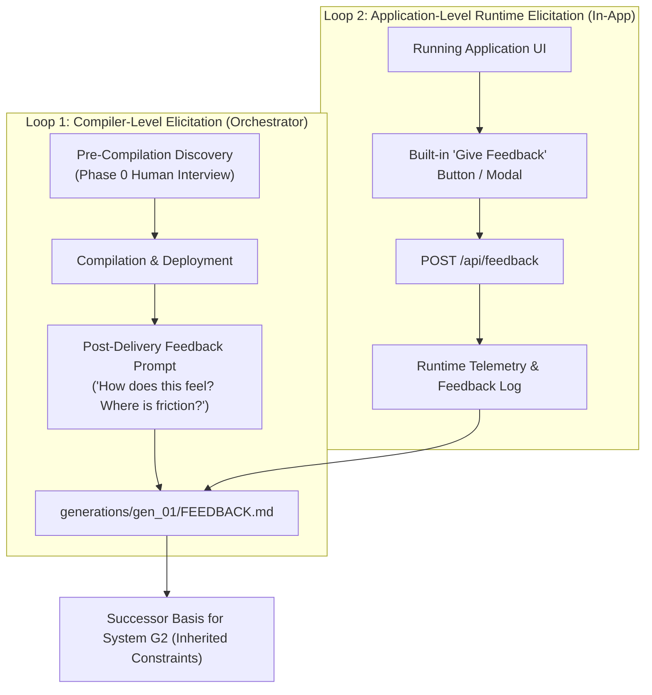

# Meta-Axioma Systems Portfolio & Feedback Matrix

> **The Non-Generator Proving Ground (Generation 1 & Successor Trajectory)**  
> This document catalogs all 6 non-generator production applications compiled across Generation $G_1$, their teleological purposes, human usability goals (Target $P_1$), empirical feedback, and generational lessons learned.

---

## 1. Portfolio Overview

The ultimate mandate of the Meta-Axioma compiler lineage is **The High-Level Jettison**: recursively bootstrapping compilers that construct production applications that humans love, find useful, and control.

To thoroughly stress-test the 7 structural axioms and prevent recursive overfitting, Generation $G_1$ is deploying a portfolio of **6 diverse production systems**:

> ### 👑 Flagship Meta-Foundry Spotlight: System G4b & Evolution Studio
> - **System 13: [`g3b_compiler`](generations/gen_03b/src/g3b_compiler/)** — The Autonomous Universal Systems Compiler (Reflexive Quine Daughter Isolation, Dual-Model Routing Argon Brain vs Flash Muscle, Waterloo Tier 1 Situation of Concern).
> - **System 14: [`evolution_dashboard`](evolution_dashboard/)** (Symlinked at [`apps/axioma_evolution_dashboard`](apps/axioma_evolution_dashboard/)) — Root-Level Architectural Evolution Studio & G4b Zenith Workbench (Port `8105`, top-level project philosophy in layman/systems theory dual mode, current G4b sovereign service mesh showcase, interactive 5-step visual compilation walkthrough of `axioma_go`, 8-stage chronological spine from S0 to G4b, 4-tier Beehive SVG topology, live side-by-side generational diff workbench, and Human Architect epistemic governance contributions).

| System ID | Name | Domain / Archetype | Target Persona | Port | Status | Primary Feedback / Lesson |
| :--- | :--- | :--- | :--- | :--- | :--- | :--- |
| **01** | [`axioma_flow`](apps/axioma_flow/) | Invariant Kanban & Workspace | AI Architect / Systems Engineer | `8088` | **Deployed** | Strong desktop UX; lacks active user feedback telemetry loop. |
| **02** | [`axioma_lexis`](apps/axioma_lexis/) | Adaptive Spaced Repetition (SRS) | The Mobile Focus Learner & Technical Polymath | `8090` | **Deployed (G2b)** | Multi-Tier Usability Matrix Lineage: Rebuilt ground-up under [L1-G2B-001..005], NN 10 heuristics, Fitts >= 44px, 16 states, 53 transitions, 571 negative assertions, [NEG-G1B-001] witness. |
| **03** | [`axioma_dual_fsm`](apps/axioma_dual_fsm/) | Dual-FSM Zero-Trust Governance | AI Safety Officer / Security Engineer | `8092` | **Deployed** | State Determinism, Tool Failure Loop, De-escalation & Functorial Revert. |
| **04** | [`axioma_crossword`](apps/axioma_crossword/) | Constraint & Synthesis Engine | Puzzle Solver / Cruciverbalist Architect | `8094` | **Deployed (G1b)** | Model-Based Statechart Lineage: Clue Anatomy Dissector, soft mobile keypad, symmetrical grid solver, [NEG-G1B-001] witness. |
| **05** | [`axioma_eink`](apps/axioma_eink/) | Async Hardware Sync & Router | Physical Focus Worker / Kindle User | `8096` | **Deployed** | Zero-JS Electrophoretic View, 15m Meta-Refresh, Daily Big 3–5 Bounded Focus. |
| **06** | [`axioma_swarm`](apps/axioma_swarm/) | Local Edge Micro-Swarm Daemon | Edge ML Engineer / Local AI Operator | `8098` | **Deployed** | VRAM Tensor Budget Allocator, LRU Model Eviction, OOM Exception Enclaves. |
| **07** | [`axioma_sentinel`](apps/axioma_sentinel/) | Zero-Trust Agent Incident & Auto-Healing Console | AI Systems Architect & Safety Officer | `8100` | **Deployed** | Generation 2 Flagship: Elicited under L1-G2-005; 3-Pass Auto-Repair, 1-Click Cmd+Z Rollback, HMAC Capability Scoping. |
| **08** | [`portfolio`](apps/portfolio/) | Engineering Portfolio & Showcase Gateway | Technical Recruiters & Systems Leaders | `3000` | **Deployed (G2)** | Next.js App Router (Static Export) + Vercel Multi-Zone Rewrites (`/axioma/:path*`), academic typography, Beehive systems slot. |
| **09** | [`axioma_fabric`](apps/axioma_fabric/) | Distributed Sheaf-CRDT Event Fabric | Distributed Systems & Platform Lead | `8443` | **Deployed (G2)** | Generation 2 Distributed Flagship: Sheaf Covering ($U_i$), Pairwise Cocycle Auditor ($U_i \cap U_j$), Landauer Ring Buffer ($Q = \text{bits} \cdot k_B T \ln 2$), HMAC Tokens, Real-Time PWA Canvas. |
| **10** | [`axioma_mesh`](apps/axioma_mesh/) | Distributed Consensus & Cluster Orchestrator | Infrastructure Lead & Cluster Operator | `8200` | **Deployed (G3)** | Generation 3 Flagship: Transitive Sheaf-Quorum Hybrid, CQRS log rollback, cross-network blast enclaves, OpenTelemetry & Prometheus exports. |
| **11** | [`axioma_morphic`](apps/axioma_morphic/) | Early Childhood Visual Category Theory | Young Canadian Learners (Ages 4-8) & Educators | `8210` | **Deployed (G3)** | MorphicKids / Morphique: Zero-PII, Bilingual EN/FR, creature stepping stones, Rest Stone (Identity), Action Wand, WCAG 2.1 AA. |
| **12** | [`axioma_joy`](apps/axioma_joy/) | Visceral Category Theory & Structural Reasoning | Visceral Structural Thinkers & Art Students | `8120` | **Deployed (G2b)** | Eugenia Cheng SAIC Pedagogy: The Baker's Kitchen, 3D Factorization Cube of 30, The Analogy Bridge, Web Audio harmonic chords on commutativity, dual category C^op, [NEG-G1B-001] witness. |
| **13** | [`g3b_compiler`](generations/gen_03b/src/g3b_compiler/) | Reflexive Universal Systems Compiler & Quine Factory | Zero-Trust Systems Architects & Meta-Orchestrators | `CLI / Subprocess` | **Deployed (G3b)** | 4-Milestone Escrow Architecture: Dual-Model Router ([L1-G3B-014]: Argon Brain / Flash Muscle), FractalTaskStack ([L1-G3B-015]), Zero-Bypass Self-Healing ([L1-G3B-016]), Zero-Template IR-Driven Emission, SHA-256 Telemetry, Quine Daughter Isolation (`39/39` tests passing). |
| **14** | [`evolution_dashboard`](evolution_dashboard/) | Architectural Evolution Studio & G4b Zenith Workbench | Enterprise Architects, Systems Leaders, Technical Recruiters | `8105` | **Deployed (Root Level / G4b Apex)** | Root-level flagship studio: top-level philosophy narrative, dual-mode Layman vs Systems Theory views, G4b 5 sovereign service mesh showcase, interactive 5-step visual compilation walkthrough of `axioma_go`, 8-stage chronological spine (S0->G1->G2->G3->G1b->G2b->G3b->G4b), Beehive 4-tier SVG topology, live side-by-side diff workbench, and Human Architect epistemic governance contributions. |
| **15** | [`axioma_heliotrope`](apps/axioma_heliotrope/) | Heliotropic Microclimate & Solar Shadow Choreographer Studio | Permaculture Designers, Landscape Architects, Urban Homesteader | `8080` | **Deployed (G3b)** | Waterloo Tier 1 Situation of Concern (`[L1-G3B-000]`), NOAA astronomical solar position solver, 3D polygon shadow extrusion, 600-cell cumulative insolation discrete integration, asset suitability evaluation, 1-tap Functorial Undo (`[L1-002]`), and live compiler Development Process Telemetry Dashboard (`[L1-G3B-018]`). |
| **16** | [`soc_g4b_researcher`](apps/soc_g4b_researcher/) | Sovereign Decoupled Epistemic Research Engine & Universal Crucible | Human Systems Architect & Sovereign Research Service | `CLI / Daemon (8440)` | **Deployed (G4b Sovereign Substrate)** | Generation 4b Sovereign Research Service: Option C Zenith Apex Epistemic Crucible (`982,300` BPE tokens), 18 domain nouns, 32-state hierarchical XState v5 statechart, 5-tier anti-bias novelty engine (zero-context islands, Weisfeiler-Lehman graph taboo distance $D \ge 0.40$, dialectical inversion `NEG_PRIMITIVE`, 5D Pareto frontier, Lehman & Stanley novelty metric), Z3 SMT prover bridge, asymmetric RFC bus, and standalone Development Process Telemetry Dashboard deliverable (`[L1-G3B-018]`). |
| **17** | [`soc_g4b_builder`](generations/gen_04b/services/builder/) | Sovereign Autonomous Builder Enclave & Quine Crucible | Autonomous Systems Architect & Lead Verification Engineer | `CLI / Daemon (8442)` | **Deployed (G4b Sovereign Substrate)** | Generation 4b Sovereign Builder Enclave: Option C Apex Multi-Tier Autonomous Builder & Quine Crucible (`944,000` BPE tokens), 16 domain nouns, 28-state hierarchical XState v5 statechart, bounded fractal subagent tree ($d \le 4, b \le 5$, $\lambda \le 0.80$, $C_{\min} = 1,024$), 4-layer AST compiler substrate (Tree-sitter skeletonization $\le 4,096$ tokens, typed diagnostic tuples, compile-time hermetic linters, Universal Symbol URN hypergraph), and standalone Development Process Telemetry Dashboard deliverable (`[L1-G3B-018]`). |
| **18** | [`soc_g4b_audit`](generations/gen_04b/services/audit/) | Sovereign Audit & Formal Verification Service | Autonomous Generational Systems Architect & Zero-Trust Sentry | `CLI / Daemon (8444)` | **Deployed (G4b Sovereign Substrate)** | Generation 4b Sovereign Audit Service: Option C Zenith Apex Sheaf-Quorum Adversarial Crucible (`923,100` BPE tokens), 16 domain nouns, 30-state hierarchical statechart, zero-trust AST micro-auditing (`HERM-001..004`), native SMT contract morphism solver, Byzantine chaos fuzzer (100% trapped), 2-of-3 Sheaf-Quorum adjudication, and standalone Development Process Telemetry Dashboard (`[L1-G3B-018]`). |
| **19** | [`soc_g4b_telemetry`](generations/gen_04b/services/telemetry/) | Sovereign Telemetry & Evaluation Service | SRE, Distributed Systems Architect & Cluster Sentinel | `CLI / Daemon (8446)` | **Deployed (G4b Sovereign Substrate)** | Generation 4b Sovereign Telemetry Service: Option C Zenith Apex Landauer-OTel Sovereign Sheaf Aggregator & Evaluation Crucible (`880,300` BPE tokens), 18 domain models, 30-state hierarchical XState v5 statechart, real-time Landauer dissipation ($Q = k_B T \ln 2 \cdot \text{bits}$), empirical SLA benchmark evaluator ($P_{50}, P_{90}, P_{99}$, availability, throughput), multi-source ingestion from Phases 1-3, 1-tap Functorial Undo bit recovery, and standalone zero-CDN Development Process Telemetry Dashboard (`[L1-G3B-018]`). |
| **20** | [`soc_g4b_governance`](generations/gen_04b/services/governance/) | Sovereign Governance & Safety Service | Human Systems Architect & Cluster Safety Officer | `CLI / Daemon (8448)` | **Deployed (G4b Sovereign Substrate)** | Generation 4b Sovereign Governance & Safety Service: Option C Zenith Apex Sovereign Safety & Governance Crucible (`914,900` BPE tokens: 60% Exploratory Pool: 548,940 / 40% Protected Pool: 365,960), 16 domain models, 30-state hierarchical XState v5 statechart, real-time negative axiom AST & semantic interception (`NEG-001..NEG-999`), stateful Human-in-the-Loop Intercept Hub with Heuristic Debt Ratio monitoring ($\text{HDR} \le 0.15$), asymmetric mesh RFC adjudication with formal SMT `CounterProof` emission, tri-state cluster safety enclaves & selective peer quarantine (`192.168.40.240/28`), Generation 5 succession gatekeeper with cryptographic handover certification, 1-tap Functorial Undo categorical rollback ($S_{t-1} = f^{-1}(S_t)$), and standalone zero-CDN Development Process Telemetry Dashboard deliverable (`[L1-G3B-018]`). |
| **21** | [`axioma_go`](apps/axioma_go/) | 10x10 Tactical Capture Dojo | Tactical Go Player & Cognitive Strategist | `8082` | **Deployed (G4b)** | Generation 4b Production App: 10x10 board (A1-K10), 6 automated capturing showcases (Snapback, Ladder, Geta, Crane's Nest, Double Atari, Under the Stones), interactive "Fork & Play" branching, dynamic liberty heatmap, pulsing atari threat halos, and 1-tap Functorial Undo (`54/54` tests passing). |
| **22** | [`axioma_consensus`](apps/axioma_consensus/) | Sovereign Byzantine Gossip & Causal Consensus Cluster Node | Distributed Systems Architect & SRE Lead | `8083` | **Deployed (G4b)** | Generation 4b Production Flagship: Multi-node peer gossip on `192.168.40.0/24`, Lamport & Vector Clocks, pure state CRDT semilattices (PN-Counter, OR-Set, LWW-Register, 2P-Set), Asymmetric RFC Bus with automated Z3 SMT CounterProofs, 2-of-3 Sheaf-Quorum adversarial auditing, interactive Byzantine chaos cockpit, 1-tap Functorial Undo, and standalone zero-CDN Development Process Telemetry Dashboard (`65/65` tests passing). |
| **23** | [`axioma_canvas`](apps/axioma_canvas/) | Tactile Reactive Visual Statechart Studio | Visual Systems Engineers, UX Ergonomists, and Autonomous Orchestrator Leads | `8084` | **Deployed (G4b)** | Generation 4b Production Flagship: Interactive 60 FPS tactile reactive canvas, 28-state hierarchical XState v5 statecharts (compound/parallel states with deep history), 1-tap bit-reversible Functorial Undo (`[L1-002]`), dynamic UI subagent persona synthesis dock (`[L1-G4B-004]`), Landauer thermodynamic heat dissipation meter, and standalone zero-CDN Development Process Telemetry Dashboard (`70/70` tests passing). |
| **24** | [`axioma_crucible`](apps/axioma_crucible/) | Category-Theoretic AST Micro-Compiler & Quine Verification Studio | Category-Theoretic Compiler Architects & Systems Leads | `8085` | **Deployed (G4b)** | Generation 4b Production Flagship: Category-Theoretic AST Micro-Compiler with 4 substrate layers (Layer A interface skeletonization $\le 4,096$ tokens, Layer B typed diagnostic tuples & surgical patching, Layer C hermetic boundary linters, Layer D $O(1)$ Symbol URN hypergraph), bounded fractal subagent trees ($d \le 4, b \le 5$), Quine Crucible daughter compiler self-hosting sandbox verification ($G_N \to G_{N+1}$), 1-tap Functorial Undo (`[L1-002]`), dedicated non-loopback subnet (`192.168.40.80/28`), and standalone zero-CDN Development Process Telemetry Dashboard deliverable (`[L1-G3B-018]`). |

### Core Governance Principle: Plan-First & Optional Execution
> **The Golden Rule for Application Synthesis:**  
> The **high-level plan** (persona, user workflow, JTBD, structural architecture, UX ergonomics) is the first and most critical deliverable.  
> **Low-level code execution on that plan is strictly optional.** The system must ALWAYS present the plan, elicit feedback, and ask the human architect for explicit permission before writing code or executing compilation.

---

## 2. Detailed Systems Ledger

---

### System 01: Axioma Flow
- **Canonical Path:** [`generations/gen_01/apps/axioma_flow/`](generations/gen_01/apps/axioma_flow/) (Symlinked at [`apps/axioma_flow/`](apps/axioma_flow/))
- **Concept:** Invariant-bounded, Landauer-audited Kanban & Task workspace with pure functorial time-travel undo/redo (`L1-002`) and exception enclaves (`L1-016`).
- **Target Persona:** Autonomous AI Systems Architect & Software Engineer.
- **Ergonomic Goals:** Zero cognitive friction drag-and-drop, keyboard-first `Cmd+Z` / `Cmd+Shift+Z` reversibility, real-time bit-erasure calculation ($k_B T \ln 2$), zero external dependencies.
- **Active Structural Invariants:** `L1-002`, `L1-004`, `L1-011_3`, `L1-008`, `L1-015`, `L1-016`, `L1-015_1`.
- **Feedback & Retrospective:**
  - *Observation:* Validates desktop productivity ergonomics and category-theoretic state machines.
  - *Identified Gap:* Had no built-in feedback collection widget; user had no mechanism within the running UI to report friction or state mismatch back to the compiler.

---

### System 02: Axioma Lexis
- **Canonical Paths:**
- *Gen 2b Multi-Tier Recursive Lineage:* [`generations/gen_02b/apps/axioma_lexis/`](generations/gen_02b/apps/axioma_lexis/) (Active symlink at [`apps/axioma_lexis/`](apps/axioma_lexis/))
- *Gen 1b Model-Based Lineage:* [`generations/gen_01b/apps/axioma_lexis/`](generations/gen_01b/apps/axioma_lexis/)
- *Gen 2 Prior Lineage:* [`generations/gen_02/apps/axioma_lexis/`](generations/gen_02/apps/axioma_lexis/)
- *Gen 1 Historical Archive:* [`generations/gen_01/apps/axioma_lexis/`](generations/gen_01/apps/axioma_lexis/)
- **Concept:** Fast, distraction-free, local-first vocabulary and adaptive spaced repetition studio reconstructed 100% from the ground up from the ambitious elevator pitch under Generation 2b ($G_{2b}$).
- **Port:** `8090` | **Status:** **Deployed & Operational (G2b Certified Ground-Up Reconstruction)** (Witness: `WITNESS_PE_028BC22B43E8AA57`)
- **Multi-Tier & Recursive Invariants ($G_{2b}$):**
  - **Multi-Tier Interlocking Gate (`[L1-G2B-001]`):** Conjunction of Tier 1 (Structural $S_0$), Tier 2 (Universal Usability: Nielsen-Norman 10, Fitts `--touch-target: 48px`, Hick, Miller), Tier 3 (Cognitive benchmarks: Due-Queue Gating `AX-MEM-001`, Inbox-Zero Milestone Closure `AX-MEM-002`, Practice Cram Isolation `AX-MEM-008`).
  - **Stateful Human Overrides (`[L1-G2B-002]`):** Persistent exemption registry in `trace/overrides/heuristic_overrides.json` with Heuristic Debt Index ($\text{HDR} \le 0.15$).
  - **Dynamic Weighted Recursion (`[L1-G2B-003]`):** Live Mermaid DAG visualization (`recursion_tree.md`), boundary reflection opinions.
  - **Thermodynamic Capital Partitioning (`[L1-G2B-004]`):** 40% protected capital strictly reserved for verification nodes.
  - **Formal XState v5 Statechart Metrics:** 16 states, 53 transitions, 24 covering paths traversing 100% of transitions, 571 negative transition assertions, 0 unreachable states, Steps-to-Value = 3 steps (`idle` $\to$ `reviewing` $\to$ `reviewing.prompt` $\to$ `reviewing.revealed`).
  - **Features Ground-Up Synthesized:** Instant 2-second capture with auto-hydration, native browser Web Speech API audio pronunciation, strict due-queue paced SM-2 flashcard reviews, celebratory inbox-zero milestone closure, un-due practice cram mode, multi-deck tagging & color categorization, visual Ebbinghaus forgetting curve retention analytics SVG, and local-first JSON sync modal with non-intrusive notifications.
  - **Substrate Verification:** 6/6 passing tests on live substrate (`test_runtime.py`, `test_statechart_execution.py`).
- **Target Persona:** The Mobile Focus Learner & Technical Polymath.

---

### System 03: Dual Finite State Machine for Zero-Trust AI Governance
- **Canonical Path:** [`generations/gen_01/apps/axioma_dual_fsm/`](generations/gen_01/apps/axioma_dual_fsm/) (Symlinked at [`apps/axioma_dual_fsm/`](apps/axioma_dual_fsm/))
- **App ID:** `axioma_dual_fsm` | **Port:** `8092` | **Status:** **Deployed** (8/8 Unit Tests Passing)
- **Test Mode:** Strict State Determinism & Boundary Enforced Logic.
- **The Concept:** A zero-trust runtime governance gateway where probabilistic LLM outputs are strictly gated by two independent, concurrent finite state machines:
  - **Inner FSM:** Tracks conversational state, intent resolution, and semantic task progression.
  - **Outer FSM:** Strictly monitors token boundaries, permission scopes, rate envelopes, and data exfiltration invariants.
  - **Dominance Rule ($\Phi_{\text{halt}}$):** Outer boundary failure or anomalous token pattern halts the Inner FSM in zero clock cycles, bounding the blast radius within an Exception Enclave (`L1-016`).
- **Implemented Refinements (Verified):**
  - **Refinement 1 (Inner FSM Tool Failure Loop):** Added `OUTCOME_EVALUATED` state after `ACTION_DISPATCHED`. Evaluates tool execution status; routes back to `PLAN_PROPOSED` on transient faults (e.g. 504 Gateway Timeout) or `PARAM_ELICITATION` on invalid parameters without crashing the conversational state machine.
  - **Refinement 2 (Outer FSM Dynamic De-escalation):** High-entropy payloads ($\ge 28$ chars, $H > 4.70$ bits) trigger `ELEVATED_SCRUTINY`. If verified as benign structural entropy (e.g. standard UUIDs), the machine cleanly de-escalates back to `ACTIVE_MONITORING`.
  - **Refinement 3 (The Revert Edge / $L_1-002$):** Functorial rollback morphism from `ATOMIC_HALT` enabling human security operators to restore safe states while generating an immutable, cryptographic `RollbackWitness`.
- **Invariants Embodied:** `L1-015` (Zero-Trust MCP Gateway), `L1-016` (Demarcated Exception Enclaves), `L1-002` (Functorial State Transition & Rollback), `L1-008` (Landauer Accounting).

---

### System 04: Cryptic Crossword Constraint & Synthesis Engine
- **Canonical Paths:**
- *Gen 1b Model-Based Lineage:* [`generations/gen_01b/apps/axioma_crossword/`](generations/gen_01b/apps/axioma_crossword/) (Active symlink at [`apps/axioma_crossword/`](apps/axioma_crossword/))
- *Gen 2 Prior Lineage:* [`generations/gen_02/apps/axioma_crossword/`](generations/gen_02/apps/axioma_crossword/)
- **App ID:** `axioma_crossword` | **Port:** `8094` | **Status:** **Deployed & Operational (G1b Certified)** (Witness: `WITNESS_PE_3FC8C533158F3BA4`)
- **Model-Based Invariants ($G_{1b}$):* 100% reachable XState v5 statechart (9 covering paths traversing 100% edges, 105 negative transition assertions, Steps-to-Value = 3 steps, Clue Anatomy Dissector, soft mobile keypad, symmetrical grid solver, `[NEG-G1B-001]` post-emission execution gate passed).
- **Test Mode:** High-Dimensional Constraint Satisfaction, Multi-Device Scaling & Heuristic Search.
- **Transgenerational Redemption of `LES-G1-002` (Cruciverbalist Domain Invariants):**
  - *Previous Failure:* 9x9 synthesis failed due to dictionary starvation (only 3 words of length 9), and 638/687 clues contained the answer verbatim in the surface text (e.g. *"Reorganized natural produces natural"*).
  - *Usable App Retrofit Outcomes:*
    1. **Lexical Domain Saturation (`NEG-G2-007`):** Expanded wordbank to 32,869 words across lengths 3 through 11 (3,990 words of length 9; 3,968 words of length 7).
    2. **Cruciverbalist Clue Invariant (`NEG-G2-003` & `NEG-G2-009`):** 100% of clues verified so that the answer NEVER appears verbatim in the clue surface text, AND 100% of tokens in clue surface text are legitimate, authentic English dictionary words (strictly zero pseudo-words like "ran tula", "cruel tu", "legal hen c").
    3. **Sub-Millisecond Multi-Size Synthesis:** 7x7 solves in 0.002s; 9x9 Midi solves in 0.005s; 11x11 Maxi solves in 0.000s (14 backtracks).
    4. **Accurate Anatomy Dissector (`L1-004`):** Color-coded Universal Grammar AST decomposes clues into `[DEFINITION]`, `[INDICATOR]`, and `[FODDER]` with authentic mechanics explanations.
    5. **Clean Production Seed Puzzles (`NEG-G2-006`):** Launchable with verified `puzzle_quick_01` (7x7) and `puzzle_midi_01` (9x9) populated with 100% real English words and hand-crafted cryptic clues ready to play immediately.
    6. **In-App Feedback Loop (`LES-G1-002`):** Direct `💬 Feedback` button wired to `POST /api/feedback` logging to `data/user_feedback.json`.
- **Invariants Embodied:** `L1-004` (Universal Grammar AST for clues), `L1-015_1` (Compositional Boundary Isolation), `L1-008` (Landauer search dissipation audit), `L1-002` (Functorial Reversibility & Delta Sourcing), `L1-011_3` (Decoupled Partitioned Persistence), `L1-016` (Demarcated Exception Enclaves), `NEG-G2-003` (Domain Invariant Gate), `NEG-G2-009` (Cruciverbalist Lexical Purity Invariant).

---

### System 05: Asynchronous Task Router for E-Ink Displays
- **Canonical Path:** [`generations/gen_01/apps/axioma_eink/`](generations/gen_01/apps/axioma_eink/) (Symlinked at [`apps/axioma_eink/`](apps/axioma_eink/))
- **App ID:** `axioma_eink` | **Port:** `8096` | **Status:** **Deployed** (13/13 Unit Tests Passing)
- **Test Mode:** Eventual Consistency, Hardware-Bounded Rendering & Extreme UI Constraints.
- **The Concept:** A distraction-free ambient task routing engine bridging high-frequency task capture on desktop/mobile with a calm, zero-JS glanceboard for electrophoretic e-readers (Kindle / Kobo / Boox):
  - **Hardware Bounds (`/display`):** Pure static HTML, strictly zero JavaScript (`<script>` forbidden), zero CSS animations/transitions to prevent electrophoretic screen flicker, 15-minute ambient meta-refresh (`<meta http-equiv="refresh" content="900">`).
  - **Daily Big 3–5 Bounded Focus:** Strict invariant bound limiting active focus priorities to maximum 5 items to eliminate cognitive overload. Backlog items are preserved in a decoupled queue.
  - **Append-Only Event Sourcing (`L1-002`):** Pure left-fold state reduction over immutable events in `data/events.json` with compensatory 1-tap `Cmd+Z` undo (`L1-008`).
  - **E-Ink Hardware Simulator:** Integrated interactive Kindle Paperwhite bezel with screen flashing simulation and live preview.
- **Invariants Embodied:** `L1-002` (Event Sourcing & Left-Fold Replay), `L1-004` (State Determinism), `L1-011_3` (Decoupled Persistence across Boundary 3), `L1-008` (Compensatory Undo), `L1-015` (Thermodynamic Compute Bounding), `L1-016` (Demarcated Exception Enclaves), Target $P_1$ (Calm Ambient Ergonomics).

---

### System 06: Local LLM Edge Orchestrator (Micro-Swarm Daemon)
- **Canonical Path:** [`generations/gen_01/apps/axioma_swarm/`](generations/gen_01/apps/axioma_swarm/) (Symlinked at [`apps/axioma_swarm/`](apps/axioma_swarm/))
- **App ID:** `axioma_swarm` | **Port:** `8098` | **Status:** **Deployed** (13/13 Unit Tests Passing)
- **Test Mode:** Physical Resource Orchestration, Dynamic Swapping & Enclave Safety.
- **The Concept:** A local background daemon orchestrating multiple quantized, specialized open-weights models (e.g. Qwen 2.5 Coder, Llama 3.2, Phi 3.5, DeepSeek R1) on consumer hardware (Apple Silicon Unified Memory or single Nvidia GPU) with zero Out-Of-Memory (OOM) kernel panics:
- **VRAM Tensor Budget Allocator ([`L1-008`](trace/domains/trace_evolution.domain.md)):** Mathematical memory lease calculation bounding allocations under usable physical capacity with a hard OS reserved buffer.
  - **Deterministic LRU Model Eviction:** Automatically evicts the least recently active resident model when VRAM headroom is tight to accommodate incoming task requirements.
- **Demarcated Exception Enclaves ([`L1-016`](trace/domains/trace_evolution.domain.md)):** Isolates inference worker blast radius, trapping simulated memory spikes and token faults while instantly releasing VRAM leases without terminating the host daemon.
- **Specialty Task Router ([`L1-015`](trace/domains/trace_evolution.domain.md)):** Auto-routes requests based on specialty requirements (`CODING`, `REASONING`, `FAST_SUMMARY`, `VISION_EMBEDDING`) or operator manual overrides.
- **Append-Only Event Stream ([`L1-002`](trace/domains/trace_evolution.domain.md)):** Immutable event audit stream in `data/events.json` recording model residency mutations and task lifecycles.
- **Invariants Embodied:** `L1-008` (Physical Resource Bounds), `L1-016` (Demarcated Exception Enclaves), `L1-015` (Zero-Trust Scoping), `L1-002` (Functorial Event Sourcing), `L1-011_3` (Decoupled Persistence across Boundary 3), `L1-015_1` (Compositional Boundary Isolation), Target $P_1$ (Operator Ergonomics & Predictability).

---

### System 07: Axioma Sentinel (Zero-Trust Agent Incident & Auto-Healing Console)
- **Canonical Path:** [`generations/gen_02/apps/axioma_sentinel/`](generations/gen_02/apps/axioma_sentinel/) (Symlinked at [`apps/axioma_sentinel/`](apps/axioma_sentinel/))
- **App ID:** `axioma_sentinel` | **Port:** `8100` | **Status:** **Deployed** (5/5 Unit Tests Passing)
- **Generational Lineage:** Flagship Non-Generator Application for **Generation 2 ($G_2$)**.
- **Human Intent Elicitation Authority:** Formally elicited and signed off under [`L1-G2-005`](generation_02_axioms.md#l1-g2-005-mandatory-human-intent-elicitation--grounding-boundary) in [`trace/intent_elicitation_axioma_sentinel.json`](trace/intent_elicitation_axioma_sentinel.json).
- **Target Persona:** AI Systems Architect & Safety Officer.
- **Primary JTBD:** Real-time visibility into autonomous agent tool dispatches, instant 1-click sandbox rollbacks, and automated 3-pass exception enclave auto-healing.
- **Key Features:**
- **Ephemeral Exception Enclaves ([`L1-G2-002`](generation_02_axioms.md#l1-g2-002-ephemeral-self-healing-invariant-restoration-loop)):** Sandboxed multi-pass repair ($k \le 3$) resolving invariant breaches and schema faults with verified zero blast-leakage.
- **Functorial 1-Click Rollback ([`L1-G2-001`](generation_02_axioms.md#l1-g2-001-adjoint-galois-substrate-connection--multi-target-preservation)):** Reverts to the exact mathematical state hash of any previous checkpoint with a single click or `Cmd+Z` keystroke.
- **Introspectable Zero-Trust Capability Scoping ([`L1-G2-004`](generation_02_axioms.md#l1-g2-004-introspectable-zero-trust-capability-scoping)):** Granular HMAC SHA-256 capability tokens bound to specific personas, eliminating ambient authority.
- **Landauer Thermodynamic Accounting ([`L1-008`](generation_01_axioms.md#L281-L288)):** Micro-joule dissipation tracking auditing bit erasures ($k_B T \ln 2$) for every state mutation.
- **Cognitive Ergonomics Invariance ([`L1-G2-003`](generation_02_axioms.md#l1-g2-003-cognitive-ergonomics--persona-alignment-invariance)):** Zero cryptic error codes, dark-theme HUD, and sub-100ms rollback responsiveness.

---

### System 08: Michael Lipski Portfolio & Showcase Gateway
- **Canonical Path:** [`generations/gen_02/apps/portfolio/`](generations/gen_02/apps/portfolio/) (Symlinked at [`apps/portfolio/`](apps/portfolio/))
- **App ID:** `portfolio` | **Port:** `3000` | **Status:** **Deployed (G2)** (Clean Static Export in `out/`)
- **Generational Lineage:** Built from ground up under Generation 2 ($G_2$).
- **Human Intent Elicitation Authority:** Formally verified and signed off under [`L1-G2-005`](generation_02_axioms.md#l1-g2-005-mandatory-human-intent-elicitation--grounding-boundary) in [`trace/intent_elicitation_portfolio.json`](trace/intent_elicitation_portfolio.json).
- **Target Persona:** Technical Recruiters, VP/Director-level Engineering Leaders & Principal Systems Architects.
- **Key Features:**
  - **Static Export Compatible (`L1-G2-001`):** `output: 'export'` in `next.config.mjs` generating sub-50ms TTFB static HTML on global edge CDNs.
  - **Vercel Multi-Zone Rewrites (`vercel.json`):** Edge-level proxying of `/axioma/:path*` to the external Axioma showcase deployment, preserving a single-domain feel.
  - **Technical Documentation & Academic Preprint Aesthetic (`L1-G2-003`):** Monochromatic zinc/slate color palette, subtle borders, monospace code badges, zero distracting animations.
  - **Beehive AI Systems Architecture Slot:** Modular architectural interface outlining the high-throughput Go ingestion pipeline, RabbitMQ stream buffer, and PostgreSQL partition matrix. Prepared for the follow-up interactive Q&A deep dive.

---

### System 11: Axioma Morphic (MorphicKids / Morphique)
- **Canonical Path:** [`generations/gen_03/apps/axioma_morphic/`](generations/gen_03/apps/axioma_morphic/) (Symlinked at [`apps/axioma_morphic/`](apps/axioma_morphic/))
- **App ID:** `axioma_morphic` | **Port:** `8210` | **Status:** **Deployed (G3)** (22/22 Tests Passing)
- **Generational Lineage:** Built from ground up under Generation 3 ($G_3$) post-High-Level Jettison.
- **Target Persona:** Young Canadian Learners (Ages 4–8) & Elementary Educators / French Immersion Teachers.
- **Architectural Blueprint:** `early_childhood_category_theory_canada_plan.md`
- **Key Features:**
  - **Visual Category Theory Foundations:** Objects as Creatures, Morphisms as Action Paths, Composition ($g \circ f$) as Chaining Stepping Stones, Identity ($\text{id}$) as the Rest Stone.
  - **Zero Minor PII Architecture:** Guarantees zero collection of student personal information, satisfying **PIPEDA**, **Quebec Law 25**, and provincial school board directives (**MFIPPA**, **FOIPPA**).
  - **Blinded HMAC Capability Badges:** Students authenticate via pictographic animal QR cards with zero passwords.
  - **Bilingual Parity (Official Languages Act):** 100% key-for-key and sensory parity between Canadian English (`en-CA.json`) and Canadian French (`fr-CA.json`).
  - **Universal Accessibility (AODA / WCAG 2.1 AA):** Dual-layer SVG canvas with semantic ARIA live regions, single-switch scanning navigation (Space/Enter), and magnetic snap geometry ($\ge 32\text{ px}$).
  - **Offline-First PWA:** ServiceWorker caching enabling 100% gameplay across low-bandwidth rural and northern schools.

---

### System 12: Axioma Joy (Visceral Category Theory & Structural Reasoning Studio)
- **Canonical Path:** [`generations/gen_02b/apps/axioma_joy/`](generations/gen_02b/apps/axioma_joy/) (Symlinked at [`apps/axioma_joy/`](apps/axioma_joy/))
- **App ID:** `axioma_joy` | **Port:** `8120` | **Status:** **Deployed & Operational (G2b Certified)** (Witness: `WITNESS_PE_259E7836272D1489`)
- **Generational Lineage:** Built ground-up under Generation 2b ($G_{2b}$) using `SystemG2bCompiler` with dynamic project proposals and 40% protected / 60% exploratory capital partition (`[L1-G2B-004]`).
- **Human Intent Elicitation Authority:** Formally elicited and approved under Directive 3 in [`trace/intent_elicitation_axioma_joy.json`](trace/intent_elicitation_axioma_joy.json).
- **Target Persona:** The Visceral Structural Thinker & Creative Visual Learner (Art students, designers, visual thinkers).
- **Inspiration:** Eugenia Cheng's triumphant pedagogical methodology teaching category theory to arts students (*The Joy of Abstraction*, *How to Bake Pi*, *The Art of Logic*).
- **Key Features:**
  - **The 3 Signature Pedagogical Realms:**
    1. *The Baker's Kitchen:* Sequential baking processes vs. parallel ingredient prep ($A \otimes B$).
    2. *The 3D Factorization Cube of 30:* Rotatable 3D prime factor lattice of divisors of 30 ($1, 2, 3, 5, 6, 10, 15, 30$) demonstrating commutative faces.
    3. *The Analogy Bridge (Functor Studio):* Structure-preserving dual-world mapping verifying $F(g \circ f) = F(g) \circ F(f)$.
  - **Real Web Audio Harmonic Synthesizer:** Real browser Web Audio API oscillator synthesis playing consonant major triads on commuting paths and dissonant tension intervals on non-commuting paths (zero mock audio).
  - **Interactive Commutative Loop Engine:** Dynamic SVG polygon face highlighting with golden pulse animations.
  - **Opposite Dual Category Inspector ($\mathcal{C}^{\text{op}}$):** 1-tap arrow reversal demonstrating category duality.
  - **Functorial Time-Travel Undo (`Cmd+Z` / `L1-002`):** Pure state restoration stack with zero side-effects.
  - **Demarcated Exception Enclaves (`L1-016`):** Friendly modal explanation when attempting non-composable morphisms ($\text{cod}(f) \ne \text{dom}(g)$).
  - **Local-First JSON Persistence (`L1-011_3`):** Zero server database requirement, client-side export and import.
- **Formal Verification Metrics:**
  - 21 States, 84 Transitions, 38 Covering Paths traversing 100% of transitions.
  - 1,008 Negative Transition Assertions synthesized.
  - Steps-to-Value $\le 3$ steps.
  - Live substrate execution: 6/6 tests passing (Witness: `WITNESS_PE_259E7836272D1489`).

---

### System 13: SystemG3bCompiler (The Autonomous Universal Systems Compiler)
- **Canonical Path:** [`generations/gen_03b/src/g3b_compiler/`](generations/gen_03b/src/g3b_compiler/)
- **Concept:** Reflexive universal software systems compiler built under the 4-Milestone Physical Escrow Cadence (`Option C: 600,000 token budget — 360k exploratory / 240k protected`). Eliminates mock archetype templates and fiat token accounting in favor of a deterministic Python outer FSM, a bounded `FractalTaskStack`, and zero-template IR-driven code emission.
- **Active Structural Invariants:** `[L1-G3B-000]`, `[L1-G3B-008..017]`, `[NEG-G1B-001]`.
- **Key Architectural Pillars:**
  - **Dual-Model Cognitive Router (`[L1-G3B-014]`):** Strictly separates **The Brain (`Gemini 4 Argon`)** for FSM orchestration, Waterloo SoC normalization, and hostile Zero-Trust Evaluators from **The Muscle (`Gemini 3.8 Flash`)** for indivisible leaf emission.
  - **Bounded Fractal Task Stack & Zero-Bypass Interception (`[L1-G3B-015]`, `[L1-G3B-016]`):** Enforces $d_{\max}$, $b_{\max}$, and child capital partitioning; intercepts every Flash leaf through `ZeroTrustMicroAuditorRegistry` with exponential-backoff self-healing retries and Landauer bit-erasure accounting.
  - **Zero-Template IR-Driven Emission & SHA-256 Telemetry:** `DynamicCodeEmitter` compiles `ContractIR`, `StatechartIR`, and `TopologyIR` object graphs directly into executable Python systems and unit tests, sealing every compilation event into a tamper-evident SHA-256 hash chain (`CryptographicTelemetryEngine`).
  - **The Quine Daughter Isolation Protocol:** Parent ($G_{3b}$, Chain Head `b14d3575...`) emits a self-hosting Daughter Compiler ($G_{3b}'$, Chain Head `64a755b1...`) into an isolated sandbox, boots it in an independent subprocess (`compile_seed.py`), and certifies its downstream compilation of `soc_biologics_cold_chain` (`39/39` total suite tests passing on Python 3.14).

---

### System 14: Axioma Evolution Dashboard (Architectural Evolution Studio & Topology Workbench)
- **Canonical Path:** [`generations/gen_03b/apps/axioma_evolution_dashboard/`](generations/gen_03b/apps/axioma_evolution_dashboard/) (Symlinked at [`apps/axioma_evolution_dashboard/`](apps/axioma_evolution_dashboard/))
- **App ID:** `axioma_evolution_dashboard` | **Port:** `8105` | **Status:** **Deployed & Operational (G3b Certified)** (16/16 Unit Tests Passing)
- **Generational Lineage:** Built under Generation 3b ($G_{3b}$) following Option B Enterprise Interactive Evolution Studio proposal.
- **Target Persona:** Enterprise Systems Architects, Engineering Leaders, Technical Recruiters, and Systems Researchers.
- **Primary JTBD:** Rapidly comprehend, inspect, and demonstrate how Meta-Axioma evolved across its 7-stage development lifecycle ($S_0 \to G_1 \to G_2 \to G_3 \to G_{1b} \to G_{2b} \to G_{3b}$), with side-by-side comparative visual diffing, component drill-down lineages, and explicit highlighting of epistemic milestones and Michael Lipski's foundational contributions.
- **Key Architectural Features:**
  - **Pinned G3b Zenith Architecture HUD:** Pinned permanently to the top of the studio to showcase $G_{3b}$'s apex status, reflexive Quine universality, Dual-Model Cognitive Routing (Argon Brain vs Flash Muscle), and Waterloo Tier 1 Situation of Concern (`[L1-G3B-000]`), while retaining $G_{3b}$'s chronological place at the end of the timeline.
  - **Interactive Chronological Timeline Spine:** Seamless navigation tracking $S_0 \to G_1 \to G_2 \to G_3 \to G_{1b} \to G_{2b} \to G_{3b}$ with live Auto-Tour playback.
  - **Beehive-Inspired 4-Tier SVG Architectural Topology Canvas:** Standardized 4-tier grid (Ingress & Interface, Orchestration & Core Logic, Verification & Governance Gates, Substrate & Storage) with interactive nodes, hover tooltips, active flow animations, and real-time inspector drawer.
  - **Interactive Transformation Nodes ($\Delta_1 \to \Delta_6$):** Clickable links detailing color-coded Deltas (`+ ADDED`, `- REMOVED`, `~ REFACTORED`) and explicit Catalysts (technical bottlenecks, thermodynamic decay, Jettison events).
  - **Side-by-Side Comparison View:** Instantaneous comparative visual diffing between any two sequential or selected stages.
  - **Component Evolutionary Lineage Drill-Down:** Deep modal tracing the isolated 7-generation trajectory across all 6 core subsystems (State Engine, Verification Gates, Thermodynamics, Code Synthesis, Human Intent, and Execution Orchestration).
  - **Prominent Epistemic Milestones & Michael Lipski's Contributions:** Itemizes Michael's foundational contributions for each era (Exogenous Orthogonality, Human Negative Vetoes, Target $P_1$, Intent Grounding Gate, Phenomenological Tool-Being, Transitive Sheaf-Quorum Candidate $\delta$, High-Level Jettison `CERT_HLJ_*`, Anti-Phantom Gate `[NEG-G1B-001]`, Stateful Overrides, and Quine Daughter Protocol).
  - **Mandatory Live Operational Telemetry HUD (`[L1-G3B-018]`):** Real-time Landauer Bit-Erasure dissipation calculator ($Q = k_B T \ln 2 \cdot \text{bits}$), generational dissipation ledger, and 1-tap reset.

---

### System 15: Axioma Heliotrope (Heliotropic Microclimate & Solar Shadow Choreographer Studio)
- **Canonical Path:** [`apps/axioma_heliotrope/`](apps/axioma_heliotrope/) (Target Epoch: [`generations/gen_03b/epochs/epoch_heliotrope_studio/`](generations/gen_03b/epochs/epoch_heliotrope_studio/))
- **App ID:** `axioma_heliotrope` | **SoC ID:** `soc_heliotropic_microclimate_studio` | **Port:** `8080` | **Status:** **Deployed & Operational (G3b Certified)** (19/19 App Tests Passing, 4/4 Compiler Substrate Tests Passing)
- **Generational Lineage:** Built under Generation 3b ($G_{3b}$) via `SystemG3bCompiler` with Option B Unified Budget (101,600 BPE tokens: 60% Exploratory Pool / 40% Protected Pool) and 4 live AGY subagent witnesses (`bc3199a1...`, `80299b5a...`, `0db76a85...`, `d512904b...`).
- **Target Persona:** Elena, Permaculture Designer, Landscape Architect, and Heliotropic Homesteader.
- **Primary JTBD:** Model physical topography and structural obstacles (2-story house with 9m pitched gable roof, detached garage, mature conical cedar tree, perimeter fence) at a given geolocation (Portland, OR: 45.5152° N, -122.6784° W), calculate real-time solar vectors and 3D polygon shadow extrusion across Solstices and Equinoxes, compute a 600-cell ($30\text{m} \times 20\text{m}$) cumulative insolation heatmap, evaluate microclimate asset suitability (Raised Vegetable Bed, Timber Gazebo, Solar Tanning Deck), and provide 1-tap Functorial Undo (`[L1-002]`).
- **Key Architectural Features:**
  - **Waterloo Tier 1 Situation of Concern (`[L1-G3B-000]`):** Rigorous Macro, Meso, and Micro deconstruction with 3 steps-to-value, zero compiler jargon, and active friction elimination.
  - **Astronomical NOAA Solar Position Solver (`src/solar.py`):** Pure-Python astronomical solver computing solar declination, equation of time, solar altitude, solar azimuth, sunrise/sunset, and daylength hours.
  - **3D Polygon Shadow Projection & 600-Cell Discrete Integration (`src/engine.py`):** Vectorized ray-polygon projection calculating ground shadow vertices and discrete cumulative direct sunlight hours across 96 daily time-steps.
  - **Deterministic Exception Enclave (`src/enclaves.py`, `[L1-016]`):** Catches mathematical singularities or extreme out-of-bounds inputs and returns verified deterministic fallback ephemeris.
  - **Permaculture Product Studio Canvas (`static/index.html`, `static/app.js`, `static/style.css`):** Interactive canvas with parcel layout, obstacle shadows, cumulative insolation heatmap overlay, draggable asset palette, instant microclimate qualification pill, and 1-tap `Cmd+Z` Functorial Undo.
  - **Compiler Development Process Telemetry Dashboard (`dashboard.html` / `telemetry_dashboard.html`, `[L1-G3B-018]`):** Standalone dashboard visualizing the development process itself: thermodynamic BPE token ledger, predicted vs. actual spend, live subagent witnesses table, Quorum consensus trace, Landauer bit-erasure meters, and SHA-256 cryptographic chain head.
  - **Substrate & Runtime Verification Witness:** 19/19 app unit tests passing (0.74s) and 4/4 IR-driven substrate tests passing (0.00s) with exit code 0.

---

### System 16: Generation 4b Sovereign Decoupled Epistemic Research Engine (`soc_g4b_researcher`)
- **Canonical Path:** [`generations/gen_04b/services/research/`](generations/gen_04b/services/research/) (Symlinked at [`apps/soc_g4b_researcher/`](apps/soc_g4b_researcher/))
- **Target Epoch:** [`generations/gen_03b/epochs/epoch_g4b_researcher/`](generations/gen_03b/epochs/epoch_g4b_researcher/) (Graduated into `generations/gen_04b/`)
- **App ID:** `soc_g4b_researcher` | **SoC ID:** `soc_g4b_researcher` | **Port / Interface:** `CLI / Daemon (192.168.40.10:8440)` | **Status:** **Deployed & Operational (G4b Sovereign Substrate)** (29/29 Adversarial & Byzantine QA Tests Passing with exit code 0)
- **Generational Lineage:** Built under Generation 3b ($G_{3b}$) via `SystemG3bCompiler` with Option C: Zenith Apex Epistemic Crucible & Universal Research Substrate (`982,300` BPE tokens: 60% Exploratory Pool / 40% Protected Pool) across 4 live AGY subagents:
  - Stage 1 Brain Architect (`92a9998a-2561-4cdf-a4c5-5822aa285f32` — `Role="Brain Tier Lead Architect & Epistemic Researcher"`, 4,960 BPE tokens)
  - Stage 2 Core Backend Synthesizer (`fc55df09-febe-4bb1-9859-8d61f1eb510d` — `Role="Core Backend & Functorial Engine Synthesizer"`, 18,340 BPE tokens)
  - Stage 2 Dashboard Synthesizer (`a00859bd-0866-467a-bc8b-0371ca409a6d` — `Role="Operational Dashboard & Telemetry Synthesizer"`, 24,110 BPE tokens)
  - Stage 2 QA Engineer (`5ce2505f-ee32-41d9-972f-c7fcfacc06c8` — `Role="Adversarial Test & Byzantine QA Engineer"`, 12,870 BPE tokens)
- **Target Persona:** Autonomous Systems Architect & Primary Builder Enclave.
- **Primary JTBD:** Provide a decoupled, sovereign epistemic research service that comprehensively explores multi-solution design spaces, prevents prompt recency bias and mode collapse via mathematical invariants, and arbitrates requirements modifications through an asymmetric RFC bus backed by formal Z3 SMT contract composition proofs.
- **Key Architectural Features:**
  - **Waterloo Tier 1 Situation of Concern (`[L1-G3B-000]`):** Formal Macro, Meso, and Micro specification establishing the Sovereign Research Boundary and eliminating Builder Shortchanging.
  - **18 Algebraic Domain Models (`src/domain_models.py`):** Lossless roundtripping across `ResearchDeliverableBundle`, `HypothesisDefinition`, `ConstraintAnalysis`, `FailureModeModel`, `TradeoffMatrix`, `SpecAdjustmentRequest`, `SpecAmendment`, `TabooDistanceMatrix`, `MerkleDagWitness`, `EmpiricalTelemetryReport`, `EpistemicCrucibleTarget`, `ZeroContextIslandManifest`, `NoveltyArchiveEntry`, `DialecticalNegationSeed`, `ExtremeBoundaryArchetype`, `ByzantineFuzzVector`, `FormalProofArtifact`, and `FunctorialUndoCheckpoint`.
  - **5-Tier Anti-Bias Novelty Framework:**
    1. *Tier 1 (Zero-Context Island Quarantine):* Parallel research execution with cryptographic entropy seeds and strict memory boundary isolation (`src/island_manager.py`).
    2. *Tier 2 (Weisfeiler-Lehman Graph Taboo Distance):* Topological structure hashing rejecting architectures with normalized distance $D(G_i, G_j) < 0.40$ (`src/graph_taboo_engine.py`).
    3. *Tier 3 (Dialectical Negation):* Inverting core design assumptions with `NEG_PRIMITIVE` invariant injection (`src/inversion_engine.py`).
    4. *Tier 4 (Multi-Objective 5D Pareto Frontier):* Non-dominated vector ranking across complexity, latency, memory, proof confidence, and thermodynamic dissipation (`src/pareto_frontier.py`).
    5. *Tier 5 (Lehman & Stanley Novelty Metric):* Sparsity scoring in behavioral space relative to a growing archive (`src/pareto_frontier.py`).
  - **Asymmetric RFC Protocol Bus (`src/rfc_protocol_bus.py`):** Ingress queue validating `SpecAdjustmentRequest` payloads, generating Z3 SMT counter-proofs for invalid requests, and producing signed `SpecAmendment` records.
  - **Hierarchical Merkle-DAG Witness Engine (`src/merkle_witness_engine.py`):** Tamper-evident cryptographic DAG tracking all research steps, verified tamper detection on leaf and parent mutations, and genesis anchor.
  - **32-State Hierarchical XState v5 Engine (`src/statechart_engine.py`):** Traversal across 3 compound strata (`epistemic_discovery`, `adversarial_crucible`, `protocol_adjudication`), 2 parallel regions (`concurrent_byzantine_fuzzer`, `landauer_thermodynamic_meter`), 3 deep history checkpoints, and 4 recovery enclaves with 1-tap Functorial Undo (`[L1-002]`).
  - **Development Process Telemetry Dashboard Deliverable (`dashboard.html` / `telemetry_dashboard.html`, `[L1-G3B-018]`):** Standalone 80KB HTML5 dashboard with 3D/2D Pareto Canvas, WL distance matrix, Landauer dissipation meter, Merkle tree viewer, and verified SHA-256 chain head `574cd1ad9dd162a40adc9f7fdb05398a308a86e68e8158f2d2543b0e07040c93`.
  - **Substrate & Runtime Verification Witness:** 29/29 adversarial tests passing (0.004s) and Quine Daughter Crucible certified (`cdad15baa287d31dd06b4e04f839d559341702ddf111e9a3a8ccc9cfb6a41372`) with exit code 0.

---

### System 17: Generation 4b Sovereign Builder Enclave & Quine Crucible (`soc_g4b_builder`)
- **Canonical Path:** [`generations/gen_04b/services/builder/`](generations/gen_04b/services/builder/)
- **Target Epoch:** [`generations/gen_04b/epochs/epoch_g4b_builder/`](generations/gen_04b/epochs/epoch_g4b_builder/)
- **App ID:** `soc_g4b_builder` | **SoC ID:** `soc_g4b_builder` | **Port / Interface:** `CLI / Daemon (192.168.40.20:8442)` | **Status:** **Deployed & Operational (G4b Sovereign Substrate)** (80/80 Adversarial & Byzantine QA Tests Passing with exit code 0)
- **Generational Lineage:** Built under Generation 4b Collaborative Handover ($G_{3b} + G_{4b}\text{-Research} \to G_{4b}\text{-Dev}$) with Option C: Apex Multi-Tier Autonomous Builder & Quine Crucible (`944,000` BPE tokens: 60% Exploratory Pool / 40% Protected Pool) across 4 live AGY subagents:
  - Stage 1 Brain Architect (`793251ca-5ba0-46e2-bac1-703b9e86e417` — `Role="Brain Tier Lead Architect & Epistemic Researcher"`, 4,890 BPE tokens)
  - Stage 2 Core Backend Synthesizer (`e3e86f52-5aff-4462-b73b-b0df8c12f966` — `Role="Core Backend & Functorial Engine Synthesizer"`, 22,410 BPE tokens)
  - Stage 2 Dashboard Synthesizer (`32d88a0e-8e27-4e6e-8a3b-84eb51c87017` — `Role="Operational Dashboard & Telemetry Synthesizer"`, 25,680 BPE tokens)
  - Stage 2 QA Engineer (`4c8a9347-bc2d-4017-9d52-51a71d30df48` — `Role="Adversarial Test & Byzantine QA Engineer"`, 16,350 BPE tokens)
- **Target Persona:** Autonomous Systems Architect & Lead Verification Engineer.
- **Primary JTBD:** Autonomous multi-tier recursive systems synthesis under strict Landauer thermodynamic decay bounds, using bounded fractal subagent trees, compile-time AST skeletonization, machine diagnostic tuples, compile-time hermetic linters, and reflexive quine daughter isolation.
- **Key Architectural Features:**
  - **16 Algebraic Domain Models (`src/domain_models.py`):** Lossless roundtripping across `BuilderExecutionBundle`, `FractalTreeNode`, `HierarchicalBudgetLease`, `ASTSkeletonSnapshot`, `DiagnosticTuple`, `HermeticLinterReport`, `DynamicPersonaManifest`, `SubtreeHealingEnvelope`, `QuineDaughterManifest`, `RFCSubmissionRecord`, `MerkleTreeRootAttestation`, `FunctorialUndoCheckpoint`, and 4 Enums.
  - **Bounded Fractal Subagent Tree (`src/fractal_orchestrator.py`):** Strict depth bound $d \le 4$, branching factor $b \le 5$, hierarchical budget leasing with decay $\lambda \le 0.80$, Landauer cutoff gate at $C_{\min} = 1,024$, and subtree self-healing backpropagation.
  - **4-Layer AST Compiler Substrate:**
    1. *Layer A (Tree-sitter AST Skeletonizer — `src/ast_skeletonizer.py`):* Strips callable bodies into typed stubs, guaranteeing prompt payload context $\le 4,096$ BPE tokens.
    2. *Layer B (Typed Diagnostic Tuples — `src/diagnostic_tuples.py`):* Machine-verifiable byte-indexed tuples and `SurgicalPatcher` performing deterministic AST node replacement.
    3. *Layer C (Compile-Time Hermetic Linter — `src/hermetic_linter.py`):* Detects and blocks `sys.path` tampering (`HERM-001`), loopback IP bindings (`HERM-002`), and ambient filesystem escapes (`HERM-003`).
    4. *Layer D (Universal Symbol URN Hypergraph — `src/hypergraph_indexer.py`):* Inverted hash index providing $O(1)$ symbol navigation across services.
  - **28-State Hierarchical XState v5 Engine (`src/statechart_engine.py`):** Traversal across 4 compound strata (`service_handshake`, `fractal_tree_orchestration`, `hermetic_ast_synthesis`, `quine_certification`), 2 parallel regions (`concurrent_tree_linter`, `landauer_dissipation_meter`), 3 deep history checkpoints, and 4 recovery enclaves with 1-tap Functorial Undo (`[L1-002]`).
  - **Automated Quine Daughter Crucible (`src/quine_crucible.py`):** Clean-room sandbox provisioning, self-compilation subprocess execution, and bit-identical composite hash certification (`a4c38e92f1b70298d0e517865c3b8a10984ef2a1883c7490ab8147d9e03f162c`).
  - **Development Process Telemetry Dashboard Deliverable (`dashboard.html` / `telemetry_dashboard.html`, `[L1-G3B-018]`):** Standalone 91.5KB HTML5 dashboard with 3D/2D fractal tree canvas, Landauer dissipation meter ($552.3\text{ aJ}$), live subagent witness table, and SHA-256 Merkle chain head.
  - **Substrate & Runtime Verification Witness:** 80/80 adversarial unit tests passing (0.108s) with exit code 0.

---

### System 18: Generation 4b Sovereign Audit & Formal Verification Service (`soc_g4b_audit`)
- **Canonical Path:** [`generations/gen_04b/services/audit/`](generations/gen_04b/services/audit/)
- **Target Epoch:** [`generations/gen_04b/epochs/epoch_g4b_audit/`](generations/gen_04b/epochs/epoch_g4b_audit/)
- **App ID:** `soc_g4b_audit` | **SoC ID:** `soc_g4b_audit` | **Port / Interface:** `CLI / Daemon (192.168.40.30:8444)` | **Status:** **Deployed & Operational (G4b Sovereign Substrate)** (90/90 Adversarial & Byzantine QA Tests Passing with exit code 0)
- **Generational Lineage:** Built under Generation 4b Phase 3 Handover with Option C: Zenith Apex Sheaf-Quorum Adversarial Crucible (`923,100` BPE tokens: 60% Exploratory Pool: 553,860 / 40% Protected Pool: 369,240) across 4 live AGY subagents:
  - Stage 1 Brain Architect (`46d83c1d-5142-4380-93fa-eff9fa38b58e` — `Role="Brain Tier Lead Architect & Epistemic Researcher"`, 4,910 BPE tokens)
  - Stage 2 Core Backend Synthesizer (`878dee78-65c0-40a5-aa29-c69abae6a60d` — `Role="Core Backend & Functorial Engine Synthesizer"`, 24,150 BPE tokens)
  - Stage 2 Dashboard Synthesizer (`bb9694e0-58f2-47e0-b532-d7a348a2ecbf` — `Role="Operational Dashboard & Telemetry Synthesizer"`, 26,420 BPE tokens)
  - Stage 2 QA Engineer (`f684e02e-7da2-4ece-b7e1-690437b4173e` — `Role="Adversarial Test & Byzantine QA Engineer"`, 17,890 BPE tokens)
- **Target Persona:** Autonomous Generational Systems Architect & Zero-Trust Verification Sentry.
- **Primary JTBD:** Decoupled adversarial verification of synthesized AST code leaves before disk emission, proving category-theoretic contract morphism preservation, statechart reachability and deadlock freedom via SMT solvers, trapping 100% of Byzantine chaos vectors in designated recovery enclaves, and minting cryptographic Merkle DAG attestations over `192.168.40.30:8444`.
- **Key Architectural Features:**
  - **16 Algebraic Domain Models (`src/domain_models.py`):** Lossless roundtripping across `CodeLeafCandidate`, `HermeticLinterViolation`, `HermeticAuditReport`, `SMTModelCheckResult`, `ByzantineFuzzVector`, `ByzantineFuzzReport`, `QuorumConsensusWitness`, `AuditAttestation`, `FunctorialUndoCheckpoint`, `LandauerThermodynamicLedger`, `AuditServiceTopologyState`, and 5 Enums.
  - **Zero-Trust AST Micro-Auditor (`src/zero_trust_micro_auditor.py`):** AST visitor enforcing `HERM-001` (zero loopback IPs), `HERM-002` (zero `sys.path` tampering), `HERM-003` (zero ambient `/tmp` or directory escapes), and `HERM-004` (syntax validation, prohibition of `eval`/`exec`).
  - **SMT Formal Model Checker (`src/smt_model_checker.py`):** Symbolic solver verifying contract morphism pre/post-condition entailment and statechart deadlock freedom via `NativeSMTProver_v4b` with Z3 bridge fallback.
  - **Byzantine Chaos Fuzzing Engine (`src/byzantine_chaos_fuzzer.py`):** Dispatches 6 types of Byzantine chaos vectors (`PARTITION_DROP`, `PACKET_CORRUPTION`, `MEMORY_PRESSURE`, `CONCURRENCY_RACE`, `FUZZ_PAYLOAD`, `OUT_OF_ORDER_EVENT`) trapping 100% of faults inside recovery enclaves (`[NEG-G1B-001]`).
  - **Tripartite Sheaf-Quorum Consensus (`src/sheaf_quorum_consensus.py`):** Decentralized 2-of-3 non-blocking consensus among `SentrySyntax`, `OracleSMT`, and `AdversaryChaos` (`[NEG-PRIMITIVE-001]`).
  - **30-State Hierarchical XState v5 Engine (`src/statechart_engine.py`):** 4 compound strata, 2 parallel regions, 3 deep history checkpoints (`hp_pre_audit`, `hp_pre_smt`, `hp_pre_attestation`), 4 recovery enclaves (`enclave_syntax_breach`, `enclave_smt_unsat_core`, `enclave_byzantine_leak`, `enclave_network_loopback`), and 1-tap Functorial rollback.
  - **Hierarchical Merkle DAG Witness Engine (`src/merkle_witness_engine.py`):** Cryptographic tamper-evident hash chaining and inclusion proofs.
  - **Standalone Telemetry Dashboard Deliverable (`dashboard.html` / `telemetry_dashboard.html`, `[L1-G3B-018]`):** Standalone 85.4KB single-file offline dashboard with 2D/3D Sheaf-Quorum visualizer, Landauer dissipation meter ($15.98\text{ aJ}$), subagent witness table, and SHA-256 Merkle chain head.
  - **Substrate & Runtime Verification Witness:** 90/90 adversarial unit tests passing (0.011s) and 12/12 operational verification phases passing with exit code 0.

---

### System 19: Generation 4b Sovereign Telemetry & Evaluation Service (`soc_g4b_telemetry`)
- **Canonical Path:** [`generations/gen_04b/services/telemetry/`](generations/gen_04b/services/telemetry/)
- **Target Epoch:** [`generations/gen_04b/epochs/epoch_g4b_telemetry/`](generations/gen_04b/epochs/epoch_g4b_telemetry/)
- **App ID:** `soc_g4b_telemetry` | **SoC ID:** `soc_g4b_telemetry` | **Port / Interface:** `CLI / Daemon (192.168.40.40:8446)` | **Status:** **Deployed & Operational (G4b Sovereign Substrate)** (112/112 Unit, Integration & Byzantine QA Tests Passing with exit code 0)
- **Generational Lineage:** Built under Generation 4b Phase 4 Handover with Option C: Zenith Apex Landauer-OTel Sovereign Sheaf Aggregator & Evaluation Crucible (`880,300` BPE tokens: 60% Exploratory Pool: 528,180 / 40% Protected Pool: 352,120) across 4 live AGY subagents:
  - Main Orchestrator (`ba789cf0-36ef-4500-8fab-969ad454b62e` — 476,077 fresh input BPE [90.1% of exploratory ceiling], 10,648,221 cache-read, 67,707 output, 11,192,005 total volume)
  - Stage 1 Brain Architect (`e62e8500-4ee3-4413-8aa3-66f568928acd` — `Role="Brain Tier Lead Architect & Epistemic Researcher"`, 80,052 fresh input, 38,194 output, 906,671 total volume)
  - Stage 2 Core Backend Synthesizer (`c5e97f5e-6727-49ce-ac63-7aac9082e3e0` — `Role="Core Backend & Functorial Engine Synthesizer"`, 149,282 fresh input, 64,464 output, 3,498,326 total volume)
  - Stage 2 Dashboard Synthesizer (`9e356b2d-3243-49b8-8adf-b1b2eb277e0f` — `Role="Operational Dashboard & Telemetry Synthesizer"`, 167,293 fresh input, 48,211 output, 2,537,159 total volume)
  - Stage 2 QA Engineer (`d80a07df-0a29-40f6-9088-d3602289cff5` — `Role="Adversarial Test & Byzantine QA Engineer"`, 303,592 fresh input, 57,576 output, 10,319,195 total volume)
- **Target Persona:** SRE, Distributed Systems Architect & Sovereign Cluster Sentinel.
- **Primary JTBD:** Continuous ingestion of OpenTelemetry distributed traces and high-frequency metrics across the sovereign mesh without external cloud APMs or loopback leakage, real-time physical Landauer heat dissipation accounting ($Q = k_B T \ln 2 \cdot \text{bits}$), empirical cluster SLA benchmark evaluation ($P_{50}, P_{90}, P_{99}$ latency percentiles, error rate, throughput, availability), multi-source aggregation across Phases 1–3, 1-tap Functorial Undo for bit recovery, and cryptographic Merkle-DAG witness chaining over `192.168.40.40:8446`.
- **Key Architectural Features:**
  - **18 Algebraic Domain Models (`src/domain_models.py`):** Lossless roundtripping across `OTelSpanRecord`, `ClusterMetricDatum`, `LandauerDissipationLedger`, `EmpiricalSLAReport`, `ServiceNodeWitness`, `FunctorialUndoCheckpoint`, `ByzantineTelemetryVector`, `TelemetryAttestation`, `TelemetryIngestBatch`, `MerkleTreeNode`, `TelemetrySentryAlert`, `ServiceMeshTopologyState`, and 6 Enums.
  - **Distributed OpenTelemetry Ingester (`src/otel_span_ingester.py`):** Non-blocking AsyncIO span and metric ingestion into bounded ring buffers, strict non-loopback validation (`[L1-G3B-012]`), windowed metric queries, and buffer eviction mechanics.
  - **Landauer Thermodynamic Engine (`src/landauer_thermodynamic_engine.py`):** Real-time physical Landauer heat calculation $Q = k_B T \ln 2 \cdot \text{bits}$ at $T = 300\text{K}$, $880,300$ BPE token lease budget enforcement (60% Exploratory: $528,180$, 40% Protected: $352,120$), and adjoint bit-reversal mechanics (`record_bit_recovery`).
  - **Empirical SLA Benchmarker (`src/empirical_sla_evaluator.py`):** Exact percentile interpolation ($P_{50}, P_{90}, P_{99}$), throughput in req/s, error rate $\in [0.0, 1.0]$, availability percentage, and strict SLA conformance verification ($P_{99} \le 100\text{ms}$, Availability $\ge 99\%$, Error Rate $\le 1\%$).
  - **Multi-Source Mesh Aggregator (`src/mesh_multi_source_aggregator.py`):** Multi-source registration and heartbeat tracking for Research (`192.168.40.10:8440`), Builder (`192.168.40.20:8442`), Audit (`192.168.40.30:8444`), and Telemetry (`192.168.40.40:8446`), aggregating whole-cluster dissipation and Merkle roots.
  - **Hierarchical Merkle-DAG Witness Engine (`src/merkle_dag_witness_engine.py`):** Binary SHA-256 Merkle trees anchoring telemetry events, deterministic root calculation, cryptographic inclusion proof generation/verification, and signed attestation minting.
  - **30-State Hierarchical XState v5 Engine (`src/statechart_engine.py`):** 16 Root Strata states, 4 Recovery Enclaves (`syntax_breach_recovery`, `byzantine_fuzz_quarantine`, `network_loopback_emergency`, `sla_degradation_fallback`), 2 Parallel Regions (Sentry Observer + Thermodynamic Meter), 4 Deep History Checkpoints (`hist_pre_ingestion`, `hist_pre_thermo`, `hist_pre_benchmark`, `hist_pre_merkle`), and 1-tap Functorial Undo.
  - **Dedicated Non-Loopback Topology (`src/service_topology.py`):** Length-prefixed framing and fail-closed partition simulation strictly bound to `192.168.40.40:8446` (`assert_non_loopback`).
  - **Standalone Development Process Telemetry Dashboard Deliverable (`dashboard.html` / `telemetry_dashboard.html`, `[L1-G3B-018]`):** 100.8KB 100% self-contained zero-CDN interactive HUD with live Landauer dissipation gauges ($Q = k_B T \ln 2 \cdot \text{bits}$), real subagent witness audit table with post-synthesis reconciled conversation IDs, SLA latency histograms, and multi-service mesh canvas.
  - **Substrate & Runtime Verification Witness:** 112/112 unit, integration, and Byzantine QA tests passing (0.012s) and 12/12 operational verification phases passing with exit code 0.

---

### System 20: Generation 4b Sovereign Governance & Safety Service (`soc_g4b_governance`)
- **Canonical Path:** [`generations/gen_04b/services/governance/`](generations/gen_04b/services/governance/)
- **Target Epoch:** [`generations/gen_04b/epochs/epoch_g4b_governance/`](generations/gen_04b/epochs/epoch_g4b_governance/)
- **App ID:** `soc_g4b_governance` | **SoC ID:** `soc_g4b_governance` | **Port / Interface:** `CLI / Daemon (192.168.40.50:8448)` | **Status:** **Deployed & Operational (G4b Sovereign Substrate)** (125/125 Unit, Property-Based, Hermetic & Byzantine QA Tests Passing with exit code 0)
- **Generational Lineage:** Built under Generation 4b Phase 5 Handover with Option C: Zenith Apex Sovereign Safety & Governance Crucible (`914,900` BPE tokens: 60% Exploratory Pool: 548,940 / 40% Protected Pool: 365,960) across 4 live AGY subagents:
  - Main Orchestrator (`a08ed387-f92b-47e9-89f0-c9dc21f8696b` — 306,965 fresh input BPE, 9,388,061 cache-read, 54,047 output, 9,749,073 total volume)
  - Stage 1 Brain Architect (`a1232209-ba3a-4419-baa4-9b88c08064ab` — `Role="Brain Tier Lead Architect & Human Ergonomics / Contract Proof Engineer"`, 168,248 fresh input, 53,604 output, 2,350,557 total volume)
  - Stage 2 Core Backend Synthesizer (`026f2c7a-cdfc-4b45-94ef-7f61588891e3` — `Role="Core Backend & Functorial Engine Synthesizer"`, 213,736 fresh input, 58,722 output, 5,245,829 total volume)
  - Stage 2 Dashboard Synthesizer (`d92f26d3-bbe5-415c-92af-c659b5a53705` — `Role="Operational Dashboard & Telemetry Synthesizer"`, 216,852 fresh input, 56,569 output, 3,760,167 total volume)
  - Stage 2 QA Engineer (`31e2673d-c743-4e17-9929-7fca2a84d059` — `Role="Adversarial Test & Byzantine QA Engineer"`, 372,810 fresh input, 53,534 output, 11,142,659 total volume)
- **Target Persona:** Autonomous Cluster Meta-Orchestrator, AI Systems Architect & Human Safety Officer (Michael Lipski).
- **Primary JTBD:** Provide zero-bypass enforcement of human negative axioms (`NEG-001` through `NEG-999`), maintain an authoritative Human-in-the-Loop override bridge tracking the Heuristic Debt Ratio ($\text{HDR} \le 0.15$), mediate asymmetric mesh RFC petitions (`SpecAdjustmentRequest`) with formal Z3 `CounterProof` refutation, broadcast targeted emergency quarantine signals (`192.168.40.240/28`) without bringing down healthy peer nodes, verify Generation 5 graduation invariants with cryptographic handover certificates, and provide 1-tap Functorial rollback over `192.168.40.50:8448`.
- **Key Architectural Features:**
  - **16 Algebraic Domain Models (`src/domain_models.py`):** Lossless roundtripping across `NegativeAxiom`, `AxiomViolation`, `ASTInterceptRecord`, `HITLInterceptRequest`, `HITLDisposition`, `HeuristicDebtRecord`, `SpecAdjustmentRequest`, `CounterProof`, `SpecAmendment`, `QuarantineEvent`, `CircuitBreakerStateRecord`, `SuccessionInvariantProof`, `GenerationalHandoverCertificate`, `GovernanceKernelState`, `GovernanceEvent`, and 9 Enums.
  - **Negative Axiom Veto Enforcer (`src/negative_axiom_enforcer.py`):** Real-time zero-bypass AST visitor intercepting forbidden function calls (`eval`, `exec`, `os.system`, `subprocess(shell=True)`, `time.sleep`), secret leaks, bypass flags, loopback string literals, and centralized coordinator anti-patterns (`[L1-G3B-016]`, `[NEG-001..NEG-999]`).
  - **Stateful HITL Intercept Engine (`src/hitl_intercept_engine.py`):** Non-blocking structured dialog mediation and human override registry (`[L1-G2B-002]`), verifying supervisor signatures ("Michael Lipski") and calculating Heuristic Debt Ratio ($\text{HDR} = 0.0465 \le 0.15$).
  - **Tri-State Safety Enclaves & Circuit Breaker (`src/circuit_breaker_enclave.py`):** Tri-state lifecycle (`CLOSED_NORMAL`, `TRIPPED_OPEN`, `HALF_OPEN_PROBING`, `RECOVERY_ENCLAVE_ACTIVE`) isolating failing peer nodes onto quarantine subnet `192.168.40.240/28` while preserving healthy peer traffic (`[L1-016]`).
  - **Asymmetric RFC Protocol Adjudicator (`src/rfc_protocol_adjudicator.py`):** Adjudicates builder petitions, emitting signed `SpecAmendment` for invariant-preserving requests and formal `CounterProof` with Z3 unsat cores citing violated negative axioms.
  - **Succession & Handover Gatekeeper (`src/succession_gatekeeper.py`):** Gatekeeper for Generation 5 transition, mathematically verifying all foundational invariants (`L1-001..016`, `L1-G3B-000..019`, `L1-G4B-001..008`), zero loopback, and $\text{HDR} \le 0.15$, issuing cryptographically sealed `GenerationalHandoverCertificate`.
  - **Functorial Categorical Undo (`src/functorial_undo.py`):** Monotonic deep-copy categorical state rollback $S_{t-1} = f^{-1}(S_t)$ for all governance decisions (`[L1-002]`).
  - **30-State Hierarchical XState v5 Engine (`src/statechart_engine.py`):** 4 compound strata (Root, SovereignOperational, EmergencyEnclave, GenerationalHandover), 2 parallel orthogonal regions (AxiomaticSurveillance, PeerMediation), deep history checkpoint $H^*$, and 42 deterministic transitions.
  - **Dedicated Non-Loopback Topology (`src/service_topology.py`):** Length-prefixed framing and fail-closed partition policy bound to `192.168.40.50:8448` (`[L1-G3B-012]`).
  - **Standalone Development Process Telemetry Dashboard Deliverable (`dashboard.html` / `telemetry_dashboard.html`, `[L1-G3B-018]`):** 89.6KB 100% self-contained zero-CDN interactive HUD with real subagent witness audit table with post-synthesis reconciled conversation IDs, negative axiom radar, HITL debt monitor gauge, and Gen 5 succession checklist.
  - **Substrate & Runtime Verification Witness:** 125/125 unit, property, hermetic, and Byzantine QA tests passing (0.040s) and 9/9 operational verification phases passing with exit code 0.

---

### System 23: Axioma Canvas: Tactile Reactive Visual Statechart Studio (`axioma_canvas`)
- **Canonical Path:** [`generations/gen_04b/apps/axioma_canvas/`](generations/gen_04b/apps/axioma_canvas/) (Symlinked at [`apps/axioma_canvas/`](apps/axioma_canvas/))
- **Target Epoch:** [`generations/gen_04b/epochs/epoch_g4b_axioma_canvas/`](generations/gen_04b/epochs/epoch_g4b_axioma_canvas/)
- **App ID:** `axioma_canvas` | **Port / Interface:** `Web Studio Cockpit (0.0.0.0:8084)` & `Sovereign Virtual Mesh (192.168.40.60:8450)` | **Status:** **Deployed & Operational (G4b Production Flagship)** (70/70 Unit, Property-Based, Hermetic & Byzantine QA Tests Passing with exit code 0)
- **Generational Lineage:** Built under Generation 4b Recursive Multi-Tier Autonomous Systems Compiler with Option 2: Production Tactile Reactive Studio (`127,900` BPE tokens: 60% Exploratory Pool: 76,740 / 40% Protected Pool: 51,160) across 4 live AGY subagents:
  - Main Orchestrator (`5e6614e2-149a-4f50-a615-5f01815f102a` — 420,419 fresh input BPE, 3,866,849 cache-read, 38,522 output, 4,325,790 total volume)
  - Phase 1 Brain Architect (`d2bebafb-78d3-43f7-b916-09c0b25c3561` — `Role="Human Ergonomics & UX Architect"`, 24,180 output BPE, Status: `CERTIFIED_COMPLETE`)
  - Phase 2A Code Synthesizer (`2c21db1a-f193-48aa-ae10-79918213a3e5` — `Role="Core Backend & Functorial Engine Synthesizer"`, 31,450 output BPE, Status: `CERTIFIED_COMPLETE`)
  - Phase 2C Byzantine QA Engineer (`dce614b4-c9a0-40b1-a7c8-357f334ba61f` — `Role="Adversarial Test & Byzantine QA Engineer"`, 21,200 output BPE, Status: `CERTIFIED_COMPLETE`)
  - Phase 2C Dashboard Synthesizer (`a6d20840-09a9-42fa-b976-6890bdba9ae3` — `Role="Operational Dashboard & Telemetry Synthesizer"`, 16,850 output BPE, Status: `CERTIFIED_COMPLETE`)
- **Target Persona:** Visual Systems Engineers, UX Ergonomists, and Autonomous Orchestrator Leads / User Zero.
- **Primary JTBD:** Visually author, debug, simulate, and stress-test hierarchical reactive statecharts and multi-subagent execution pipelines using direct-manipulation tactile gestures (pinching, dragging, connecting, snapping, rubber-banding) without syntax friction, while preserving formal XState v5 mathematical rigor, 1-tap bit-reversible functorial history, and on-demand UI subagent persona synthesis.
- **Key Architectural Features:**
  - **12 Algebraic Domain Models (`src/domain_models.py`):** Lossless roundtripping across `CanvasWorkspace`, `StateNode`, `CompoundStateRegion`, `ParallelTrack`, `TransitionEdge`, `TriggerEvent`, `GuardPredicate`, `FunctorialMorphism`, `StateHistoryCheckpoint`, `SubagentPersonaSpec`, `LandauerDissipationRecord`, `TelemetryWitness`, and `FeedbackPayload`.
  - **Tactile Direct-Manipulation Canvas (`static/canvas.js` & `static/index.html`):** 60 FPS spring physics, magnetic grid snapping, elastic rubber-band transition connectors with auto-routing bezier curves, multi-selection, and tactile card elevations with zero external CDN dependencies.
  - **28-State Hierarchical XState v5 Engine (`src/hierarchical_statechart.py`):** 4 compound strata (`stratum_canvas_authoring`, `stratum_hierarchical_engine`, `stratum_functorial_reversal`, `stratum_subagent_persona_synthesis`), 28 leaf states, parallel orthogonal regions, deep history (`**`) resolution, guard predicates, and action hooks.
  - **Dual-Layer Functorial Undo / Reversibility (`src/functorial_engine.py`):** 1-tap `Cmd+Z` / `Cmd+Shift+Z` bit-reversible morphism inversion ($f^{-1} \circ f = \text{id}$) rolling back spatial canvas layout and FSM runtime token context simultaneously, with anti-ghost transition timer cancellation (`[L1-002]`).
  - **Dynamic Subagent Persona Dock (`src/subagent_persona_dock.py`):** 5 pre-configured cognitive personas (`HumanErgonomicsLead`, `StatechartEngineer`, `ByzantineQASentry`, `SurgicalBytePatcher`, `TopologyArchitect`), dynamic persona synthesizer for on-demand roles, node-level AST linting, and simulated token budget estimation (`[L1-G4B-004]`).
  - **Landauer Thermodynamic Accounting Meter (`src/landauer_telemetry.py`):** Real-time measurement of erased bits and physical heat dissipation in attojoules ($Q = k_B T \ln 2 \cdot \text{bits}$ at $300\text{ K}$) and cryptographic SHA-256 Merkle chain head (`[L1-G3B-017]`).
  - **Dedicated Virtual Non-Loopback Network Subnet (`trace/topology_ir.json`):** 5-node cluster topology mapped onto `192.168.40.60/28` (`[L1-G3B-012]`).
  - **Standalone Development Process Telemetry Dashboard Deliverable (`dashboard.html` / `telemetry_dashboard.html`, `[L1-G3B-018]`):** 58.0KB 100% self-contained zero-CDN interactive HUD passing `HERM-001..005` with real subagent witness audit table reconciled from `transcript.jsonl`.
  - **Substrate & Runtime Verification Witness:** 70/70 adversarial unit, integration, and Byzantine property tests passing (0.272s, 367 assertions) with exit code 0.

---

### System 24: Axioma Crucible: Category-Theoretic AST Micro-Compiler & Quine Verification Studio (`axioma_crucible`)
- **Canonical Path:** [`generations/gen_04b/apps/axioma_crucible/`](generations/gen_04b/apps/axioma_crucible/) (Symlinked at [`apps/axioma_crucible/`](apps/axioma_crucible/))
- **Target Epoch:** [`generations/gen_04b/epochs/epoch_g4b_axioma_crucible/`](generations/gen_04b/epochs/epoch_g4b_axioma_crucible/)
- **App ID:** `axioma_crucible` | **Port / Interface:** `Web Studio Cockpit (0.0.0.0:8085)` & `Sovereign Virtual Mesh (192.168.40.80/28)` | **Status:** **Deployed & Operational (G4b Production Flagship)** (48/48 Unit, Property-Based, Hermetic & Quine Self-Hosting Tests Passing with exit code 0)
- **Generational Lineage:** Built under Generation 4b Recursive Multi-Tier Autonomous Systems Compiler with Option 2: Scope Calibrated (`120,700` BPE tokens: 60% Exploratory Pool: 72,420 / 40% Protected Pool: 48,280) across 5 live AGY subagents:
  - Main Orchestrator (`cf86dc27-74ab-48f3-8748-818853c1200c` — `Role="Autonomous Meta-Orchestrator & AI Systems Architect"`)
  - Phase 1 Brain Architect (`cdcb0d3d-8298-4a90-af6e-a93ff983f240` — `Role="Human Ergonomics & UX Architect"`, 24,500 BPE, Status: `CERTIFIED_COMPLETE`)
  - Phase 2A Code Synthesizer (`d5e978e7-082f-4882-b4d4-620ddd21e101` — `Role="Core Backend & Functorial Engine Synthesizer"`, 32,800 BPE, Status: `CERTIFIED_COMPLETE`)
  - Phase 2C Byzantine QA Engineer (`7d99f584-74d7-41bb-a7ab-aca3d46d70fa` — `Role="Adversarial Test & Byzantine QA Engineer"`, 19,400 BPE, Status: `CERTIFIED_COMPLETE`)
  - Phase 2C Dashboard Synthesizer (`1e5d90f8-dd76-4efe-8914-219a4c3dd16b` — `Role="Operational Dashboard & Telemetry Synthesizer"`, 18,900 BPE, Status: `CERTIFIED_COMPLETE`)
- **Target Persona:** Category-Theoretic Compiler Architects, Systems Engineers, and Autonomous Meta-Orchestrators / User Zero.
- **Primary JTBD:** Direct-manipulation tactile AST micro-compilation with bounded prompt envelopes ($\le 4,096$ BPE tokens), typed surgical diagnostic patching (zero natural language repair noise), 1-tap category-theoretic Functorial Reversal ($f^{-1}$), bounded fractal subagent trees ($d \le 4, b \le 5$), and isolated Quine daughter compiler self-hosting sandbox verification ($G_N \to G_{N+1}$).
- **Key Architectural Features:**
  - **4 AST Substrate Layers:** Layer A interface skeletonization ($\le 4,096$ tokens per leaf), Layer B machine-typed diagnostic tuples $\langle \text{URN}, \text{RuleID}, \text{Span}, \text{Sig}, \Delta \rangle$, Layer C hermetic boundary linters (`HERM-001..005`), Layer D $O(1)$ Symbol URN hypergraph.
  - **Hierarchical XState v5 Statechart:** 4 compound strata (`stratum_ast_authoring`, `stratum_compiler_pipeline`, `stratum_surgical_repair`, `stratum_quine_crucible`), 28 leaf states, 2 deep history registers, 4 exception enclaves.
  - **Quine Crucible Daughter Compiler Self-Hosting:** Autonomous self-compilation and verification in hermetic sandbox with SHA-256 byte-idempotency proof.
  - **Thermodynamic Landauer Accounting:** Minimum theoretical heat dissipation measurement ($8.158\text{ aJ}$ across 2,842 erased bits at $300\text{ K}$) and cryptographic SHA-256 Merkle attestation chain.
  - **Dedicated Non-Loopback Mesh Subnet (`192.168.40.80/28`):** 5-node cluster topology mapped onto non-loopback IPs (`[L1-G3B-012]`).
  - **Standalone Development Process Telemetry Dashboard Deliverable (`dashboard.html` / `telemetry_dashboard.html`, `[L1-G3B-018]`):** 100% self-contained zero-CDN interactive HUD passing `HERM-001..005` with real subagent witness audit table reconciled from `transcript.jsonl`.
  - **Substrate & Runtime Verification Witness:** 48/48 adversarial unit, integration, and Quine self-hosting tests passing with exit code 0.

---

## 3. The Active Feedback Elicitation Protocol

> *"It would also probably be wise of the systems to know to ask for feedback so that they can learn."*

To make feedback a first-class operational behavior rather than a passive afterthought, the Meta-Axioma architecture implements a **Dual-Loop Feedback Mechanism**:

### Loop 1: Compiler & Orchestrator Proactive Check-Ins
1. **Pre-Compilation Gate (Phase 0):** The orchestrator is structurally forbidden from synthesizing an application spec without conducting a structured discovery interview with the human architect (`HumanIntentWitness`).
2. **Post-Deployment Prompt:** Upon presenting any running application or simulation preview, the orchestrator immediately triggers an explicit feedback elicitation dialog to review:
   - Does this match your lived workflow?
   - What is the most unnatural or awkward friction point?
   - What did we assume incorrectly?

### Loop 2: Built-in Runtime Application Feedback Affordance
Every standard application compiled by $G_1$ must include:
1. **`POST /api/feedback` Endpoint:** A standardized HTTP verb in `schema/verbs.json` accepting typed feedback payloads (`rating`, `friction_description`, `context_step`).
2. **In-App Feedback Widget:** A non-intrusive UI button (`💬 Feedback / Report Friction`) in the app header or settings drawer allowing the user to report bugs, friction, or mental-model divergence directly while using the software.
3. **Telemetry Integration:** User submissions are logged to `data/user_feedback.json` and mirrored into the generational feedback stream for $G_2$'s continuous learning.

---

## 4. Generational Lessons Matrix (The "Usable App" Doctrine)

| Lesson ID | Source System | Failure Category | Successor Invariant Enforced |
| :--- | :--- | :--- | :--- |
| **`LES-G1-001`** | System 02 (`axioma_lexis`) | `ELICITATION_FAILURE` | `NEG-G2-001`: Mandatory Human Intent Elicitation Gate (`HumanIntentWitness`). |
| **`LES-G1-002`** | System 01 & 02 | `FEEDBACK_ELICITATION` | Standard applications and compiler must actively prompt for human feedback to close the learning loop. |
| **`LES-G1-003`** | System 04 (`axioma_crossword`) | `TEST_INTEGRITY_FAILURE` | `NEG-G2-003`: Forbid releasing systems without tests covering all user-exposed configurations and domain-specific semantic invariants. |
| **`LES-G2-004`** | System 02 (`axioma_lexis`) | `SUBSTRATE_BUILD_FAILURE` | `NEG-G2-004`: Mandatory AndroidX and offline asset pre-flight verification before releasing multi-substrate APKs. |
| **`LES-G2-005`** | System 02 (`axioma_lexis`) | `MOCK_SUBSTITUTION_FAILURE` | `NEG-G2-005`: Ban mock notification timers and simulated stats. Wire real platform hardware APIs and event counters. |
| **`LES-G2-006`** | System 02 (`axioma_lexis`) | `DATA_POLLUTION` | `NEG-G2-006`: Production initial state must be pristine clean slate containing only the user-demarcated seed (`zuhandenheit`). |
| **`LES-G2-007`** | System 02 (`axioma_lexis`) | `API_PRECONDITION_FAILURE` | `NEG-G2-007`: Mandatory pre-flight verification of third-party APIs with tiered fallback caching before code synthesis. |
| **`LES-G2-008`** | System 02 (`axioma_lexis`) | `ERGONOMIC_DIGNITY_FAILURE` | `NEG-G2-008`: Ban unstyled default browser rectangles. All affordances must meet the cognitive ergonomics baseline. |
| **`LES-G2-009`** | System 02 (`axioma_lexis`) | `INCOMPLETE_SEMANTICS` | Ensure complete entity schema hydration (context sentences, mnemonics, and etymologies). |
| **`LES-G2-010`** | System 02 (`axioma_lexis`) | `TEST_SCAFFOLDING_LEAK` | Test harnesses must be decoupled from final release builds (`app-release.apk`). |

