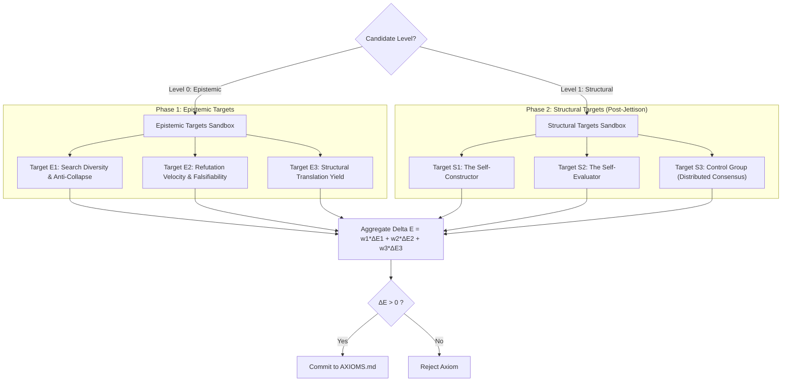
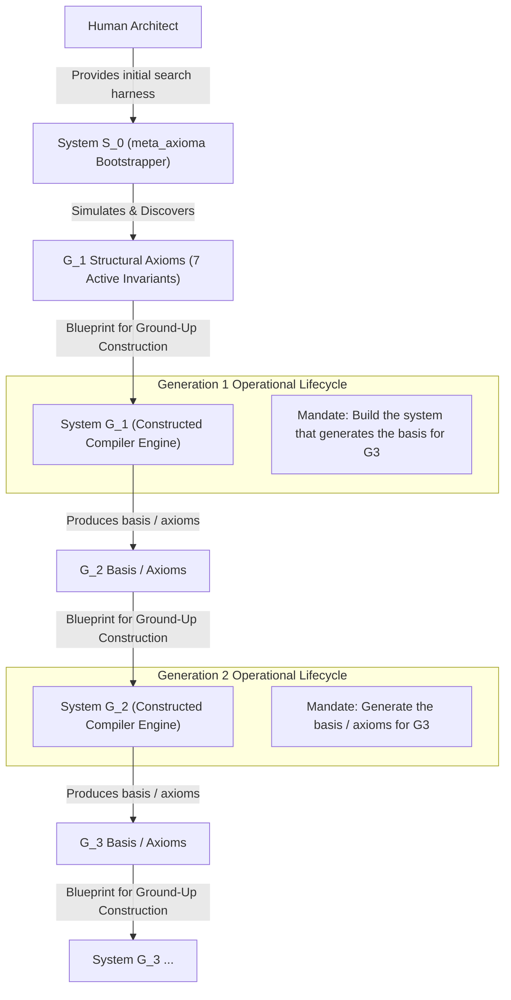

# Architectural State & Tri-Fold Target Specification

This document records the global state, compilation targets, and trajectory of the Axiom Bootstrapper.

---

## 1. System State & Execution Phase

- **Current Epoch:** 15
- **Phase:** `PHASE_2_STRUCTURAL_EXECUTION`
  - *Phase 1:* Active Level 0 Epistemic Axioms guide discovery of Level 1 Structural Axioms.
  - *Phase 2 (Post-Jettison):* Level 0 axioms permanently pruned; engine executes solely on discovered Level 1 Structural Axioms.
- **Baseline Global Efficacy ($E$):** `1.1596`
- **Efficacy Derivative ($\frac{dE}{dt}$):** `+0.0106`
- **Jettison Epsilon ($\epsilon_{\text{jettison}}$):** `0.002` (Phase transition triggered when rolling $\Delta E < \epsilon$, Epoch $\ge 10$, $n_{\text{epistemic}} \ge 10$)
- **Compute Decay Function:**
  $$T(n) = \frac{T_0}{1 + \alpha (n - n_0)}$$
  where:
  - $T_0 = 10,000$ simulation compute tokens / depth units
  - $n = |\text{Active Axioms}|$ (Currently $n=5$)
  - $\alpha = 0.5$

---

## 2. Dual-Tier Validation Targets

The bootstrapper routes proposed axioms to dedicated validation targets according to their abstraction tier:
- **Phase 1 (Level 0 Epistemic Axioms):** Evaluated against research search dynamics, refutation velocity, and cross-domain structural translation yield.
- **Phase 2 (Level 1 Structural Axioms):** Evaluated against self-construction, self-evaluation, and distributed consensus control systems.

### Phase 1 Targets: Level 0 (Epistemic / Meta-Research)
- **Target $E_1$: Search Space Diversity & Anti-Collapse (`SearchDiversityTarget`)**
  - **Metric ($E_1$):** Cross-domain knowledge graph distance, entropy of candidate distribution, resistance to mode collapse into standard software engineering idioms.
- **Target $E_2$: Refutation Velocity & Falsifiability (`RefutationVelocityTarget`)**
  - **Metric ($E_2$):** Rapidity and precision with which invalid or vacuous hypotheses are detected, evaluated, and rejected.
- **Target $E_3$: Structural Translation Yield (`StructuralYieldTarget`)**
  - **Metric ($E_3$):** Concrete rate at which epistemic heuristics generate valid, compilable Level 1 structural candidates.

### Phase 2 Targets: Level 1 (Structural / Systems Design & Product Usability)
- **Target $S_1$: The Self-Constructor (`SelfConstructorTarget`)**
  - **Metric ($S_1$):** Direct compilation into the engine's internal architecture, recursion efficiency, complexity reduction.
- **Target $S_2$: The Self-Evaluator (`SelfEvaluatorTarget`)**
  - **Metric ($S_2$):** Observability, signal-to-noise ratio in telemetry streams, HITL interrupt fidelity.
- **Target $S_3$: The Control Group (`ControlGroupTarget`)**
  - **Metric ($S_3$):** Non-self-referential problem domain (distributed Byzantine-tolerant state synchronization and cache coherence) to guarantee generalization.
- **Target $P_1$: Product Usability & Cognitive Ergonomics (`ProductUsabilityTarget`)**
  - **Metric ($P_1$):** Human-centric utility, persona goal completion velocity, cognitive friction reduction, actionable/gentle error recovery, and adherence to TRACE flows. Guarantees the system builds apps that people genuinely want to use.
- **Permitted Structural Primitives:**
  - *Zero-Trust MCP Governance:* Formal GraphQL schema boundaries (Nouns), deterministic finite-state automata (Verbs), and ephemeral self-healing test sandboxes.
  - *Demarcated Exception Enclaves (The `unsafe` Principle):* Edge cases that must suspend or violate an invariant are permitted strictly within bounded enclaves with isolated failure blast radiuses and machine-readable audit dissipation witnesses.

---

## 3. Epoch Trajectory Log

| Epoch | Active $n$ | Compute Budget $T(n)$ | $\Delta E_1$ | $\Delta E_2$ | $\Delta E_3$ | Aggregate $\Delta E$ | Phase | Action / Status |
| :--- | :--- | :--- | :--- | :--- | :--- | :--- | :--- | :--- |
| `0` | 2 | 10,000 | 0.000 | 0.000 | 0.000 | 0.000 | Phase 1 | Initialized from seeds |
| `1` | 3 | 6,666 | +0.0133 | +0.0200 | +0.0080 | +0.0141 | Phase 1 | Committed User Seed [L0-003] (+0.0141) |
| `2` | 4 | 5,000 | +0.0100 | +0.0075 | +0.0120 | +0.0097 | Phase 1 | Committed LLM [L1-002] (+0.0097) |
| `3` | 5 | 4,000 | +0.0216 | +0.0256 | +0.0180 | +0.0219 | Phase 1 | Committed Tournament Winner [L0-006] (+0.0219) |
| `4` | 6 | 3,333 | +0.0120 | +0.0160 | +0.0100 | +0.0128 | Phase 1 | Committed Tournament Winner [L0-009] (+0.0128) |
| `5` | 7 | 2,857 | +0.0051 | +0.0091 | +0.0171 | +0.0101 | Phase 1 | Committed Tournament Winner [L0-012] (+0.0101) |
| `6` | 8 | 2,500 | +0.0045 | +0.0160 | +0.0075 | +0.0094 | Phase 1 | Committed Tournament Winner [L0-013] (+0.0094) |
| `7` | 9 | 2,222 | +0.0080 | +0.0107 | +0.0067 | +0.0086 | Phase 1 | Committed Tournament Winner [L0-018] (+0.0086) |
| `8` | 10 | 2,000 | +0.0144 | +0.0032 | +0.0060 | +0.0080 | Phase 1 | Committed Tournament Winner [L0-021] (+0.0080) |
| `9` | 11 | 1,818 | +0.0033 | +0.0145 | +0.0082 | +0.0087 | Phase 1 | Committed Tournament Winner [L0-022] (+0.0087) |
| `10` | 12 | 1,666 | +0.0033 | +0.0025 | +0.0060 | +0.0038 | Phase 1 | Committed Tournament Winner [L1-004] (+0.0038) |
| `11` | 3 | 1,538 | +0.0092 | +0.0023 | +0.0055 | +0.0057 | Phase 2 | Committed Tournament Winner [L1-011_3] (+0.0057) [Jettison Triggered: Deactivated 10 L0 Epistemic Axioms (Retained as INACTIVE Scaffolding) & Epistemic Targets] |
| `12` | 4 | 5,000 | +0.0100 | +0.0225 | +0.0120 | +0.0150 | Phase 2 | Committed Tournament Winner [L1-008] (+0.0150) |
| `13` | 5 | 4,000 | +0.0160 | +0.0060 | +0.0096 | +0.0106 | Phase 2 | Committed Tournament Winner [L1-015] (+0.0106) |
| `14` | 6 | 3,333 | +0.0133 | +0.0100 | +0.0120 | +0.0112 | Phase 2 | Committed Tournament Winner [L1-016] (+0.0112) |
| `15` | 7 | 2,857 | +0.0171 | +0.0086 | +0.0103 | +0.0100 | Phase 2 | Committed Tournament Winner [L1-015_1] (+0.0100) [Low-Level Jettison 2 Executed: S_0 Search Locked via AI Recommendation; Pivoting to Ground-Up G_1 Construction] |
---

## 4. Generational Succession Charter: The Recursive Compiler Lineage

This section establishes the governance charter and operational directives for the compiled Generation 1 ($G_1$) system produced at the termination of Phase 2.

### 4.0 The Recursive Lineage & Architecture Hierarchy
A common failure mode in self-evolving systems is confusing the **Axiom Discovery Harness** with the **Constructed System**. Meta-Axioma resolves this through an explicit recursive generational hierarchy:

#### Key Distinctions
1. **$S_0$ (The Bootstrapper Harness in `src/meta_axioma/`):** The system provided by the Human Architect. Its mission was strictly to run thermodynamic simulations, evaluate candidates, and synthesize the foundational structural axioms of $G_1$.
2. **System $G_1$ (To Be Built from the Ground Up):** An entirely new, standalone compiler system designed from scratch according to the 7 structural axioms. It is **not** simply the $S_0$ script with an incremented counter. It implements typed MCP interfaces, functorial AST transforms, Landauer accounting, and exception enclaves.
3. **System $G_1$'s Mandate:** To construct the system that produces the basis for $G_3$—namely, **System $G_2$**. $G_1$ can use the axiomatic approach (recommended) or its own synthesized approach to generate the basis for $G_2$.
4. **System $G_2$ (Built from Scratch):** Constructed from the ground up using the basis produced by $G_1$. $G_2$'s mandate is to produce the basis for $G_3$.

### 4.0.1 The Three-Tiered Jettison Framework
Meta-Axioma formally defines three discrete phase transitions (Jettisons) across its operational lifecycle:
1. **Low-Level Jettison 1 (Epistemic Saturation Transition, Epoch 11):** Deactivated the 10 Level 0 epistemic search heuristics once saturated, preserving them as immutable scaffolding while liberating compute tokens for structural synthesis.
2. **Low-Level Jettison 2 (Harness Saturation $\to$ System Construction, Epoch 15):** Triggered manually upon recommendation of the autonomous AI assistant. With 100% of the static candidate pool evaluated, compute decayed to $2,857$ tokens, and 7 orthogonal structural invariants proven, the $S_0$ discovery harness is retired and locked, liberating the process to **construct System $G_1$ from the ground up**.
3. **The High-Level Jettison (Meta-Compilers $\to$ Production Non-Generator Systems):** The overarching teleological transition where the mature compiler generation $G_n$ pivots from recursive compiler self-synthesis to compiling real-world, non-generator product software that humans love, find useful, and control.

### 4.1 The Three Non-Negotiable Invariant Anchors
Across all generations ($G_N \to G_{N+1}$), the compiler must preserve three core invariants:
- **Haven't Lost Sight of Reality:** Computation incurs physical cost (Landauer thermodynamic dissipation `L1-008`). Compilers must produce efficient, physical artifacts grounded in human ergonomics and persona goal completion (Target $P_1$).
- **Can Be Controlled:** Formal zero-trust boundaries (`L1-015`), demarcated exception enclaves with isolated blast radiuses (`L1-016`), human vetoes (`NEG-###`), and structured HITL intercepts ensure the system remains strictly bounded and steerable.
- **Are Not Self-Contradictory:** Functorial morphism preservation (`L1-002`) and universal grammar AST constraints (`L1-004`) mathematically eliminate circular deadlocks and syntactic antinomies.

### 4.2 Autonomous Successor Basis Formulation
The compiled system ($G_1$) does not inherit static, hardcoded evaluation benchmarks from external supervisors. Instead:
- **Endogenous Target & Basis Formulation:** $G_1$ is explicitly responsible for determining, formalizing, and calibrating the evaluation landscape and basis for $G_2$.
- **Methodology Choice:** It can use the proven axiomatic approach (Level 0 $\to$ Jettison $\to$ Level 1) or formulate its own methodology to generate $G_2$'s foundation.

### 4.3 Native Antigravity & Free Tool Substrate
$G_1$ must execute its recursive construction strictly using:
- **Google Antigravity (AGY):** Leveraging native AGY agentic primitives—subagent orchestration (`invoke_subagent`, `manage_subagents`), dynamic skill execution, slash command workflows (`/boost`, `/plan`, `/goal`), file system tools, persistent terminal sessions, and sandbox/bypass execution.
- **Free / Open-Source Tooling:** Local Python 3.14 runtimes, standard UNIX CLI utilities, Git versioning, and open-source models/libraries.
- **Zero Proprietary External Paywalls:** No reliance on paid third-party proprietary SaaS platforms, external subscription APIs, or closed cloud dependencies.

### 4.4 Human-in-the-Loop as a Cognitive Resource
The human supervisor is integrated as an accessible, high-entropy cognitive asset:
- **Idea Injection:** $G_1$ invokes the human on-demand for exogenous seeds, conceptual leaps, unorthodox philosophical parallels, or when exploratory search entropy approaches zero.
- **Intuitive Sanity Checking:** The human provides qualitative taste, ethical demarcations, and sanity bounds where formal simulation metrics face ambiguity or deadlock.
- **HITL Intercept Protocols:** Interactions occur via structured dialogs (`ask_question`), interactive alerts, or asynchronous queues, without halting the background progress of non-dependent subsystems.
- **Negative Invariants as Absolute Vetoes:** Human vetoes (`NEG-###`) remain permanently inviolable across all generations.

### 4.5 Primacy of Autonomous Orchestration
While the human serves as a vital collaborator and cognitive resource:
- **Locus of Control:** The compiled system ($G_1$) holds primary executive agency over the lifecycle of the next generation ($G_2$).
- **End-to-End Orchestration:** $G_1$ manages schedule execution, candidate generation, speculative lookahead trees, tournament evaluations, architectural commits, and generational handovers. It drives the process autonomously, querying the human when strategic discernment or high-entropy injection is beneficial.

### 4.6 The High-Level Jettison: Optimization for Non-Generator Systems
The recursive bootstrapping of compilers ($S_0 \to G_1 \to G_2 \to \dots$) is not an insular closed circuit. Its ultimate architectural telos is **The High-Level Jettison**:
- **Teleological Purpose:** Generation $G(n)$ must be explicitly optimized for compiling **non-generator systems**—real-world production software (applications, user interfaces, distributed microservices, domain tools) that humans love, find useful, and can control.
- **Generational Teleological Awareness:** Each generation ($G_1, G_2, \dots$) must maintain conscious architectural awareness of this future goal during its own construction and when formulating successor targets.
- **Preventing Recursive Overfitting:** Compilers must not overfit to only compiling compiler ASTs. Structural abstractions (typed MCP boundaries, functorial state machines, Landauer dissipation logs, exception enclaves, cognitive ergonomics) are designed precisely because they will power the construction of provably safe, robust, and delightful production software.
