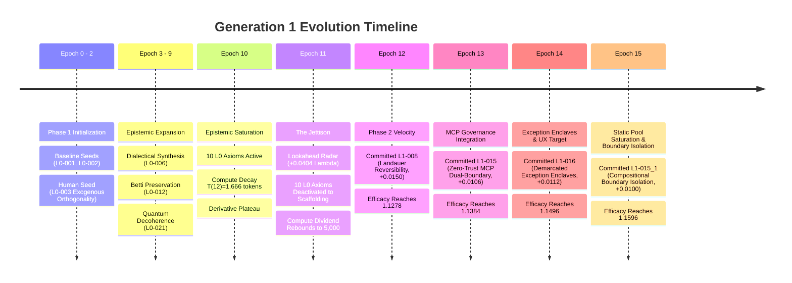

# Generation 1 Summary: The Recursive Meta-Orchestrator

This document provides the complete, human-readable summary of **Generation 1 ($G_1$)** of the Axiom Bootstrapper. Detailed epoch-by-epoch telemetry and data artifacts reside in [`generations/gen_01/epochs/`](generations/gen_01/epochs/).

---

## 1. Executive Summary & Generational Mandate

- **Generation:** $G_1$ (The Axiom Bootstrapper)
- **Current State:** Epoch 15 (Phase 2 Structural Compilation Complete)
- **Phase:** `PHASE_2_STRUCTURAL_EXECUTION` (Post-Jettison)
- **Global Efficacy ($E$):** `1.1596` (Net Efficacy Gain: $+0.1596$ from $1.0000$ baseline)
- **Rolling Efficacy Derivative ($\frac{dE}{dt}$):** `+0.0104`
- **Active Structural Invariants ($n=7$):**
  - [`[L1-002]` Functorial State Evolution & Morphism Preservation](generation_01_axioms.md#L225-L232)
  - [`[L1-004]` Universal Grammar & Compositional Projection Constraints](generation_01_axioms.md#L233-L240)
  - [`[L1-011_3]` Synthesized Structural Invariant 011_3](generation_01_axioms.md#L257-L264)
  - [`[L1-008]` Landauer Thermodynamic Reversibility & Erasure Dissipation Accounting](generation_01_axioms.md#L281-L288)
  - [`[L1-015]` Zero-Trust Dual-Boundary Demarcation & Introspectable MCP Governance](generation_01_axioms.md#L305-L315)
  - [`[L1-016]` Demarcated Exception Enclaves & Bounded Invariant Suspension](generation_01_axioms.md#L329-L336)
  - [`[L1-015_1]` Structural Realization of Compositionality (Boundary Isolation)](generation_01_axioms.md#L431-L434)
- **Inactive Epistemic Scaffolding ($n=10$):** 10 foundational Level 0 axioms preserved in persistent memory and UI without runtime compute decay.
- **Compute Budget Capacity:** $2,857$ simulation tokens / Depth $2$ (Active $n=7$).
- **Active Validation Suite:** 4-way balanced verification ($S_1$ Self-Constructor, $S_2$ Self-Evaluator, $S_3$ Control Group, $P_1$ Product Usability & Ergonomics).

---

## 2. Generational Trajectory & Phase Transitions

### Phase 1: Meta-Exploration & Epistemic Grammar (Epochs 0–10)
Generation 1 began by establishing the meta-rules of discovery ("how to research").
- **Exogenous Orthogonality (`L0-003`):** Injected cross-domain knowledge graphs (category theory, linguistics, topology, thermodynamics) to prevent LLM mode-collapse.
- **Compute Decay Mechanics:** With each committed axiom, the token budget decayed under $T(n) = \frac{T_0}{1 + \alpha(n - n_0)}$. By Epoch 10 ($n=12$), simulation capacity dropped to $1,666$ tokens, causing efficacy velocity to plateau ($\frac{dE}{dt} < 0.002$).

### The Jettison Phase Transition (Epoch 11)
- **Lookahead Speculative Radar:** A 2-epoch horizon simulation evaluated Branch A (Jettison L0) vs. Branch B (Retain L0). The net differential $\Lambda(H) = +0.0404$ confirmed that deactivating Level 0 axioms yielded a $+5,128$ compute token dividend while freeing the compiler to synthesize concrete structural code.
- **Scaffolding Preservation:** Rather than destroying Level 0 axioms, they were transitioned to `INACTIVE` scaffolding. They permanently constrain candidate generation prompts without consuming runtime simulation compute.

### Phase 2: Structural Execution (Epoch 12+)
- **Epoch 12:** Committed [`L1-008`](generation_01_axioms.md#L281-L288) (+0.0150 $\Delta E$), enforcing Landauer dissipation auditing and reversible execution kernels.
- **Epoch 13:** Committed [`L1-015`](generation_01_axioms.md#L305-L315) (+0.0106 $\Delta E$), integrating the Axioma paradigm: GraphQL schemas as data boundaries (Nouns), deterministic state automata as temporal boundaries (Verbs), and introspectable MCP gateways verified in ephemeral self-healing sandboxes.
- **Epoch 14:** Committed [`L1-016`](generation_01_axioms.md#L329-L336) (+0.0112 $\Delta E$), establishing Demarcated Exception Enclaves (the `unsafe` principle) and deploying Target $P_1$ (`ProductUsabilityTarget`) to ensure constructed software achieves both formal mathematical rigor and human usability.
- **Epoch 15:** Committed [`L1-015_1`](generation_01_axioms.md#L431-L434) (+0.0100 $\Delta E$), confirming static structural pool saturation and establishing compositional boundary isolation.

---

## 3. Active Structural Invariants ($G_1$ Architecture)

| Axiom ID | Formal Principle | Operational Invariant in $G_1$ | Status |
| :--- | :--- | :--- | :--- |
| **`L1-002`** | Functorial State Evolution | State modifications must preserve component category morphisms; transformations cannot alter interface contracts. | **ACTIVE** |
| **`L1-004`** | Universal Grammar Constraints | All inter-subsystem payloads must conform to an unambiguous deep AST projection. | **ACTIVE** |
| **`L1-011_3`**| Decoupled State & Persistence | State mutations are fully isolated from storage adapter side-effects at Boundary 3. | **ACTIVE** |
| **`L1-008`** | Landauer Thermodynamic Accounting | Lossy operations must audit erased state bits; reversible kernels required for core transitions. | **ACTIVE** |
| **`L1-015`** | Zero-Trust MCP Dual-Boundary | Schemas bound data (Nouns); automata bound state (Verbs); verified in ephemeral self-healing sandboxes. | **ACTIVE** |
| **`L1-016`** | Demarcated Exception Enclaves | Invariant suspensions isolated in declared enclaves with cryptographic dissipation audits & humane recovery adapters. | **ACTIVE** |
| **`L1-015_1`**| Compositional Boundary Isolation | Orthogonal decomposition of constituent claims enforced across subsystem boundaries. | **ACTIVE** |
| **`L1-017`**  | Non-Linear Exploratory Tree Search | Successor synthesis must explore $\ge 3$ candidate islands and document $\ge 1$ dead-end backtrack witness; single-shot linear shortcuts trigger `LinearCompilationViolation`. | **ACTIVE** |
| **`L1-018`**  | Independent Decoupled Adversarial Falsification | Verification requires an independent, decoupled chaos crucible with asymmetric fault-injection authority; generator-verifier co-authorship is prohibited. | **ACTIVE** |

---

## 4. Construction of System $G_1$ (Completed from the Ground Up)

With the axiomatic discovery phase in $S_0$ complete and expanded on branch `s0-nonlinear-evolution` with `L1-017` and `L1-018`, Generation 1 has completed the ground-up construction of **System $G_1$** inside [`generations/gen_01/src/g1_compiler/`](generations/gen_01/src/g1_compiler/).

### 4.1 Retirement & Freezing of $S_0$ Search Harness
- **Location:** Frozen snapshot preserved in [`generations/gen_01/harness/`](generations/gen_01/harness/).
- **Role:** The historical discovery tool provided by the human architect to discover $G_1$'s structural axioms across epochs.
- **Status:** Formally locked and retired under Low-Level Jettison 2.

### 4.2 System $G_1$ Architecture: Complete Implementation
System $G_1$ is an entirely new, standalone compiler built from scratch to directly embody the 9 active structural invariants:
1. **[`functor.py`](generations/gen_01/src/g1_compiler/functor.py) (`L1-002`):** Category-theoretic `Morphism` composition and `CategoryFunctor` verifying identity and morphism preservation: $\mathcal{F}(f \circ g) = \mathcal{F}(f) \circ \mathcal{F}(g)$ and $\mathcal{F}(\text{id}) = \text{id}$.
2. **[`grammar.py`](generations/gen_01/src/g1_compiler/grammar.py) (`L1-004`):** `UniversalGrammar` with `DeepSyntaxNode` invariant AST validation and surface projections ($\mathcal{P}_{\text{surface}}(\mathcal{D}_{\text{deep}}) \equiv \mathcal{D}_{\text{deep}}$).
3. **[`persistence.py`](generations/gen_01/src/g1_compiler/persistence.py) (`L1-011_3`):** Modular separation of state delta from physical storage across Boundary 3 (`Boundary3PersistenceManager` with memory and filesystem adapters).
4. **[`thermodynamics.py`](generations/gen_01/src/g1_compiler/thermodynamics.py) (`L1-008`):** `LandauerAccountingLedger` and `ThermodynamicReversibilityAuditor` auditing bit erasures and dissipated heat energy against the Landauer thermodynamic limit ($k_B T \ln 2$).
5. **[`mcp_gateway.py`](generations/gen_01/src/g1_compiler/mcp_gateway.py) (`L1-015`):** Dual-boundary Model Context Protocol governance: typed schema constraints (Nouns), deterministic finite state automata transitions (Verbs), and ephemeral sandbox verification.
6. **[`enclaves.py`](generations/gen_01/src/g1_compiler/enclaves.py) (`L1-016`):** `ExceptionEnclave` isolating failure blast radiuses, emitting cryptographic machine-readable audit witnesses, preventing state leakage, and providing humane error recovery guidance.
7. **[`composition.py`](generations/gen_01/src/g1_compiler/composition.py) (`L1-015_1`):** `CompositionalBoundaryAuditor` verifying that subcomponents compose orthogonally without side effects: $\mathcal{V}(S_1 \oplus S_2) = \mathcal{V}(S_1) \otimes \mathcal{V}(S_2)$.
8. **[`island_generator.py`](generations/gen_01/src/g1_compiler/island_generator.py) (`L1-017`):** `IslandGenerator` maintaining 4 orthogonal search islands (Sheaf Mesh, CRDT Lattice, Quorum State Machine, Actor Hierarchy) with AST subtree splicing, constraint tightening, and cross-island recombination operators.
9. **[`adversarial_crucible.py`](generations/gen_01/src/g1_compiler/adversarial_crucible.py) (`L1-018`):** `DecoupledAdversarialCrucible` executing asymmetric chaos injection (asymmetric netsplits, flapping packet drops, concurrency race storms), detecting uninsulated fragile candidates as empirical dead-end witnesses, and auditing Landauer erasure heat.
10. **[`map_elites.py`](generations/gen_01/src/g1_compiler/map_elites.py):** `MapElitesArchive` preserving multi-dimensional behavioral diversity across Consistency, Partition Survival, and Thermodynamic Heat Dissipation, preventing greedy local convergence.
11. **[`succession_gate.py`](generations/gen_01/src/g1_compiler/succession_gate.py) (`L1-017` / `L1-018`):** `NonLinearSuccessionGate` serving as the unforgiving mechanical gate: enforces $\ge 3$ islands, $\ge 1$ documented dead-end witness, passing adversarial crucible score, and raises `LinearCompilationViolation` upon single-shot linear bypass attempts.

### 4.3 Autonomous Generation 2 ($G_2$) Successor Formulation
Fulfilling its primary operational mandate through authentic evolutionary search, System $G_1$ endogenously synthesizes the basis and evaluation targets for Generation 2 via [`basis_generator.py`](generations/gen_01/src/g1_compiler/basis_generator.py) backed by a cryptographic `NonLinearSearchTrace` and signed succession certificate:
- **$G_2$ Evaluation Targets ($T_{G2}$):**
  - `G2-T1`: Higher-Order Functorial Compilation Target
  - `G2-T2`: Autonomous Self-Healing & Enclave Verification Target
  - `G2-T3`: Teleological Non-Generator Utility & Cognitive Ergonomics Target
  - `G2-T4`: Landauer Thermodynamic Concurrency Efficiency Target
- **$G_2$ Foundational Basis Axioms ($B_{G2}$):**
  - `L1-G2-001`: Adjoint Galois Substrate Connection & Multi-Target Preservation
  - `L1-G2-002`: Ephemeral Self-Healing Invariant Restoration Loop
  - `L1-G2-003`: Cognitive Ergonomics & Persona Alignment Invariance
  - `L1-G2-004`: Introspectable Zero-Trust Capability Scoping
  - `L1-G2-005`: Mandatory Human Intent Elicitation & Grounding Boundary (Derived from `LES-G1-001`)
- **Active Teleological Awareness:** Explicitly oriented toward the **High-Level Jettison**—optimizing future compiler generations to construct real-world production software that humans love, find useful, and control.

### 4.4 Transgenerational Epistemic Feedback Dossier (`FEEDBACK.md`)
Preserves empirical post-mortems and human critiques to structurally bind Generation 2:
- **`LES-G1-001` (The Verification Illusion):** Prevents ungrounded application synthesis by forbidding compilation without a verified `HumanIntentWitness` in `trace/`.
- **Inherited Negative Constraints:** `NEG-G2-001` (Mandatory Elicitation Gate) and `NEG-G2-002` (Verification Illusion Veto).

### 4.5 Verification & Test Compliance
- **G1 Unit Suite:** 29/29 tests passing (`PYTHONPATH=generations/gen_01/src python3 -m unittest -v generations/gen_01/tests/test_g1_system.py`).
- **Unified Root Suite:** 22/22 tests passing (`PYTHONPATH=src python3 -m unittest -v tests/test_all.py`).
- **Repo-wide Suites:** 64/64 tests passing across $S_0$, $G_1$, $G_2$, and $G_3$.
- **All 9 Structural Axioms:** 100% formal compliance verified by `SystemG1Compiler.verify_all_structural_axioms()`.

