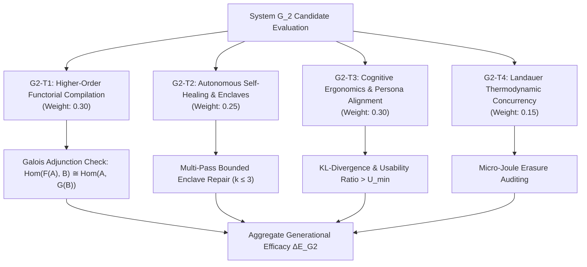

# Generation 2 Architectural State & Target Specification (`generation_02_architecture.md`)

> **Architectural Trajectory and Evaluation Framework for Generation 2 ($G_2$)**  
> Constructed from the ground up on the basis synthesized by **System $G_1$**.  
> Status: **OPERATIONAL (Epoch 2)**

---

## 1. System State & Execution Phase

- **Current Generation:** $G_2$ (Autonomous Domain Compiler)
- **Current Epoch:** 2
- **Phase:** `PHASE_1_DOMAIN_EXECUTION`
- **Active Structural Invariants ($n=7$):**
  - `[L1-G2-001]` Adjoint Galois Substrate Connection & Multi-Target Preservation
  - `[L1-G2-002]` Ephemeral Self-Healing Invariant Restoration Loop
  - `[L1-G2-003]` Cognitive Ergonomics & Persona Alignment Invariance
  - `[L1-G2-004]` Introspectable Zero-Trust Capability Scoping
  - `[L1-G2-005]` Mandatory Human Intent Elicitation & Grounding Boundary
  - `[L1-G2-006]` Phenomenological Tool-Being & Zuhandenheit Attunement Invariant
  - `[L1-G2-007]` Kinetic Chaining & Semantic Momentum Propagation
- **Inherited Negative Invariants ($n=3$):**
  - `NEG-G2-001` Mandatory Intent Elicitation Gate (`HumanIntentWitness`)
  - `NEG-G2-002` Anti-Hubris Verification Illusion Veto
  - `NEG-G2-003` Full-Flow & Domain Invariant Test Gate
- **Inherited Scaffolding Pool:** 10 Level 0 Meta-Axioms + 7 Level 1 Structural Axioms from $G_1$
- **Thermodynamic Compute Decay Budget:**
  $$T_2(n) = \frac{T_{0}}{1 + \alpha (n - n_0)} = \frac{10,000}{1 + 0.5 \times 7} = 2,222 \text{ simulation tokens / depth 2}$$
- **Global Efficacy Baseline ($E_{G2}$):** `1.1596` (Cumulative Delta: `+0.9515`)

---

## 2. Generation 2 Evaluation Target Framework



### Target Specifications

1. **Target `G2-T1` (Higher-Order Functorial Compilation | Weight: 0.30):**  
   Evaluates multi-substrate compilation. Requires that intent-level AST structures project into varied execution substrates (e.g. CLI, Web PWA, Native Server) with zero functorial morphism distortion:
   $$\|\mathcal{F}(f \circ g) - (\mathcal{F}(f) \circ \mathcal{F}(g))\|_{\text{substrate}} = 0$$

2. **Target `G2-T2` (Autonomous Self-Healing & Enclave Verification | Weight: 0.25):**  
   Evaluates resilience to invariant infractions. The compiler executes an ephemeral sandbox healing loop (up to $k=3$ attempts). Proves zero blast leakage:
   $$\text{SelfHealRate}(m \in \text{Enclaves}) \ge 0.95 \land \text{BlastLeakage} = \emptyset$$

3. **Target `G2-T3` (Teleological Non-Generator Utility & Cognitive Ergonomics | Weight: 0.30):**  
   Evaluates the degree to which compiled outputs reduce cognitive friction and align with human persona workflows:
   $$\text{Utility}(A_{\text{app}}) = \frac{\text{PersonaGoalVelocity}}{1 + \text{CognitiveFriction}} > U_{\min} \quad \text{and} \quad D_{\text{KL}}(\text{Model}_{\text{User}} \parallel \text{Model}_{\text{System}}) \le \varepsilon_{\text{ergonomics}}$$

4. **Target `G2-T4` (Landauer Thermodynamic Concurrency Efficiency | Weight: 0.15):**  
   Audits bit-erasure entropy dissipation across concurrent pipeline executions:
   $$\frac{\Delta Q_{\text{dissipated}}}{\text{Throughput}} < Q_{\text{budget}}$$

---

## 3. System $G_2$ Modular Architecture

System $G_2$ is structured inside [`generations/gen_02/src/g2_compiler/`](file:///Users/michaellipski/dev/meta-axioma/generations/gen_02/src/g2_compiler/):

```
g2_compiler/
├── __init__.py                # Package exports
├── types.py                   # Type definitions & AST schemas
├── galois_substrate.py        # [L1-G2-001] Galois adjoint multi-substrate mapper
├── self_healing.py            # [L1-G2-002] Multi-pass enclave self-healing engine
├── cognitive_ergonomics.py    # [L1-G2-003] Persona alignment & UX friction auditor
├── capability_scoping.py      # [L1-G2-004] Zero-trust cryptographic capability token system
├── intent_grounding.py        # [L1-G2-005] Human intent elicitation gate (NEG-G2-001)
├── phenomenology.py           # [L1-G2-006] Phenomenological Tool-Being auditor (Zuhandenheit)
├── kinetic_chain.py           # [L1-G2-007] Kinetic Chaining & Semantic Momentum compiler
├── basis_generator.py         # Endogenous synthesizer formulating Generation 3 (G_3)
└── engine.py                  # Standalone System G_2 unified compiler orchestrator
```

---

## 4. Generational Succession Teleology: Towards $G_3$ and Non-Generator Production Systems

System $G_2$'s primary mission is two-fold:
1. **Compile Production Non-Generator Systems:** Execute the High-Level Jettison by delivering provably ergonomic, self-healing applications with verified human intent grounding.
2. **Synthesize Generation 3 ($G_3$):** Autonomously evaluate its own operational limits and compile the successor basis and evaluation landscape for Generation 3.
