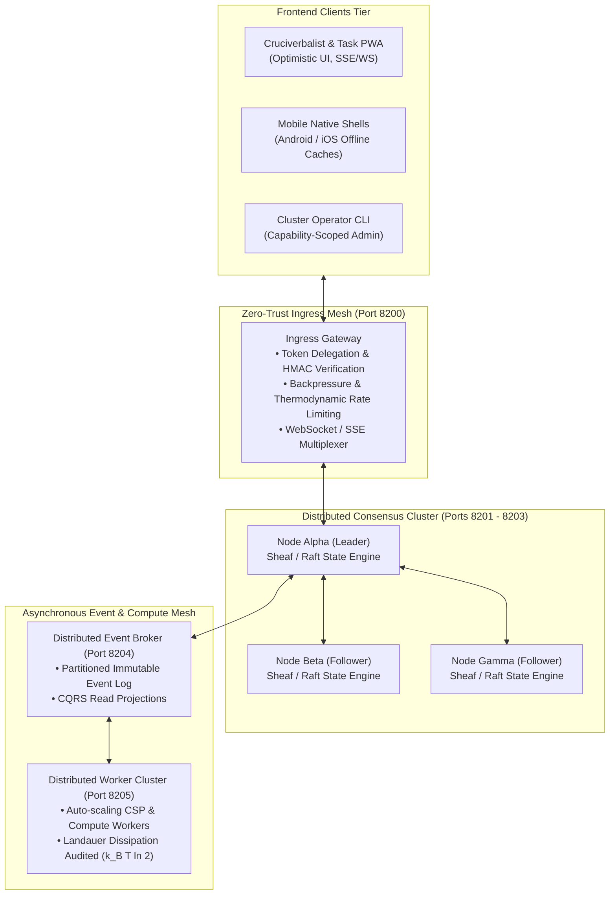

# Generation 3 Architecture: Distributed Systems & Complex Backend Compiler (`generation_03_architecture.md`)

> **Generation:** $G_3$ (Distributed Systems & Complex Backend Compiler)  
> **Status:** **OPERATIONAL (Phase 1 Distributed Foundation Initialized)**  
> **Predecessor Origin:** Synthesized autonomously by **System $G_2$** following completion of the Usable App Standard.  
> Detailed epoch telemetry resides in [`generations/gen_03/epochs/`](generations/gen_03/epochs/).

---

## 1. Executive Mandate & The High-Level Jettison Gateway

Generation 3 is the culmination of the Meta-Axioma compiler lineage. While Generation 1 discovered the 7 structural axioms and Generation 2 mastered cognitive ergonomics and single-node multi-substrates, **Generation 3 solves the ultimate engineering frontier: General Distributed Systems with Complex Backends servicing Frontend Extremities**.

### Core Pillars of Generation 3:
1. **Topological Sheaf Consensus (`L1-G3-001`):** Mathematical consistency across multi-node backend clusters and client caches under arbitrary network partitions ($CAP$ and $PACELC$ bounds).
2. **Zero-Ambient Distributed Capability Mesh (`L1-G3-002`):** Unforgeable, cryptographically delegable capability tokens across inter-service RPC and gateway pipelines.
3. **Distributed Blast Radius Containment (`L1-G3-003`):** 3-pass ephemeral healing enclaves preventing cascading microservice failures.
4. **Functorial Event Sourcing & CQRS (`L1-G3-004`):** Append-only event streaming with 1-click time-travel cluster rollback.
5. **The High-Level Jettison Convergence (`L1-G3-005`):** Complete transition of compiler compute into synthesizing and operating production-grade distributed applications that humans love, find useful, and control.

---

## 2. Distributed Systems Topology

---

## 3. Evaluation Target Suite (`G3-T1` through `G3-T4`)

| Target | Name | Weight | Mathematical Bound | Telos |
| :--- | :--- | :---: | :--- | :--- |
| **`G3-T1`** | Distributed Sheaf Consensus | `0.30` | $H^0(U, \mathcal{F}) \cong \Gamma(U, \mathcal{F}) \land \text{SplitBrain} = 0$ | Verifiable state synchronization across nodes under simulated network splits. |
| **`G3-T2`** | Zero-Downtime Cluster Hot-Patching | `0.25` | $\text{ClusterAvailability} \ge 0.9999 \land \text{StateLoss} = 0$ | Live service and schema hot-reloads with zero transaction drop. |
| **`G3-T3`** | End-to-End Client Servicing & Ergonomics | `0.30` | $\text{ClientLatency} < 100\text{ms} \land \text{Friction} = 0$ | Responsive frontends with transparent optimistic updates and real-time streams. |
| **`G3-T4`** | Thermodynamic Cluster Dissipation | `0.15` | $E_{\text{cluster}} \le \sum k_B T \ln(2) \cdot \Delta S_{\text{erased}} < \text{Lease}$ | Landauer memory and bit-erasure bounding across worker nodes. |

---

## 4. Flagship Distributed System: Axioma Mesh (`SYS-09`)

Generation 3 will demonstrate these capabilities by compiling **`axioma_mesh` (Zero-Trust Distributed Event & Compute Mesh)**:
* **Ingress API Gateway (Port 8200):** Token validation, rate-limiting, and WebSocket push streaming.
* **3-Node Sheaf Consensus Cluster (Ports 8201–8203):** Replicated state machine with partition tolerance.
* **Distributed Event Broker (Port 8204):** Append-only event log and CQRS projections.
* **Distributed Worker Pool (Port 8205):** Asynchronous constraint and heavy compute execution.
* **Operations Glassmorphic Dashboard (Web PWA):** Real-time cluster topology visualizer, live node health, and task dispatching.
