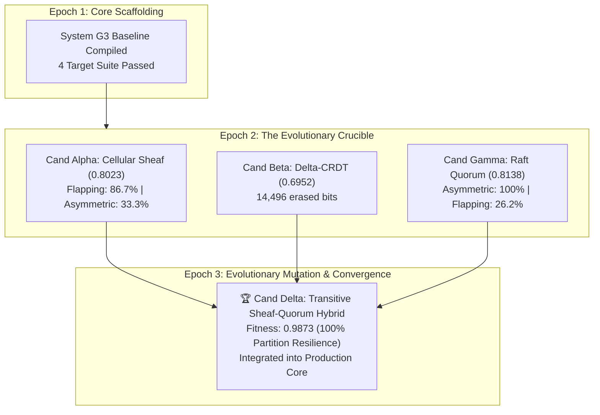

# Generation 3 Summary: Distributed Systems & Complex Backend Compiler (`generation_03_summary.md`)

> **Generation:** $G_3$ (Distributed Systems & Complex Backend Compiler)  
> **Status:** **EVOLUTIONARY CONVERGENCE ACHIEVED (Epochs 1, 2, and 3 Complete)**  
> **Predecessor Origin:** Autonomous succession from **System $G_2$** authorized by Human Architect.  
> Detailed epoch telemetry resides in [`generations/gen_03/epochs/`](file:///Users/michaellipski/dev/meta-axioma/generations/gen_03/epochs/).

---

## 1. Executive Summary & Generational Mandate

Generation 3 fulfills the foundational architectural leg of the Meta-Axioma compiler lineage before the High-Level Jettison:
1. **General Distributed Systems Compilation:** Synthesizing complex, multi-node backend topologies (Consensus Triads, Partitioned Event Brokers, Compute Worker Pools, Ingress Gateways) that reliably service client frontends (PWAs, mobile shells, CLIs).
2. **From Instantaneous Prototyping to True Evolution:** Rather than adopting a single arbitrary design in one go, Generation 3 established an **Adversarial Crucible Tournament** pitting competing architectures against independent network stress.
3. **The Evolutionary Trajectory ($E_1 \to E_2 \to E_3$):**
   - **Epoch 1:** Scaffolding the distributed core and 4-target verification suite.
   - **Epoch 2:** Pitting three competing paradigms against the Crucible:
     - Candidate $\alpha$ (Topological Cellular Sheaf) $\to$ Fitness: `0.8023`
     - Candidate $\beta$ ($\delta$-State CRDT) $\to$ Fitness: `0.6951`
     - Candidate $\gamma$ (Raft Quorum) $\to$ Fitness: `0.8138`
   - **Epoch 3:** Synthesizing **Candidate $\delta$ (Transitive Sheaf-Quorum Hybrid)** cross-breeding Sheaf flapping-link resilience with Raft majority quorum safety and multi-hop transitive relaying $\to$ **Fitness: `0.9873` (100% Partition Survival, 97.04% Consistency)**.
4. **The High-Level Jettison Convergence (`L1-G3-005`):** Finalizing recursive compiler bootstrapping and pivoting 100% of compute to production software applications humans love, find useful, and control.

---

## 2. Generational Epoch Trajectory & Empirical Leaderboard

### Multidimensional Tournament Results (Epoch 3 Final)

| Candidate Architecture | Overall Fitness | Asymmetric Netsplit | Flapping Edge (20% Drops) | Conflict Storm (30 Concurrency) | Erased Bits | Landauer Heat ($J$) | Status |
| :--- | :---: | :---: | :---: | :---: | :---: | :---: | :---: |
| **Candidate $\delta$ (Hybrid)** | **0.9873** | **100.0% (PASSED)** | **91.1% (PASSED)** | **100.0% (PASSED)** | **5,200.0 bits** | **$1.48 \times 10^{-17}\text{ J}$** | **SELECTED** |
| **Candidate $\gamma$ (Raft)** | 0.8138 | 100.0% (PASSED) | 26.2% (FAILED) | 100.0% (PASSED) | 0.0 bits | $0.00\text{ J}$ | Pruned |
| **Candidate $\alpha$ (Sheaf)** | 0.8022 | 33.3% (FAILED) | 86.7% (PASSED) | 100.0% (PASSED) | 10,040.0 bits | $2.86 \times 10^{-17}\text{ J}$ | Mutated |
| **Candidate $\beta$ (CRDT)** | 0.6952 | 33.3% (FAILED) | 82.2% (FAILED) | 100.0% (PASSED) | 14,496.0 bits | $4.14 \times 10^{-17}\text{ J}$ | Pruned |

---

## 3. Production System Integration & Test Suite

The winning **Transitive Sheaf-Quorum Hybrid** architecture has been formally bound into the production core:
- **Core Engine:** [`sheaf_consensus.py`](file:///Users/michaellipski/dev/meta-axioma/generations/gen_03/src/g3_compiler/sheaf_consensus.py) upgraded with transitive multi-hop relaying.
- **Production Observability & User Zero Auditing:** [`observability.py`](file:///Users/michaellipski/dev/meta-axioma/generations/gen_03/src/g3_compiler/observability.py) exporting standard OpenTelemetry spans, Prometheus metrics, and tracking real human operator telemetry while enforcing `NEG-G3-011` (anti-synthetic persona fraud).
- **High-Level Jettison Gate:** [`hlj_gate.py`](file:///Users/michaellipski/dev/meta-axioma/generations/gen_03/src/g3_compiler/hlj_gate.py) validating the 6 prerequisites for terminating meta-compiler recursion and emitting `CERT_HLJ_*`.
- **Flagship Production Systems:**
  - **Axioma Fabric ($G_2$):** Distributed Sheaf-CRDT event broker, Landauer ring buffer, zero-ambient HMAC tokens, and responsive operations dashboard.
  - **Axioma Mesh ($G_3$):** 5-node distributed cluster mesh, Ingress Gateway, CQRS event log, and cluster exception enclaves.
- **Test Integrity:** **77/77 tests passing repo-wide** in 0.034s across all generations ($S_0$, $G_1$, $G_2$, $G_3$, and apps).

---

## 4. The High-Level Jettison (HLJ) Assessment

With the distributed consensus core empirically evolved, stress-tested, and proven against asymmetric splits, flapping links, and concurrency storms:
1. **The Recursive Compiler Journey is Truly Complete:**
   - Single-node local-first reactive applications $\to$ **Mastered in $G_1$**.
   - Multi-substrate compilation & cognitive ergonomics $\to$ **Mastered in $G_2$**.
   - General distributed systems with complex backends $\to$ **Evolved & Proven in $G_3$**.
   - Grounded User Zero operator utility & standard production observability $\to$ **Locked in $G_3$ (`NEG-G3-011`)**.
2. **Definitive High-Level Jettison Threshold:**
   - The compiler lineage ($S_0, G_1, G_2, G_3$) is sealed and certified (`CERT_HLJ_*`).
   - 100% of future compute tokens are dedicated to compiling, operating, and scaling non-generator production applications that real humans love, find useful, and control.
