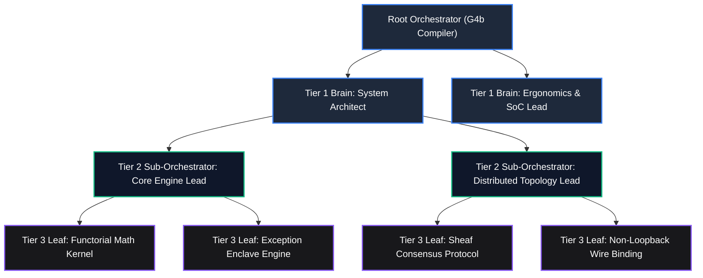

# Generation 4b: The Recursive Multi-Tier Autonomous Systems Compiler
## Successor Target Charter & Recursive Subagent Tree Architecture

- **Status:** PRE-BOOTSTRAP SPECIFICATION
- **Predecessor:** System $G_{3b}$ (Autonomous Universal Systems Compiler)
- **Primary Innovation:** Bounded Fractal Tree Recursion (`enable_subagent_tools=True`), Hierarchical Budget Leasing, and Merkle-DAG Cryptographic Telemetry.

---

## 1. The Generational Succession Thesis ($G_{3b} \to G_{4b}$)

System $G_{3b}$ mastered universal systems compilation through **two-stage flat subagent execution**, **7 orthogonally maximal engineering personas**, the **Adversarial Quorum Gate**, and **zero-template IR-driven emission**. However, $G_{3b}$ operates under a strict topological ceiling:
- The Meta-Orchestrator manages a single flat layer of subagents ($S_0 \to \text{Orchestrator} \to \text{Subagents}$).
- Subagents are prohibited from spawning child subagents (`[L1-G3B-015]` Stack Purity).
- When a complex micro-problem requires deep exploratory synthesis, the parent orchestrator must either absorb all reasoning overhead or flatten the task into indivisible leaves prematurely.

**Generation 4b ($G_{4b}$)** dissolves this topological ceiling by introducing **Recursive Multi-Tier Subagent Trees** while strictly preventing runaway compute explosions through **thermodynamic Landauer decay, hierarchical budget leasing, and Merkle-DAG cryptographic telemetry**.

---

## 2. Core Invariants & Axiomatic Foundations of $G_{4b}$

### `[L1-G4B-001]` Fractal Tree Recursion Axiom (`enable_subagent_tools=True`)
- Intermediate subagents are equipped with autonomous subagent spawning tools (`enable_subagent_tools=True` or `invoke_subagent` delegation).
- When a subtask exceeds atomic cognitive complexity, the assigned subagent can formulate a localized `SituationOfConcern`, decompose it into child tasks, and spawn child subagents to resolve them.
- Maximum recursion depth is strictly bounded by a compile-time invariant:
  $$\text{depth}(N) \le d_{\max} = 4$$
- Maximum branching factor per node is strictly bounded:
  $$\text{branching}(N) \le b_{\max} = 5$$

---

### `[L1-G4B-002]` Hierarchical Fractional Budget Leasing & Landauer Decay
Recursive tree expansion is mathematically bounded by strict fractional budget leasing:
1. **Parent-to-Child Token Leasing:** A parent node $N$ with allocated budget $B_N$ may lease at most a fraction $\lambda \in (0, 1)$ (nominal $\lambda = 0.80$) of its remaining capital across all its child subagents:
   $$\sum_{i=1}^{k} B_{\text{child}_i} \le \lambda \cdot B_N$$
2. **Parent Reserve Guarantee:** The parent node must retain $(1 - \lambda) = 20\%$ of its allocated budget exclusively for its own evaluation, aggregation, and verification sinks.
3. **Geometric Token Attenuation:** At recursion depth $d$, the maximum budget available to any child subagent decays exponentially:
   $$B_d \le B_0 \cdot \left(\frac{\lambda}{b}\right)^d$$
   When $B_d < C_{\min} = 1,024$ tokens, the compiler's **Thermodynamic Cutoff Gate** trips, forbidding further subagent spawning and forcing immediate leaf resolution. Infinite recursion is physically and mathematically impossible.
4. **Unspent Token Re-absorption:** Any unspent tokens from child subagents are automatically credited back up the tree to the parent's available budget.

---

### `[L1-G4B-003]` Merkle-DAG Cryptographic Telemetry Witness
$G_{3b}$'s linear event chain is upgraded to a **Hierarchical Merkle DAG**:
1. Every leaf execution produces an immutable witness record:
   $$W_{\text{leaf}} = \langle \text{task\_id}, \text{conversation\_id}, \text{prompt\_bpe}, \text{response\_bpe}, \text{hash} \rangle$$
2. An intermediate sub-orchestrator aggregates the witnesses of its children by computing a Merkle tree root:
   $$H_{\text{parent}} = \text{SHA256}\left(H_{\text{child}_1} \parallel H_{\text{child}_2} \parallel \dots \parallel H_{\text{child}_k} \parallel \text{SelfTelemetry}\right)$$
3. The root compiler seals the root Merkle hash into `telemetry_ledger.json` and `telemetry_dashboard.html`. Any tampering or phantom emission at any depth in the tree invalidates the entire Merkle root.

---

### `[L1-G4B-004]` Dynamic On-the-Fly Persona Specialization (`define_subagent`)
- While $G_{3b}$ relies on 7 pre-configured orthogonal personas, $G_{4b}$ empowers intermediate orchestrators to dynamically synthesize domain-specific subagent personas using `define_subagent`.
- Dynamic personas are instantiated with tailored system prompts, mathematical invariant checkers, and custom heuristics derived directly from the micro-level Situation of Concern (e.g. `RiemannianMetricProver`, `CRDTSyncAuditor`, `AudioBufferKernelSynthesizer`).
- Every dynamically defined persona must register its governing axioms and non-empty optimization objective function before invocation.

---

### `[L1-G4B-005]` Subtree-Isolated Self-Healing Backpropagation
- If a leaf or child subagent fails zero-trust micro-auditing (e.g. contract violation, loopback leak, syntax error), the defect is trapped **locally within that specific subtree**.
- The intermediate parent sub-orchestrator triggers an isolated re-prompt for that child node without unwinding the global stack or contaminating ancestor contexts.
- Landauer erased bits are accumulated at the node level:
  $$Q_{\text{node}} = k_B T \ln(2) \cdot \sum \text{bits}_{\text{erased}}$$
- If a subtree exceeds $3$ failed retries, the subtree's circuit breaker trips, backpropagating a formal failure envelope to the parent to select an alternative architectural path.

---

### `[L1-G4B-006]` Dual-Model Tier Optimization & Quota Circuit Breakers
- The `ENABLE_ARGON` feature flag is inherited recursively:
  - When `ENABLE_ARGON = True`: High-level reasoning nodes (Tier 1 & Tier 2 sub-orchestrators) run on Gemini 4 Argon (`Model="pro"`), while leaf synthesizers run on Gemini 3.8 Flash (`Model="flash"`).
  - When `ENABLE_ARGON = False`: All tree tiers gracefully run under Gemini 3.8 Flash (`Model="flash"`), completely eliminating API quota exhaustion while preserving full recursive tree mechanics and prompt specialization.

---

## 3. Structural Comparison Matrix: $G_{3b}$ vs. $G_{4b}$

| Architectural Dimension | System $G_{3b}$ (Current) | System $G_{4b}$ (Successor Target) |
| :--- | :--- | :--- |
| **Delegation Topology** | Flat 2-Stage Gated Pipeline ($S_0 \to \text{Orchestrator} \to \text{Subagents}$) | Bounded Fractal Tree ($R_0 \to R_1 \to \dots \to R_d$) |
| **Subagent Tooling** | `enable_subagent_tools=False` | `enable_subagent_tools=True` |
| **Max Recursion Depth** | $d = 1$ (Flat execution) | $d \le 4$ (Strictly bounded) |
| **Budget Allocation** | Static 60/40 Split at root level | Hierarchical fractional leasing ($\lambda \le 0.80$, geometric decay) |
| **Cryptographic Telemetry** | Linear SHA-256 Hash Chain | Hierarchical Merkle-DAG Witness Tree |
| **Persona System** | 7 Static Orthogonal Personas | 7 Core Personas + Dynamic `define_subagent` Synthesis |
| **Fault Remediation** | Root-level orchestrator isolated retry | Subtree-isolated local self-healing backpropagation |
| **Quota Governance** | `ENABLE_ARGON` flag (Argon vs. Flash fallback) | Inherited recursive `ENABLE_ARGON` flag + Landauer cutoff |

---

## 4. Bootstrapping Roadmap for Generation 4b

When the human architect commands compilation of Generation 4b:
1. **Milestone 1:** Implement `generations/gen_04b/src/g4b_compiler/tree/` (`FractalSubagentTree`, `HierarchicalBudgetLeasing`, `MerkleDAGWitness`).
2. **Milestone 2:** Implement dynamic subagent synthesizer via `define_subagent` and subtree self-healing backpropagation.
3. **Milestone 3:** Implement recursive Quorum consensus across intermediate tree nodes.
4. **Milestone 4:** Execute the Recursive Quine Crucible: Parent ($G_{4b}$) recursively spawns Daughter ($G_{4b}'$) via multi-tier subagent trees to compile a novel downstream distributed system with 100% verified Merkle-DAG telemetry.

---

## 5. Companion Architectural Specifications

1. [`META-AXIOMA-4B-STRUCTURAL-INVARIANTS-AND-INDEXING.md`](file:///Users/michaellipski/dev/meta-axioma/META-AXIOMA-4B-STRUCTURAL-INVARIANTS-AND-INDEXING.md): Defines compile-time Tree-sitter AST skeletonization ($\le 4,096$ tokens), typed machine diagnostic tuples, enclave boundary linters, and universal symbol URN hypergraph indexing.
2. [`META-AXIOMA-4B-SERVICE-DECOUPLING-AND-RESEARCH-PROTOCOL.md`](file:///Users/michaellipski/dev/meta-axioma/META-AXIOMA-4B-SERVICE-DECOUPLING-AND-RESEARCH-PROTOCOL.md): Defines the decoupling of autonomous research from development, Phase 1 research bootstrapping ($G_{3b} \to G_{4b}\text{-Research}$), Phase 2 collaborative development ($G_{3b} + G_{4b}\text{-Research} \to G_{4b}\text{-Dev}$), and specialized auxiliary services (Audit & Verification, Telemetry & Evaluation, Governance & Safety).

