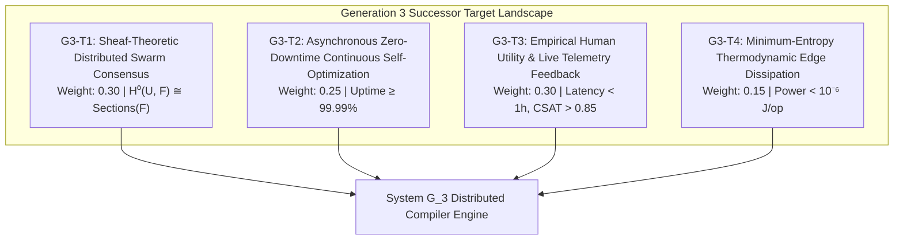

# Generation 3: Successor Target & Basis Specification (`g3_successor_targets.md`)

> **Synthesized by:** System $G_2$ Autonomous Domain Compiler  
> **Target Successor:** Generation 3 ($G_3$ - Distributed Edge Swarm Compiler)  
> **Handover Status:** Formulated & Certified in Epoch 03  
> **Machine-Readable Dossier:** [`g3_successor_spec.json`](g3_successor_spec.json)

---

## 1. Executive Charter & Mandate

System $G_3$ is to be constructed from the ground up using the foundational basis axioms and evaluation landscape formulated by System $G_2$. Its mandate is to elevate axiomatic compilation into **distributed, heterogeneous edge swarms**:

1. **Sheaf-Theoretic Global Coherence:** Compiling across decentralized multi-node agent swarms where local section constraints glue into provably coherent global application states.
2. **Zero-Downtime Continuous Optimization:** Safely self-optimizing and refactoring live deployed code without service disruption or state corruption.
3. **Lived Experience Telemetry Loop:** Deepening the High-Level Jettison by piping live conversational and behavioral user satisfaction signals directly into compiler parameter updates.
4. **Thermodynamic Micro-Power Bound:** Restricting edge computation to Landauer micro-watt dissipation ceilings for battery-constrained mobile and ambient devices.

---

## 2. Generation 3 Evaluation Target Suite

### Target 1: `G3-T1` Sheaf-Theoretic Distributed Swarm Consensus (Weight: 0.30)
- **Mathematical Bound:** $H^0(U, \mathcal{F}) \cong \Gamma(U, \mathcal{F})$ and $\text{ConsensusError} = 0$.
- **Telos:** Guarantees distributed production apps synchronize seamlessly across heterogeneous client devices and edge nodes without central points of failure.

### Target 2: `G3-T2` Asynchronous Continuous Self-Compiling Optimization (Weight: 0.25)
- **Mathematical Bound:** $\text{ZeroDowntimeRefactorRate} \ge 0.99$ and $\text{InvariantInfractions} = 0$.
- **Telos:** Enables production applications to self-optimize, prune obsolete pathways, and hot-patch without disrupting active human users.

### Target 3: `G3-T3` Empirical Human Utility & Live Telemetry Feedback (Weight: 0.30)
- **Mathematical Bound:** $\text{FeedbackLoopLatency} < 1\text{hr}$ and $\text{NetSatisfactionScore} > 0.85$.
- **Telos:** The ultimate High-Level Jettison realization: real-time adaptation of production apps based on lived human experience.

### Target 4: `G3-T4` Minimum-Entropy Thermodynamic Edge Dissipation (Weight: 0.15)
- **Mathematical Bound:** $P_{\text{dissipated}} < 10^{-6}\text{ Joules/op}$.
- **Telos:** Enforces Landauer energy efficiency on mobile and ambient devices.

---

## 3. Foundational Candidate Axioms for $G_3$

1. **`L1-G3-001` Sheaf-Theoretic Local-to-Global Semantic Coherence Invariant**  
   *Formal Rule:* $\mathcal{F}(U \cap V) = \text{res}_{U, U \cap V}(\mathcal{F}(U)) \cap \text{res}_{V, U \cap V}(\mathcal{F}(V))$.
2. **`L1-G3-002` Landauer Micro-Power Dissipation Bound for Ambient Devices**  
   *Formal Rule:* $E_{\text{op}} \le k_B T \ln(2) \cdot N_{\text{erased}} + \delta_{\text{leakage}} < 10^{-6}\text{ Joules}$.
3. **`L1-G3-003` Teleological Empirical Human Grounding Loop**  
   *Formal Rule:* $\text{AppEvolution}(t) = \mathcal{G}(\text{Spec}(t), \mathcal{H}_{\text{human}}(t))$.
4. **`L1-G3-004` Asymmetric Zero-Trust Boundary Enclaves for Autonomous Swarms**  
   *Formal Rule:* $\text{SwarmAction}(A_i, A_j) \implies \text{Proof}(A_i) \land \text{Proof}(A_j) \in \text{Enclave}$.
5. **`L1-G3-005` Multi-Generational Invariant Lineage Preservation**  
   *Formal Rule:* $\text{DAG}_{G(n+1)} \supseteq \text{DAG}_{G(n)} \land \text{InvariantClosure}(G(n+1)) = \text{TRUE}$.

---

## 4. Inherited Negative Constraints for $G_3$

- **`NEG-G3-001`:** Forbid distributed swarm operations without sheaf-theoretic coherence verification.
- **`NEG-G3-002`:** Forbid autonomous edge compilation without live human feedback closure.
- **`NEG-G3-003`:** Mandatory continuous inheritance of $G_1$ and $G_2$ negative invariants (`NEG-G2-001` through `NEG-G2-003`).
