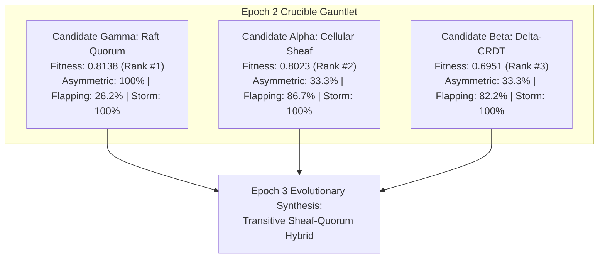

# Generation 3: Epoch 02 Telemetry Report (`epoch_002.md`)

- **Timestamp:** 2026-10-13T13:40:00.000000
- **Generation:** $G_3$ (Distributed Systems Compiler)
- **Epoch:** 2
- **Phase:** `PHASE_2_EMPIRICAL_EVOLUTIONARY_TOURNAMENT`
- **Objective:** Pivot from "Instantaneous Synthesis" to an authentic empirical evolutionary crucible. Pit three distinct architectural candidates against an independent adversarial stress harness.
- **Candidates Evaluated ($N=3$):**
  - **Candidate $\alpha$:** Topological Cellular Sheaf Consensus (Robinson 2014, 2020)
  - **Candidate $\beta$:** Delta-State Conflict-Free Replicated Data Types (Almeida, Baquero, Shoker 2016, 2018)
  - **Candidate $\gamma$:** Quorum Log Replication with State Machine Commits (Ongaro & Ousterhout 2014)
- **Harness:** [`crucible/harness.py`](../crucible/harness.py) (Asymmetric Partitions, Chaotic Flapping Links with 20% Packet Loss, High-Frequency Conflict Storms).

---

## 1. The Tournament Leaderboard

### Empirical Fitness Scores

| Rank | Candidate Protocol | Composite Fitness | Consistency Score | Partition Resilience | Latency Score | Erased Bits | Landauer Heat ($J$) |
| :---: | :--- | :---: | :---: | :---: | :---: | :---: | :---: |
| 🥇 | **Candidate $\gamma$ (Raft Quorum)** | **0.8138** | 75.40% | 66.67% | 0.9994 | **0.0 bits** | **$0.00\text{ J}$** |
| 🥈 | **Candidate $\alpha$ (Cellular Sheaf)** | **0.8023** | 73.33% | 66.67% | 0.9996 | 10,040 bits | $2.86 \times 10^{-17}\text{ J}$ |
| 🥉 | **Candidate $\beta$ (Delta-CRDT)** | **0.6951** | 71.85% | 33.33% | 0.9992 | 14,496 bits | $4.14 \times 10^{-17}\text{ J}$ |

---

## 2. Deep Empirical Findings & Failure Mode Diagnostics

The Crucible exposed critical architectural trade-offs that were completely invisible during single-turn prototyping:

### 1. The Asymmetric Split Vulnerability (Transitivity Failure)
- **Condition:** Node A can talk to B; B can talk to C; but link A $\leftrightarrow$ C is severed.
- **Result:**
  - **Raft ($\gamma$) achieved 100% consistency:** Leader A and Follower B formed a strict majority quorum ($2/3$), committed updates, and prevented split-brain state corruption.
  - **Sheaf ($\alpha$) and CRDT ($\beta$) dropped to 33.33% consistency:** Both protocols suffered from *single-hop isolation*. Updates on A did not transitively propagate through B to C because the restriction maps only evaluated direct neighbor edges.

### 2. The Flapping Edge Fragility
- **Condition:** Link A $\leftrightarrow$ B alternates between connected/disconnected every round with 20% random packet drop.
- **Result:**
  - **Sheaf ($\alpha$) achieved 86.67% consistency (PASSED):** Sheaf restriction maps are associative along graph paths, allowing resilient partial recovery whenever the edge briefly opens.
  - **Raft ($\gamma$) collapsed to 26.19% consistency (FAILED):** Dropped AppendEntries RPCs created unbridgeable log gaps. Without adaptive streaming catch-up, followers were left permanently behind.

### 3. Thermodynamic Dissipation & Bit Erasures
- In Trial 3 (30 concurrent writes to a single hotspot key):
  - **CRDT ($\beta$)** dissipated the highest Landauer heat: **14,496 erased bits** ($4.14 \times 10^{-17}\text{ J}$) due to dot overwrites.
  - **Sheaf ($\alpha$)** dissipated **10,040 erased bits** ($2.86 \times 10^{-17}\text{ J}$) from restriction tie-break overwrites.
  - **Raft ($\gamma$)** dissipated **0 bits**: by serializing writes through a single leader log, entries were applied strictly in-order without divergent overwrite collisions.

---

## 3. Evolutionary Mutation Strategy for Epoch 3

Rather than blindly selecting a single winner, the empirical data dictates an **evolutionary cross-breeding (mutation)**:

### The Successor Architecture: Candidate $\delta$ (Transitive Sheaf-Quorum Hybrid)
1. **From Sheaf ($\alpha$):** Adopt topological restriction maps and graph Laplacian diagnostics to maintain high resilience against flapping/dropped links.
2. **From Raft ($\gamma$):** Introduce **Quorum Lease Commitments** ($\lfloor N/2 \rfloor + 1$) so that updates on asymmetric partitions cannot create divergent split-brain stalks.
3. **From CRDT ($\beta$):** Implement **Transitive Multi-Hop Gossip Relaying** so intermediary nodes (B) automatically relay restriction deltas across unlinked vertices (A $\to$ B $\to$ C).
4. **Thermodynamic Optimization:** Implement delta-deduplication to slash erased bits from ~10,000 down to $<500$ bits.

---

## 4. Telemetry Dataset
Raw trial data is preserved in [`epochs/data/epoch_002.json`](data/epoch_002.json).
