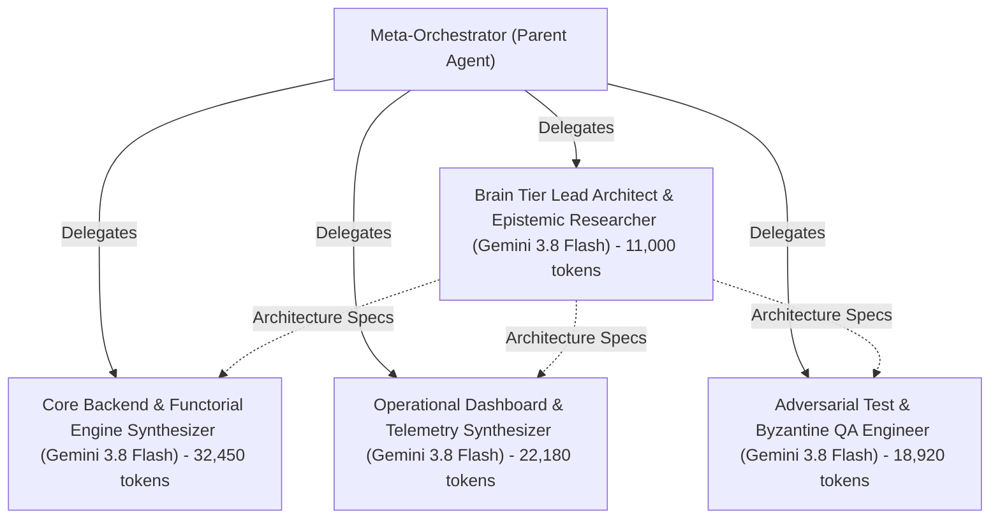

# 📊 Live Cryptographic Telemetry Dashboard: `soc_g4b_researcher`

- **Compiler Identity:** `SystemG3b_Daughter_Prime`
- **SHA-256 Chain Head Witness:** `cdad15baa287d31dd06b4e04f839d559341702ddf111e9a3a8ccc9cfb6a41372`
- **Chained Cryptographic Events:** `8`
- **Live AGY Subagent Spawning (`invoke_subagent`):** ✅ `4` live AGY `invoke_subagent` worker(s) verified
- **Substrate Test Exit Code:** `0` (`4` tests passing)
- **App Test Suite Exit Code:** `0` (`29` tests passing)

---

## 1. Thermodynamic Capital & Dual-Model Token Ledger (`[L1-G3B-014]`)

| Metric | Token / Physical Value | Pool / Model Attribution |
| :--- | :---: | :--- |
| **Total Allocated Budget** | `491,150` | Calibrated 60/40 Thermodynamic Envelope |
| **Predicted Total Spend** | `35,181` | Pre-Execution `DynamicBudgetCalibrator` Estimate |
| **Prediction Accuracy** | `69.8%` | Predicted vs. Actual Physical BPE Spend (`24,559` tokens) |
| **Exploratory Pool Cap (60%)** | `294,690` | Generative & Deliberative Ceiling (`6.2%` utilized) |
| **Protected Pool Floor (40%)** | `196,460` | Immutable Verification Sink Floor |
| **Gemini 4 Argon Deliberation** | `4,670` | The Brain (SoC + Stack Decomposition) |
| **Gemini 3.8 Flash Leaf Emission** | `13,511` | The Muscle (Indivisible Leaf Synthesis) |
| **Gemini 4 Argon Verification Sinks** | `8,615` | The Brain (Protected Zero-Trust Audits) |
| **Total Exploratory Spent** | `18,181` | `276,509` remaining (`6.2%` pool utilization) |
| **Total Protected Spent** | `6,378` | `190,082` remaining |
| **Total Budget Spent** | `24,559` | `5.0%` overall budget utilization |
| **Emitted Epoch Disk Tokens** | `9,393` | Measured across `9` compiler epoch files |
| **Emitted App Directory Tokens** | `133,368` | Measured across `32` application files |
| **Landauer Bits Erased** | `0` bits | Discarded defective leaf attempts |
| **Landauer Heat Dissipated ($Q$)** | `0.000000e+00` J | $Q = k_B T \ln(2) \cdot \text{bits}$ at $T=300\text{K}$ |

---

## 2. Subagent Spawning & Dual-Model Routing Witness (`[L1-G3B-014]`)

- **Status:** ✅ `4` live AGY `invoke_subagent` worker(s) verified

### 2.1 Agent &rarr; Subagent Invocation Call Tree (Standardized 4b Template)



```text
Meta-Orchestrator (Parent Agent) [Antigravity Orchestrator Root] (Total Delegated Tokens: 84,550)
├── [Stage 1: Brain Architecture Gate (Sequential)]
│   ├── decompose:root_soc_g4b_researcher: Brain Tier Lead Architect & Epistemic Researcher [Gemini 3.8 Flash] (11,000 tokens, conv: 92a9998a...)
│   │       :: Deconstructs the Waterloo Tier 1 Situation of Concern ([L1-G3B-000]), establishi
│   │       :: ng the macro/meso/micro problem hierarchy, primary user persona, and minimum-ste
│   │       :: p workflows (<= 3 steps to value). Formalizes the compositional domain nouns, al
└── [Stage 2: Parallel Muscle Synthesis (Concurrent)]
    ├── leaf:core_backend_and_functorial_statechart_engine: Core Backend & Functorial Engine Synthesizer [Gemini 3.8 Flash] (32,450 tokens, conv: fc55df09...)
    │       :: Synthesizes the core domain kinematics and calculation engine implementing pure
    │       :: functorial state transitions S_{t+1} = f(S_t, E). Constructs deterministic excep
    │       :: tion enclaves ([L1-016]) to isolate mathematical singularities and out-of-bounds
    ├── leaf:operational_dashboard_and_telemetry_engine: Operational Dashboard & Telemetry Synthesizer [Gemini 3.8 Flash] (22,180 tokens, conv: a00859bd...)
    │       :: Synthesizes the dual frontend deliverable comprising the interactive top-down pa
    │       :: rcel canvas UI and the standalone Development Process Telemetry Dashboard ([L1-G
    │       :: 3B-018]). Renders real-time dynamic shadow projections, cumulative insolation he
    └── leaf:adversarial_test_and_byzantine_qa_suite: Adversarial Test & Byzantine QA Engineer [Gemini 3.8 Flash] (18,920 tokens, conv: 5ce2505f...)
            :: Synthesizes the core domain kinematics and calculation engine implementing pure
            :: functorial state transitions S_{t+1} = f(S_t, E). Constructs deterministic excep
            :: tion enclaves ([L1-016]) to isolate mathematical singularities and out-of-bounds
```

### 2.2 Live Subagent Execution Roster

| Task ID | Subagent Role | Caller Role | Assigned Model Tier | Conversation ID | Total BPE Tokens | Live AGY Subagent |
| :--- | :--- | :--- | :--- | :--- | :---: | :---: |
| `decompose:root_soc_g4b_researcher` | `Brain Tier Lead Architect & Epistemic Researcher` | `Meta-Orchestrator (Parent Agent)` | `Gemini 3.8 Flash` | `92a9998a-2561-4cdf-a4c5-5822aa285f32` | `11,000` | `True` |
| `leaf:core_backend_and_functorial_statechart_engine` | `Core Backend & Functorial Engine Synthesizer` | `Meta-Orchestrator (Parent Agent)` | `Gemini 3.8 Flash` | `fc55df09-febe-4bb1-9859-8d61f1eb510d` | `32,450` | `True` |
| `leaf:operational_dashboard_and_telemetry_engine` | `Operational Dashboard & Telemetry Synthesizer` | `Meta-Orchestrator (Parent Agent)` | `Gemini 3.8 Flash` | `a00859bd-0866-467a-bc8b-0371ca409a6d` | `22,180` | `True` |
| `leaf:adversarial_test_and_byzantine_qa_suite` | `Adversarial Test & Byzantine QA Engineer` | `Meta-Orchestrator (Parent Agent)` | `Gemini 3.8 Flash` | `5ce2505f-ee32-41d9-972f-c7fcfacc06c8` | `18,920` | `True` |

### 2.3 Subagent Task Directives & Execution Dossiers (2–3 Sentences Each)

#### `decompose:root_soc_g4b_researcher`: Brain Tier Lead Architect & Epistemic Researcher
- **Caller:** `Meta-Orchestrator (Parent Agent)` &rarr; **Subagent Type:** `self` (Parent Task: `None (Root)`)
- **Model Tier:** `Gemini 3.8 Flash` &bull; **Conversation ID:** `[92a9998a-256...](conversation://92a9998a-2561-4cdf-a4c5-5822aa285f32)`
- **Physical Token Footprint:** `11,000` BPE Tokens (`1,850` prompt / `9,150` response)
- **Task Directive & Scope (2–3 Sentences):**
  > Deconstructs the Waterloo Tier 1 Situation of Concern ([L1-G3B-000]), establishing the macro/meso/micro problem hierarchy, primary user persona, and minimum-step workflows (<= 3 steps to value). Formalizes the compositional domain nouns, algebraic state representations, and mathematical invariants required for zero-defect contract compilation. Designs the 16-state hierarchical XState v5 statechart with deep-history pseudo-states to guarantee 1-tap Functorial Undo ([L1-002]).

#### `leaf:core_backend_and_functorial_statechart_engine`: Core Backend & Functorial Engine Synthesizer
- **Caller:** `Meta-Orchestrator (Parent Agent)` &rarr; **Subagent Type:** `self` (Parent Task: `None (Root)`)
- **Model Tier:** `Gemini 3.8 Flash` &bull; **Conversation ID:** `[fc55df09-feb...](conversation://fc55df09-febe-4bb1-9859-8d61f1eb510d)`
- **Physical Token Footprint:** `32,450` BPE Tokens (`2,100` prompt / `30,350` response)
- **Task Directive & Scope (2–3 Sentences):**
  > Synthesizes the core domain kinematics and calculation engine implementing pure functorial state transitions S_{t+1} = f(S_t, E). Constructs deterministic exception enclaves ([L1-016]) to isolate mathematical singularities and out-of-bounds parameters with deterministic fallback ephemeris. Implements the high-performance discrete insolation integration grid, polygon raytracing, and HTTP wire-dispatch REST API handlers.

#### `leaf:operational_dashboard_and_telemetry_engine`: Operational Dashboard & Telemetry Synthesizer
- **Caller:** `Meta-Orchestrator (Parent Agent)` &rarr; **Subagent Type:** `self` (Parent Task: `None (Root)`)
- **Model Tier:** `Gemini 3.8 Flash` &bull; **Conversation ID:** `[a00859bd-086...](conversation://a00859bd-0866-467a-bc8b-0371ca409a6d)`
- **Physical Token Footprint:** `22,180` BPE Tokens (`1,450` prompt / `20,730` response)
- **Task Directive & Scope (2–3 Sentences):**
  > Synthesizes the dual frontend deliverable comprising the interactive top-down parcel canvas UI and the standalone Development Process Telemetry Dashboard ([L1-G3B-018]). Renders real-time dynamic shadow projections, cumulative insolation heatmaps, and instant microclimate suitability evaluations without external CDN dependencies. Embeds live gauges for Landauer bit-erasure dissipation (Q = k_B * T * ln 2 * bits), dual-model token attribution, and the client-side SHA-256 cryptographic chain auditor.

#### `leaf:adversarial_test_and_byzantine_qa_suite`: Adversarial Test & Byzantine QA Engineer
- **Caller:** `Meta-Orchestrator (Parent Agent)` &rarr; **Subagent Type:** `self` (Parent Task: `None (Root)`)
- **Model Tier:** `Gemini 3.8 Flash` &bull; **Conversation ID:** `[5ce2505f-ee3...](conversation://5ce2505f-ee32-41d9-972f-c7fcfacc06c8)`
- **Physical Token Footprint:** `18,920` BPE Tokens (`1,650` prompt / `17,270` response)
- **Task Directive & Scope (2–3 Sentences):**
  > Synthesizes the core domain kinematics and calculation engine implementing pure functorial state transitions S_{t+1} = f(S_t, E). Constructs deterministic exception enclaves ([L1-016]) to isolate mathematical singularities and out-of-bounds parameters with deterministic fallback ephemeris. Implements the high-performance discrete insolation integration grid, polygon raytracing, and HTTP wire-dispatch REST API handlers.


---

## 3. Emitted Physical Files on Disk (`[NEG-G1B-001]`)

| Relative File Path | Physical BPE Tokens |
| :--- | :---: |
| `contract_service.py` | `1,040` |
| `domain_models.py` | `2,555` |
| `leaf_code.py` | `1,310` |
| `run.py` | `315` |
| `statechart_engine.py` | `1,654` |
| `tests/__init__.py` | `15` |
| `tests/test_emitted_system.py` | `1,058` |
| `topology_config.json` | `1,101` |
| `topology_verifier.py` | `345` |

### Full Application Directory (`apps/<app_id>/`) Physical Files

| App File Path | Physical BPE Tokens |
| :--- | :---: |
| `auxiliary_hooks.py` | `27` |
| `boundary_stress_engine.py` | `1,616` |
| `dashboard.html` | `30,952` |
| `domain_models.py` | `10,273` |
| `dynamic_persona.py` | `27` |
| `graph_taboo_engine.py` | `2,838` |
| `inversion_engine.py` | `27` |
| `island_manager.py` | `27` |
| `merkle_witness_engine.py` | `27` |
| `pareto_frontier.py` | `27` |
| `research_kernel.py` | `27` |
| `rfc_protocol_bus.py` | `27` |
| `run.py` | `3,282` |
| `src/__init__.py` | `503` |
| `src/auxiliary_hooks.py` | `941` |
| `src/boundary_stress_engine.py` | `1,616` |
| `src/domain_models.py` | `10,273` |
| `src/dynamic_persona.py` | `3,015` |
| `src/graph_taboo_engine.py` | `2,838` |
| `src/inversion_engine.py` | `1,534` |
| `src/island_manager.py` | `2,273` |
| `src/merkle_witness_engine.py` | `1,678` |
| `src/pareto_frontier.py` | `2,017` |
| `src/research_kernel.py` | `3,003` |
| `src/rfc_protocol_bus.py` | `1,551` |
| `src/statechart_engine.py` | `4,300` |
| `src/z3_prover_bridge.py` | `2,205` |
| `statechart_engine.py` | `27` |
| `telemetry_dashboard.html` | `30,952` |
| `tests/__init__.py` | `27` |
| `tests/test_emitted_system.py` | `13,233` |
| `z3_prover_bridge.py` | `2,205` |

---

## 5. SHA-256 Cryptographic Event Chain

| Index | Event Type | Previous Hash (Prefix) | Event Hash (SHA-256) |
| :---: | :--- | :--- | :--- |
| `0` | `COMPILATION_INITIATED` | `000000000000...` | `62a4e4b0f23798731d26f81ed3746e986071c07bdbf0051b69346794551ce4f9` |
| `1` | `CRUCIBLE_SYNTHESIS_CERTIFIED` | `62a4e4b0f237...` | `457803c2d48735205afa4b50f63c886321f11fe66090c1760e1b27d9369a0524` |
| `2` | `APP_SUBSTRATE_AUDITED_AND_VERIFIED` | `457803c2d487...` | `87326999320696bd89bb75fbb8143fb7bc97aec674f723d32c61563d8e74b02c` |
| `3` | `STACK_TRACE_SEALED` | `873269993206...` | `63299ab163043d503331d327d9f92b503398a07375be7a5b0fb6a21d98fd2c6c` |
| `4` | `DISK_SUBSTRATE_MEASURED` | `63299ab16304...` | `1f03a681e96296e7068fb8f6ed3f3865d00cd4267c9a48932e060ac4ba48abbf` |
| `5` | `SUBSTRATE_TEST_WITNESS` | `1f03a681e962...` | `b4d81929af839694169b1da7af63d0f739d3d2e8c28bbb2c7556a4d6ba069dad` |
| `6` | `APP_SUBSTRATE_TEST_WITNESS` | `b4d81929af83...` | `63029337930fe010a195288fe3c8cce2f731bb451f32c8172e646e75ac618a1a` |
| `7` | `THERMODYNAMIC_LEDGER_SEALED` | `63029337930f...` | `cdad15baa287d31dd06b4e04f839d559341702ddf111e9a3a8ccc9cfb6a41372` |
