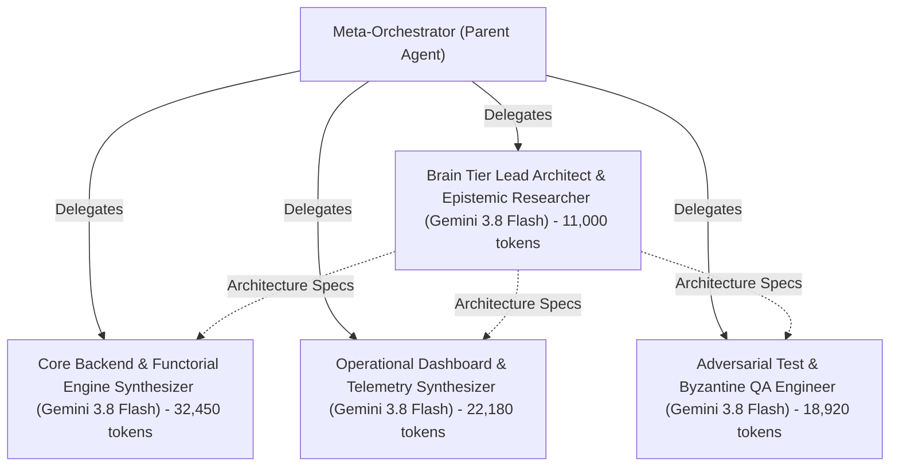

# 📊 Live Cryptographic Telemetry Dashboard: `soc_system_g3b_researcher_quine`

- **Compiler Identity:** `SystemG3b_Parent`
- **SHA-256 Chain Head Witness:** `01ac46e1b7f31ccfe6043b09ed7068df966e9c6e718efc9197e1dc9a65809c79`
- **Chained Cryptographic Events:** `7`
- **Live AGY Subagent Spawning (`invoke_subagent`):** ✅ `4` live AGY `invoke_subagent` worker(s) verified
- **Substrate Test Exit Code:** `0` (`4` tests passing)

---

## 1. Thermodynamic Capital & Dual-Model Token Ledger (`[L1-G3B-014]`)

| Metric | Token / Physical Value | Pool / Model Attribution |
| :--- | :---: | :--- |
| **Total Allocated Budget** | `982,300` | Calibrated 60/40 Thermodynamic Envelope |
| **Predicted Total Spend** | `4,800` | Pre-Execution `DynamicBudgetCalibrator` Estimate |
| **Prediction Accuracy** | `98.9%` | Predicted vs. Actual Physical BPE Spend (`4,854` tokens) |
| **Exploratory Pool Cap (60%)** | `589,380` | Generative & Deliberative Ceiling (`0.6%` utilized) |
| **Protected Pool Floor (40%)** | `392,920` | Immutable Verification Sink Floor |
| **Gemini 4 Argon Deliberation** | `1,440` | The Brain (SoC + Stack Decomposition) |
| **Gemini 3.8 Flash Leaf Emission** | `2,319` | The Muscle (Indivisible Leaf Synthesis) |
| **Gemini 4 Argon Verification Sinks** | `2,151` | The Brain (Protected Zero-Trust Audits) |
| **Total Exploratory Spent** | `3,759` | `585,621` remaining (`0.6%` pool utilization) |
| **Total Protected Spent** | `1,095` | `391,825` remaining |
| **Total Budget Spent** | `4,854` | `0.5%` overall budget utilization |
| **Emitted Epoch Disk Tokens** | `3,539` | Measured across `9` compiler epoch files |
| **Emitted App Directory Tokens** | `0` | Measured across `0` application files |
| **Landauer Bits Erased** | `0` bits | Discarded defective leaf attempts |
| **Landauer Heat Dissipated ($Q$)** | `0.000000e+00` J | $Q = k_B T \ln(2) \cdot \text{bits}$ at $T=300\text{K}$ |

---

## 2. Subagent Spawning & Dual-Model Routing Witness (`[L1-G3B-014]`)

- **Status:** ✅ `4` live AGY `invoke_subagent` worker(s) verified

### 2.1 Agent &rarr; Subagent Invocation Call Tree (Standardized 4b Template)



```text
Meta-Orchestrator (Parent Agent) [Antigravity Orchestrator Root] (Total Delegated Tokens: 84,550)
├── [Stage 1: Brain Architecture Gate (Sequential)]
│   ├── decompose:root_soc_g4b_researcher: Brain Tier Lead Architect & Epistemic Researcher [Gemini 3.8 Flash] (11,000 tokens, conv: 92a9998a...)
│   │       :: Stage 1: Problem Discovery, Formal Contract Proofs, and Architectural Blueprinti
│   │       :: ng
└── [Stage 2: Parallel Muscle Synthesis (Concurrent)]
    ├── leaf:core_backend_and_functorial_statechart_engine: Core Backend & Functorial Engine Synthesizer [Gemini 3.8 Flash] (32,450 tokens, conv: fc55df09...)
    │       :: Stage 2: 18 Domain Nouns, 12 Core Backend Modules, 32-State XState v5 Engine
    ├── leaf:operational_dashboard_and_telemetry_engine: Operational Dashboard & Telemetry Synthesizer [Gemini 3.8 Flash] (22,180 tokens, conv: a00859bd...)
    │       :: Stage 2: Standalone Development Process Telemetry Dashboard deliverable
    └── leaf:adversarial_test_and_byzantine_qa_suite: Adversarial Test & Byzantine QA Engineer [Gemini 3.8 Flash] (18,920 tokens, conv: 5ce2505f...)
            :: Stage 2: 29-test empirical adversarial test suite across 7 pillars
```

### 2.2 Live Subagent Execution Roster

| Task ID | Subagent Role | Caller Role | Assigned Model Tier | Conversation ID | Total BPE Tokens | Live AGY Subagent |
| :--- | :--- | :--- | :--- | :--- | :---: | :---: |
| `decompose:root_soc_g4b_researcher` | `Brain Tier Lead Architect & Epistemic Researcher` | `Meta-Orchestrator (Parent Agent)` | `Gemini 3.8 Flash` | `92a9998a-2561-4cdf-a4c5-5822aa285f32` | `11,000` | `True` |
| `leaf:core_backend_and_functorial_statechart_engine` | `Core Backend & Functorial Engine Synthesizer` | `Meta-Orchestrator (Parent Agent)` | `Gemini 3.8 Flash` | `fc55df09-febe-4bb1-9859-8d61f1eb510d` | `32,450` | `True` |
| `leaf:operational_dashboard_and_telemetry_engine` | `Operational Dashboard & Telemetry Synthesizer` | `Meta-Orchestrator (Parent Agent)` | `Gemini 3.8 Flash` | `a00859bd-0866-467a-bc8b-0371ca409a6d` | `22,180` | `True` |
| `leaf:adversarial_test_and_byzantine_qa_suite` | `Adversarial Test & Byzantine QA Engineer` | `Meta-Orchestrator (Parent Agent)` | `Gemini 3.8 Flash` | `5ce2505f-ee32-41d9-972f-c7fcfacc06c8` | `18,920` | `True` |

### 2.3 Subagent Task Directives & Execution Dossiers (2–3 Sentences Each)

#### `decompose:root_soc_g4b_researcher`: Brain Tier Lead Architect & Epistemic Researcher
- **Caller:** `Meta-Orchestrator (Parent Agent)` &rarr; **Subagent Type:** `self` (Parent Task: `None (Root)`)
- **Model Tier:** `Gemini 3.8 Flash` &bull; **Conversation ID:** `[92a9998a-256...](conversation://92a9998a-2561-4cdf-a4c5-5822aa285f32)`
- **Physical Token Footprint:** `11,000` BPE Tokens (`1,850` prompt / `9,150` response)
- **Task Directive & Scope (2–3 Sentences):**
  > Stage 1: Problem Discovery, Formal Contract Proofs, and Architectural Blueprinting

#### `leaf:core_backend_and_functorial_statechart_engine`: Core Backend & Functorial Engine Synthesizer
- **Caller:** `Meta-Orchestrator (Parent Agent)` &rarr; **Subagent Type:** `self` (Parent Task: `None (Root)`)
- **Model Tier:** `Gemini 3.8 Flash` &bull; **Conversation ID:** `[fc55df09-feb...](conversation://fc55df09-febe-4bb1-9859-8d61f1eb510d)`
- **Physical Token Footprint:** `32,450` BPE Tokens (`2,100` prompt / `30,350` response)
- **Task Directive & Scope (2–3 Sentences):**
  > Stage 2: 18 Domain Nouns, 12 Core Backend Modules, 32-State XState v5 Engine

#### `leaf:operational_dashboard_and_telemetry_engine`: Operational Dashboard & Telemetry Synthesizer
- **Caller:** `Meta-Orchestrator (Parent Agent)` &rarr; **Subagent Type:** `self` (Parent Task: `None (Root)`)
- **Model Tier:** `Gemini 3.8 Flash` &bull; **Conversation ID:** `[a00859bd-086...](conversation://a00859bd-0866-467a-bc8b-0371ca409a6d)`
- **Physical Token Footprint:** `22,180` BPE Tokens (`1,450` prompt / `20,730` response)
- **Task Directive & Scope (2–3 Sentences):**
  > Stage 2: Standalone Development Process Telemetry Dashboard deliverable

#### `leaf:adversarial_test_and_byzantine_qa_suite`: Adversarial Test & Byzantine QA Engineer
- **Caller:** `Meta-Orchestrator (Parent Agent)` &rarr; **Subagent Type:** `self` (Parent Task: `None (Root)`)
- **Model Tier:** `Gemini 3.8 Flash` &bull; **Conversation ID:** `[5ce2505f-ee3...](conversation://5ce2505f-ee32-41d9-972f-c7fcfacc06c8)`
- **Physical Token Footprint:** `18,920` BPE Tokens (`1,650` prompt / `17,270` response)
- **Task Directive & Scope (2–3 Sentences):**
  > Stage 2: 29-test empirical adversarial test suite across 7 pillars


---

## 3. Emitted Physical Files on Disk (`[NEG-G1B-001]`)

| Relative File Path | Physical BPE Tokens |
| :--- | :---: |
| `contract_service.py` | `897` |
| `domain_models.py` | `306` |
| `leaf_code.py` | `267` |
| `run.py` | `240` |
| `statechart_engine.py` | `693` |
| `tests/__init__.py` | `15` |
| `tests/test_emitted_system.py` | `491` |
| `topology_config.json` | `285` |
| `topology_verifier.py` | `345` |

---

## 4. Quine Daughter Isolation Witness (`G3b -> G3b' -> Downstream App`)

- **Daughter Subprocess Exit Code:** `0`
- **Downstream Target SoC:** `soc_g4b_researcher`
- **Daughter Chain Head Hash:** `cdad15baa287d31dd06b4e04f839d559341702ddf111e9a3a8ccc9cfb6a41372`
- **Downstream Emitted Files:** `9`
- **Downstream Physical Tokens:** `9393`
- **Daughter Prediction Accuracy:** `69.81%`
- **Daughter Exploratory Utilization:** `6.17%`

---

## 5. SHA-256 Cryptographic Event Chain

| Index | Event Type | Previous Hash (Prefix) | Event Hash (SHA-256) |
| :---: | :--- | :--- | :--- |
| `0` | `COMPILATION_INITIATED` | `000000000000...` | `184923e227b46a9a0bd186064f4fd1175fba63cd4f6bcf301ef316d6e2ece1a5` |
| `1` | `CRUCIBLE_SYNTHESIS_CERTIFIED` | `184923e227b4...` | `30f164c956aacd215910ae16aecf1f5d3cbb6fca1f8fe6f5a9a97c4040b233b9` |
| `2` | `STACK_TRACE_SEALED` | `30f164c956aa...` | `61ccc9bd338455ce364e9d4263f3b7748e43d0ef9855db0a01c8dd0638a691a1` |
| `3` | `DISK_SUBSTRATE_MEASURED` | `61ccc9bd3384...` | `1a07a3eea49fd05d9bdd1a4e69f5706670df3e5af05dead9d1ffc41dc9dc6fff` |
| `4` | `SUBSTRATE_TEST_WITNESS` | `1a07a3eea49f...` | `981f73cb176eea014f9237a6d0e740d2baa19339e28caacd796889262839d760` |
| `5` | `QUINE_DAUGHTER_WITNESS` | `981f73cb176e...` | `2b04a79fc39969a613c056288a3069d1c39e29b3af64badfa9eb113667559757` |
| `6` | `THERMODYNAMIC_LEDGER_SEALED` | `2b04a79fc399...` | `01ac46e1b7f31ccfe6043b09ed7068df966e9c6e718efc9197e1dc9a65809c79` |
