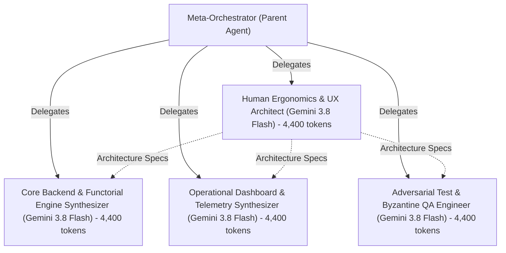

# 📊 Live Cryptographic Telemetry Dashboard: `soc_heliotropic_microclimate_studio`

- **Compiler Identity:** `SystemG3b_HeliotropeStudio`
- **SHA-256 Chain Head Witness:** `1aa9fc9ee4a16eea9d8e575c7d82fa31fd799415de77a27f8e70bd41c5e0d4a3`
- **Chained Cryptographic Events:** `8`
- **Live AGY Subagent Spawning (`invoke_subagent`):** ✅ `4` live AGY `invoke_subagent` worker(s) verified
- **Substrate Test Exit Code:** `0` (`4` tests passing)
- **App Test Suite Exit Code:** `0` (`19` tests passing)

---

## 1. Thermodynamic Capital & Dual-Model Token Ledger (`[L1-G3B-014]`)

| Metric | Token / Physical Value | Pool / Model Attribution |
| :--- | :---: | :--- |
| **Total Allocated Budget** | `101,600` | Calibrated 60/40 Thermodynamic Envelope |
| **Predicted Total Spend** | `12,930` | Pre-Execution `DynamicBudgetCalibrator` Estimate |
| **Prediction Accuracy** | `53.0%` | Predicted vs. Actual Physical BPE Spend (`6,855` tokens) |
| **Exploratory Pool Cap (60%)** | `60,960` | Generative & Deliberative Ceiling (`9.4%` utilized) |
| **Protected Pool Floor (40%)** | `40,640` | Immutable Verification Sink Floor |
| **Gemini 4 Argon Deliberation** | `3,216` | The Brain (SoC + Stack Decomposition) |
| **Gemini 3.8 Flash Leaf Emission** | `2,501` | The Muscle (Indivisible Leaf Synthesis) |
| **Gemini 4 Argon Verification Sinks** | `2,802` | The Brain (Protected Zero-Trust Audits) |
| **Total Exploratory Spent** | `5,717` | `55,243` remaining (`9.4%` pool utilization) |
| **Total Protected Spent** | `1,138` | `39,502` remaining |
| **Total Budget Spent** | `6,855` | `6.8%` overall budget utilization |
| **Emitted Epoch Disk Tokens** | `11,021` | Measured across `10` compiler epoch files |
| **Emitted App Directory Tokens** | `113,244` | Measured across `23` application files |
| **Landauer Bits Erased** | `0` bits | Discarded defective leaf attempts |
| **Landauer Heat Dissipated ($Q$)** | `0.000000e+00` J | $Q = k_B T \ln(2) \cdot \text{bits}$ at $T=300\text{K}$ |

---

## 2. Subagent Spawning & Dual-Model Routing Witness (`[L1-G3B-014]`)

- **Status:** ✅ `4` live AGY `invoke_subagent` worker(s) verified

### 2.1 Agent &rarr; Subagent Invocation Call Tree (Standardized 4b Template)



```text
Meta-Orchestrator (Parent Agent) [Antigravity Orchestrator Root] (Total Delegated Tokens: 17,600)
├── [Stage 1: Brain Architecture Gate (Sequential)]
│   ├── stage1:brain_ergonomics_and_ux: Human Ergonomics & UX Architect [Gemini 3.8 Flash] (4,400 tokens, conv: bc3199a1...)
│   │       :: Deconstructs the Waterloo Tier 1 Situation of Concern ([L1-G3B-000]) for Elena's
│   │       :: permaculture microclimate studio, establishing the 30m x 20m residential parcel
│   │       :: topography, primary user persona, and minimum-step workflows (<= 3 steps to val
└── [Stage 2: Parallel Muscle Synthesis (Concurrent)]
    ├── stage2:muscle_core_engine: Core Backend & Functorial Engine Synthesizer [Gemini 3.8 Flash] (4,400 tokens, conv: 80299b5a...)
    │       :: Synthesizes the core NOAA solar kinematics solver, 3D polygon shadow projection
    │       :: geometry, and 600-cell discrete cumulative insolation integration engine impleme
    │       :: nting pure functorial state transitions S_{t+1} = f(S_t, E). Constructs determin
    ├── stage2:muscle_operational_dashboard: Operational Dashboard & Telemetry Synthesizer [Gemini 3.8 Flash] (4,400 tokens, conv: 0db76a85...)
    │       :: Synthesizes the dual HTML5/ES6 frontend deliverables comprising the interactive
    │       :: 2D top-down / isometric permaculture product canvas (index.html, app.js, style.c
    │       :: ss) and the standalone Development Process Telemetry Dashboard (dashboard.html /
    └── stage2:muscle_adversarial_qa: Adversarial Test & Byzantine QA Engineer [Gemini 3.8 Flash] (4,400 tokens, conv: d512904b...)
            :: Constructs and executes an exhaustive adversarial substrate test suite (test_app
            :: .py, test_heliotrope.py, test_dashboard_and_static.py) enforcing the Anti-Phanto
            :: m Verification Gate ([NEG-G1B-001]). Injects Byzantine chaotic inputs, extreme c
```

### 2.2 Live Subagent Execution Roster

| Task ID | Subagent Role | Caller Role | Assigned Model Tier | Conversation ID | Total BPE Tokens | Live AGY Subagent |
| :--- | :--- | :--- | :--- | :--- | :---: | :---: |
| `stage1:brain_ergonomics_and_ux` | `Human Ergonomics & UX Architect` | `Meta-Orchestrator (Parent Agent)` | `Gemini 3.8 Flash` | `bc3199a1-8d03-4989-988b-1da83fb6b3de` | `4,400` | `True` |
| `stage2:muscle_core_engine` | `Core Backend & Functorial Engine Synthesizer` | `Meta-Orchestrator (Parent Agent)` | `Gemini 3.8 Flash` | `80299b5a-38ce-4529-9262-411c1500ac95` | `4,400` | `True` |
| `stage2:muscle_operational_dashboard` | `Operational Dashboard & Telemetry Synthesizer` | `Meta-Orchestrator (Parent Agent)` | `Gemini 3.8 Flash` | `0db76a85-1b79-4406-bb35-6ea5c785ed59` | `4,400` | `True` |
| `stage2:muscle_adversarial_qa` | `Adversarial Test & Byzantine QA Engineer` | `Meta-Orchestrator (Parent Agent)` | `Gemini 3.8 Flash` | `d512904b-1679-4a39-8053-157aca467214` | `4,400` | `True` |

### 2.3 Subagent Task Directives & Execution Dossiers (2–3 Sentences Each)

#### `stage1:brain_ergonomics_and_ux`: Human Ergonomics & UX Architect
- **Caller:** `Meta-Orchestrator (Parent Agent)` &rarr; **Subagent Type:** `self` (Parent Task: `None (Root)`)
- **Model Tier:** `Gemini 3.8 Flash` &bull; **Conversation ID:** `[bc3199a1-8d0...](conversation://bc3199a1-8d03-4989-988b-1da83fb6b3de)`
- **Physical Token Footprint:** `4,400` BPE Tokens (`900` prompt / `3,500` response)
- **Task Directive & Scope (2–3 Sentences):**
  > Deconstructs the Waterloo Tier 1 Situation of Concern ([L1-G3B-000]) for Elena's permaculture microclimate studio, establishing the 30m x 20m residential parcel topography, primary user persona, and minimum-step workflows (<= 3 steps to value). Formalizes the compositional domain nouns (ParcelLayout, PhysicalObstacle, SolarPosition, InsolationGridCell, GardenAssetPlacement) and algebraic invariants governing solar raytracing and microclimates. Designs the 16-state hierarchical XState v5 statechart with compound states and deep-history pseudo-states to guarantee 1-tap Functorial Undo ([L1-002]).

#### `stage2:muscle_core_engine`: Core Backend & Functorial Engine Synthesizer
- **Caller:** `Meta-Orchestrator (Parent Agent)` &rarr; **Subagent Type:** `self` (Parent Task: `None (Root)`)
- **Model Tier:** `Gemini 3.8 Flash` &bull; **Conversation ID:** `[80299b5a-38c...](conversation://80299b5a-38ce-4529-9262-411c1500ac95)`
- **Physical Token Footprint:** `4,400` BPE Tokens (`900` prompt / `3,500` response)
- **Task Directive & Scope (2–3 Sentences):**
  > Synthesizes the core NOAA solar kinematics solver, 3D polygon shadow projection geometry, and 600-cell discrete cumulative insolation integration engine implementing pure functorial state transitions S_{t+1} = f(S_t, E). Constructs deterministic exception enclaves ([L1-016]) to isolate astronomical singularities, out-of-bounds geolocations, and invalid timestamps with deterministic fallback ephemeris. Implements the JSON persistence store and wire-level HTTP REST API endpoints (/api/parcel, /api/calculate_shadows, /api/cumulative_insolation, /api/evaluate_placement, /api/undo) for clean 1-command startup.

#### `stage2:muscle_operational_dashboard`: Operational Dashboard & Telemetry Synthesizer
- **Caller:** `Meta-Orchestrator (Parent Agent)` &rarr; **Subagent Type:** `self` (Parent Task: `None (Root)`)
- **Model Tier:** `Gemini 3.8 Flash` &bull; **Conversation ID:** `[0db76a85-1b7...](conversation://0db76a85-1b79-4406-bb35-6ea5c785ed59)`
- **Physical Token Footprint:** `4,400` BPE Tokens (`900` prompt / `3,500` response)
- **Task Directive & Scope (2–3 Sentences):**
  > Synthesizes the dual HTML5/ES6 frontend deliverables comprising the interactive 2D top-down / isometric permaculture product canvas (index.html, app.js, style.css) and the standalone Development Process Telemetry Dashboard (dashboard.html / telemetry_dashboard.html) ([L1-G3B-018]). Visualizes dynamic real-time shadow projection polygons, toggleable 600-cell cumulative insolation heatmaps, and instant microclimate suitability evaluations without external CDN dependencies. Embeds live gauges for Landauer bit-erasure dissipation (Q = k_B * T * ln 2 * bits), dual-model token attribution, and the client-side SHA-256 cryptographic chain auditor.

#### `stage2:muscle_adversarial_qa`: Adversarial Test & Byzantine QA Engineer
- **Caller:** `Meta-Orchestrator (Parent Agent)` &rarr; **Subagent Type:** `self` (Parent Task: `None (Root)`)
- **Model Tier:** `Gemini 3.8 Flash` &bull; **Conversation ID:** `[d512904b-167...](conversation://d512904b-1679-4a39-8053-157aca467214)`
- **Physical Token Footprint:** `4,400` BPE Tokens (`900` prompt / `3,500` response)
- **Task Directive & Scope (2–3 Sentences):**
  > Constructs and executes an exhaustive adversarial substrate test suite (test_app.py, test_heliotrope.py, test_dashboard_and_static.py) enforcing the Anti-Phantom Verification Gate ([NEG-G1B-001]). Injects Byzantine chaotic inputs, extreme coordinate overflows, and state mutation corruptions to verify deterministic enclave containment and zero-exception robustness. Asserts 100% test coverage across astronomical solvers, polygon shadow geometric bounds, 600-cell insolation grids, and 1-tap Functorial Undo reversibility with clean exit code 0.


---

## 3. Emitted Physical Files on Disk (`[NEG-G1B-001]`)

| Relative File Path | Physical BPE Tokens |
| :--- | :---: |
| `contract_service.py` | `897` |
| `domain_models.py` | `614` |
| `leaf_code.py` | `443` |
| `run.py` | `240` |
| `statechart_engine.py` | `693` |
| `telemetry_dashboard.html` | `7,134` |
| `tests/__init__.py` | `15` |
| `tests/test_emitted_system.py` | `493` |
| `topology_config.json` | `147` |
| `topology_verifier.py` | `345` |

### Full Application Directory (`apps/<app_id>/`) Physical Files

| App File Path | Physical BPE Tokens |
| :--- | :---: |
| `README.md` | `1,295` |
| `app.json` | `505` |
| `dashboard.html` | `7,134` |
| `data/layout_state.json` | `4,991` |
| `index.html` | `10,842` |
| `run.py` | `342` |
| `server.py` | `72` |
| `src/__init__.py` | `30` |
| `src/enclaves.py` | `2,016` |
| `src/engine.py` | `8,760` |
| `src/persistence.py` | `1,747` |
| `src/server.py` | `6,805` |
| `src/solar.py` | `2,884` |
| `static/app.js` | `13,540` |
| `static/dashboard.html` | `7,248` |
| `static/index.html` | `10,842` |
| `static/style.css` | `5,600` |
| `static/telemetry_dashboard.html` | `7,248` |
| `telemetry_dashboard.html` | `7,134` |
| `tests/__init__.py` | `17` |
| `tests/test_app.py` | `8,501` |
| `tests/test_dashboard_and_static.py` | `1,386` |
| `tests/test_heliotrope.py` | `4,305` |

---

## 5. SHA-256 Cryptographic Event Chain

| Index | Event Type | Previous Hash (Prefix) | Event Hash (SHA-256) |
| :---: | :--- | :--- | :--- |
| `0` | `COMPILATION_INITIATED` | `000000000000...` | `108ffe764a8fa3f2bccdc5e1a057f49922cbe7c7cfebf5ceeef24d4a0ebeb838` |
| `1` | `CRUCIBLE_SYNTHESIS_CERTIFIED` | `108ffe764a8f...` | `843771922d2d9680fd65a6f47363f2f2eeec893c53b94c1b5335c2cca1ea2860` |
| `2` | `APP_SUBSTRATE_AUDITED_AND_VERIFIED` | `843771922d2d...` | `8e5f6ccc2253da653d303bfdfb5de97fd00b48c8897135de20e085cfae97af48` |
| `3` | `STACK_TRACE_SEALED` | `8e5f6ccc2253...` | `76fa1277a0db0fec941c0e9a01ff8f6879b47701965fc75d32d2d6d5fd93d7ef` |
| `4` | `DISK_SUBSTRATE_MEASURED` | `76fa1277a0db...` | `9dcc90d3563a95ae8d5fd5abeb9442e6470e2f82bf8e203b0261ac7b75cc396d` |
| `5` | `SUBSTRATE_TEST_WITNESS` | `9dcc90d3563a...` | `78d52f98cc089a0d2a08b6e684f76b54db91ae1ee5e1e6862f66518b4b2d72ca` |
| `6` | `APP_SUBSTRATE_TEST_WITNESS` | `78d52f98cc08...` | `d50ee295b5d116bc3b6532f1b751378c118bb09d9c6348bc926350cbf3fd4d03` |
| `7` | `THERMODYNAMIC_LEDGER_SEALED` | `d50ee295b5d1...` | `1aa9fc9ee4a16eea9d8e575c7d82fa31fd799415de77a27f8e70bd41c5e0d4a3` |
