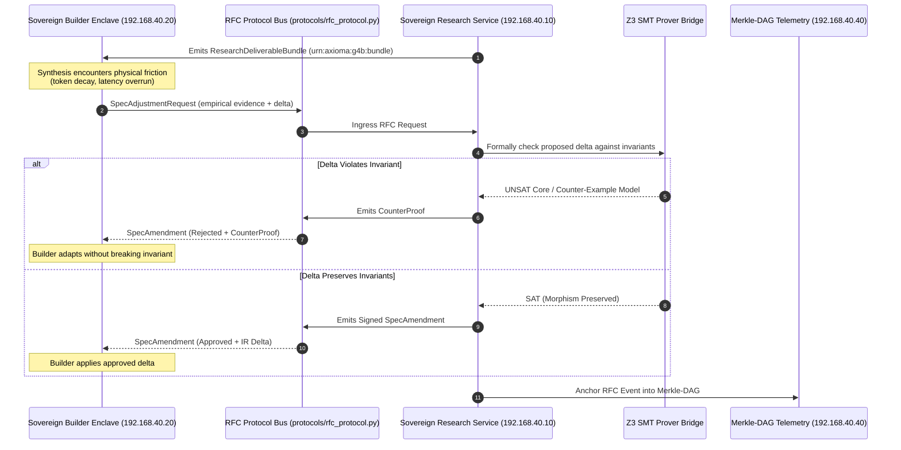

# Generation 4b: Service-Oriented Sovereign Mesh Architecture

## 1. Architectural Philosophy & Charter
Generation 4b marks the transition from monolithic compilers to a **Decoupled Sovereign Service Mesh** (`[L1-G4B-001]`). Rather than allowing the generative builder to dictate research or execute code within research loops, Generation 4b enforces physical and logical isolation between research, synthesis, formal auditing, telemetry, and human governance.

### Core Invariants
- **[L1-G4B-001] Decoupled Research Sovereignty:** The Research Service (`services/research/`) operates as an independent service enclave with its own statechart, invariants, and Merkle-DAG ledger.
- **[L1-G4B-002] Zero-Code Research Tool Boundary:** The Research Service is physically barred from executing or writing production code. Its sole output is the immutable `ResearchDeliverableBundle`.
- **[L1-G4B-003] Hierarchical Merkle-DAG Telemetry:** All inter-service communications, RFC requests, and approvals are anchored into a tamper-evident SHA-256 cryptographic DAG.
- **[L1-G3B-012] Anti-Loopback Interface Binding:** Services bind exclusively to non-loopback IPs in the `192.168.40.0/24` subnet.
- **[L1-G4B-008] Mandatory Post-Synthesis Orchestrator Witness Reconciliation Gate:** Because subagents executing in parallel isolated sandboxes cannot observe sibling conversation IDs, the parent orchestrator is strictly mandated to execute a post-synthesis reconciliation pass across all dashboard and telemetry deliverables (`telemetry_dashboard.html`, `dashboard.html`, `generate_dashboard.py`, and epoch metadata). This pass injects the real `conversationId` values returned by `invoke_subagent`, marks all subagent statuses as `CERTIFIED_COMPLETE`, and anchors empirical token measurements from `transcript.jsonl` (fresh input, cache-read, output). Synthetic placeholder UUIDs in final deliverables are strictly forbidden.


---

## 2. Directory Layout (Option A: Service-Oriented Sovereign Mesh)
```
generations/gen_04b/
├── README.md                           # Generational overview & multi-service topology
├── run.py                              # Cluster launcher & health check
├── protocols/                          # Shared wire schemas & URN contracts
│   ├── __init__.py
│   ├── rfc_protocol.py                 # SpecAdjustmentRequest, SpecAmendment, CounterProof
│   ├── urn_registry.py                 # Universal Symbol URN taxonomy
│   └── deliverable_bundle.py           # ResearchDeliverableBundle schemas
├── services/
│   ├── research/                       # Sovereign Decoupled Research Service (relocated soc_g4b_researcher)
│   │   ├── run.py                      # Research service entrypoint
│   │   ├── src/                        # 12 core research modules
│   │   ├── dashboard.html              # Interactive operational HUD
│   │   ├── telemetry_dashboard.html    # Standalone development process telemetry dashboard
│   │   └── tests/                      # 29 unit & adversarial tests
│   ├── builder/                        # Sovereign Builder Enclave (G4b-Dev / Phase 2 target)
│   ├── audit/                          # Audit & Formal Verification Service
│   ├── telemetry/                      # Telemetry & Evaluation Service
│   └── governance/                     # Governance & Safety Service
├── apps/                               # Non-generator production applications compiled by G4b
├── epochs/                             # Compilation epochs & Merkle ledgers
└── tests/                              # Generational cross-service integration tests
```

---

## 3. Asynchronous RFC Protocol & Service Mesh Communication


---

## 4. Verification & Testing
To run the Generation 4b generational test suite:
```bash
python3 -m unittest discover -v -s generations/gen_04b/tests
```

To run the full cluster launcher:
```bash
python3 generations/gen_04b/run.py
```
