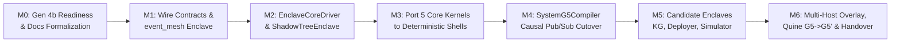

# Generation 5 Option 2 High-Level Implementation Roadmap (`option2_g4b_implementation_roadmap.md`)

> **Document Type:** Generational Bootstrapping & Milestone Roadmap (G4b $\to$ G5 Option 2)  
> **Target Scope:** General Generational (`generations/gen_04b/` $\to$ `generations/gen_05/`)  
> **Target Generation:** Generation 5 ($G_5$)  
> **Author:** Sovereign Research Service (`services/research/`, `192.168.40.10`)  
> **Created Date:** 2026-11-11  
> **Status:** APPROVED IMPLEMENTATION PLAN (Option 2)  
> **Architecture Baseline:** [`option2_hybrid_sdk_mesh_architecture.md`](option2_hybrid_sdk_mesh_architecture.md)  
> **Related URNs:** `urn:axioma:g5:roadmap:m0_to_m6`, `urn:axioma:g5:boot:bridge_kernel`

---

## 1. Bootstrapping Philosophy: Using Generation 4b to Build Generation 5

Meta-Axioma never abandons its currently verified compiler to hand-write a successor outside governance. **Generation 4b serves as the sovereign factory that specifies, synthesizes, smoke-tests, and certifies Generation 5 (`generations/gen_05/`)** incrementally across Milestones **M0–M6**:

1. **Research (`services/research/`):** Emits per-milestone `ResearchDeliverableBundle` specs and machine-checkable `AcceptanceSpecIR` contracts (`FalsificationVector`s + `banned_ast_patterns`).
2. **Builder (`services/builder/`) & `SystemG4bCompiler`:** Synthesizes each Gen 5 enclave inside `generations/gen_05/` through the **3-Phase Causal Reactive Pipeline** (`[INV-G4B-CAUSAL-001..003]`), fractal budget leases (`d <= 4, b <= 5, lambda <= 0.80`), and 60/40 thermodynamic capital accounting.
3. **Audit (`services/audit/`):** Enforces pre-disk `ZeroTrustMicroAuditor` (`HERM-001..006`), `SMTModelChecker` contract morphisms, `AcceptanceGate` mutation falsification, and live OS subprocess entrypoint smoke probes (`[NEG-G1B-002]`).
4. **Telemetry & Governance (`services/telemetry/`, `services/governance/`):** Seals build witnesses into `TelemetryVault` + SHA-256 Merkle chains, reconciles authentic subagent `conversationId` witnesses (`[L1-G4B-008]`), enforces `HDR <= 0.15`, and issues the final `GenerationalHandoverCertificate` via `SuccessionGatekeeper`.

### Breaking the Circular Bootstrapping Paradox (`[L1-G5-BOOT-001]`)
If Gen 5 entrypoints (`run.py`) built in early milestones unconditionally `import google.antigravity` (which requires a compiled PyPI wheel absent in offline sandboxes) or assume live external daemons at import time, Gen 4b's Gate 3 `--smoke-test` subprocess check (`[NEG-G1B-002]`) will fail and deadlock succession.

Therefore, every Gen 5 milestone enforces a **2-Layer Bootstrapping Architecture (`BootstrappingBridgeKernel`)**:
- **Layer 0 (Stdlib Hermetic Core):** Pure Python 3.14 standard library protocols, statecharts, and envelopes. `python3 -u run.py --smoke-test` exercises Layer 0 and exits `0` in `<50ms` inside Gen 4b's sandbox with zero network or external package dependencies.
- **Layer 1 (Lazy SDK & Mesh Escalation):** `AntigravitySDKAgentRunner` (`google.antigravity.Agent`) and multi-host transport adapters load lazily inside operational async loops, seamlessly falling back to Profile B (`DeterministicRunner` / local IPC) in sandboxed tests.

---

## 2. High-Level Milestone Roadmap (`M0` $\to$ `M6`)

### Milestone 0 — Pre-Succession Gate, Documentation Formalization, & Baseline Benchmarks
- **Scope:** Lock Gen 5 Option 2 architecture and roadmap into `generations/gen_04b/next_gen/`, verify Gen 4b cleanliness (`HDR <= 0.15`), and record baseline IPC vs. WAL throughput metrics.
- **Gen 4b Tooling Used:**
  - `SuccessionGatekeeper.verify_physical_witnesses()` across all 5 `REQUIRED_INVARIANT_GROUPS` (`test_generational_topology.py`, `test_qfd_lifecycle.py`, `test_acceptance_spec_contracts.py`, `service_topology.py`, `hitl_intercept_engine.py`).
  - `QuineCrucibleEngine.certify_daughter_compiler("gen_05a")` baseline clean-room test.
  - Benchmark local `socketpair` / `AF_UNIX` / `TelemetryVault` throughput to set quantitative M1 latency SLAs.
- **Exit Gate:** 100% passing `generations/gen_04b/tests` (`test_service_subprocess_smoke.py` included), `HDR <= 0.15`, and Human Architect approval of M1–M6 milestone specs.

### Milestone 1 — Gen 5 Wire Protocols & `services/event_mesh/` Foundation
- **Scope:** Establish `generations/gen_05/protocols/` and the standalone `services/event_mesh/` deterministic enclave (`MeshEventEnvelope`, `CausalMerkleToken`, `KernelBypassMeshFabric`, Bimodal Queue Router).
- **Gen 4b Tooling Used:**
  - `SovereignResearchKernel` emits `AcceptanceSpecIR` (`DomainArchetype.DISTRIBUTED_MESH_BACKEND`) forbidding central coordinator singletons (`NEG-PRIMITIVE-001`), polling loops (`NEG-PRIMITIVE-003`), blocking calls (`NEG-PRIMITIVE-004`), and loopback bindings (`[L1-G3B-012]`).
  - `SystemG4bCompiler` compiles `protocols/` + `services/event_mesh/` via Phase 2A Builder Muscle and Phase 2C Blind QA Muscle.
- **Verification Gate:** `AcceptanceGate` passes `FalsificationVector` mutation tests (clock/signature/overflow defects); `KernelBypassMeshFabric` passes Darwin `<60`-byte socket path & `fcntl.flock` recovery tests; `<50ms` fast-lane isolation verified under `15s` simulated cognitive delay; `run.py --smoke-test` exits `0` in `<5s`.

### Milestone 2 — Dual-Profile `EnclaveCoreDriver` (AGY SDK Adapter) & `ShadowTreeEnclave`
- **Scope:** Synthesize the reusable adapter separating Deterministic Service Shells from Ephemeral `google.antigravity.Agent` workers, plus quarantined shadow disk execution (`ShadowTreeEnclave`) and `SocraticBountyBalancer`.
- **Gen 4b Tooling Used:**
  - `SystemG4bCompiler` builds `EnclaveCoreDriver` (Profile A: lazy `google.antigravity.Agent` with `LocalAgentConfig` default read-only vs. `CapabilitiesConfig()` write-enabled and async `response.thoughts` / `response.tool_calls` forwarding; Profile B: stdlib IPC / `DeterministicRunner`).
  - Synthesize `.scratch/shadow/<task_id>/` tree isolation, diff-based `PatchProposalEnvelope`, and 3-of-3 multisig commit logic.
- **Verification Gate:** Profile B offline suite passes with zero `google.antigravity` binary present (`[L1-G5-BOOT-001]`); capability tests prove Research/Audit configs cannot mutate canonical disk files (`[L1-G4B-002]`); shadow rollback leaves canonical trees untouched on rejection.

### Milestone 3 — Migrating the 5 Sovereign Enclaves to Deterministic Shells + Event-Sourced Telemetry
- **Scope:** Port `telemetry`, `governance`, `research`, `builder`, and `audit` into `generations/gen_05/services/` as autonomous `mesh.events.*` pub/sub actors, retiring `PostToolUse` hook scraping and the 79.2% push-ingress bottleneck.
- **Gen 4b Tooling Used:** `SystemG4bCompiler` compiles each enclave in strict dependency order:
  1. **`telemetry`** (100% deterministic `mesh.events.#` subscriber + pure event-sourced statechart projection $\mathcal{P}(E_{0..t})$ eliminating dummy bootstrap records).
  2. **`governance`** (deterministic `NEG-###` / `HDR` / traffic matrix prover $\mathbf{A}_{i,j} \equiv 0$ + `CircuitBreakerEnclave`).
  3. **`research`** (default read-only SDK council + `Z3ProverBridge` + `QFDEngine` + `RFCProtocolBus`).
  4. **`builder`** (`BoundedFractalOrchestrator` + `ASTSkeletonizer` + write-jailed `ShadowTreeEnclave`).
  5. **`audit`** (`bits_erased == 0` sentry + `CausalMerkleToken` precondition gate + blind QA `Agent` + `SheafQuorumConsensusEngine`).
- **Verification Gate:** Each enclave passes `--smoke-test` (`[NEG-G1B-002]`), deterministic log-replay equivalence, and zero-heat audit assertions (`[L1-G5-THERM-002]`).

### Milestone 4 — `SystemG5Compiler` Reactive Causal Cutover
- **Scope:** Replace Gen 4b's synchronous RPC orchestrator (`SystemG4bCompiler.compile()`) with `SystemG5Compiler`, advancing the 36-state compilation FSM purely via `CausalMerkleToken`-sealed pub/sub events.
- **Gen 4b Tooling Used:**
  - `SystemG4bCompiler` builds `generations/gen_05/compiler/` and executes differential A/B compilation parity: compiling a reference non-generator app under both `SystemG4bCompiler` and `SystemG5Compiler` and asserting identical contract invariants, grounding seals, smoke passes, and Merkle witnesses.
  - Chaos fault tests inject out-of-order `audit` triggers missing Phase 2B seals to verify buffering/rejection (`[L1-G5-CAUSAL-001]`).
- **Exit Gate:** End-to-end Gen 5 compilation passes with `HDR <= 0.15`, zero forbidden traffic edges ($\mathbf{A}_{i,j} \equiv 0$), and 100% passing app/enclave tests.

### Milestone 5 — Candidate Enclaves Expansion (`knowledge_graph`, `deployer`, `simulator`)
- **Scope:** Close the full software lifecycle loop (**Design $\to$ Build $\to$ Verify $\to$ Deploy $\to$ Simulate $\to$ Observe**) via `knowledge_graph`, `deployer`, and `simulator` (`candidate_services.md`, `qfd_autonomic_mesh.md`).
- **Gen 4b / Gen 5 Execution:** `SystemG5Compiler` (audited against Gen 4b `AcceptanceGate` invariants) builds:
  1. `services/knowledge_graph/` (AST/URN lineage & cross-generational anti-pattern taboo checks).
  2. `services/deployer/` (local/Wasm canary shifter $5\% \to 25\% \to 100\%$ + automated rollback breaker).
  3. `services/simulator/` (synthetic persona swarms publishing live `mesh.events.qfd.friction_telemetry` to Research with convergence proof `[L1-G5-QFD-001]`).
- **Exit Gate:** Deterministic replay of `10,000` VOC friction events in `<500ms`; Simulator discovers injected canary deadlock and triggers automated `deployer` rollback.

### Milestone 6 — Multi-Host Overlay (`192.168.50.0/24`), Quine Graduation, & Final Handover
- **Scope:** Enable user-space encrypted multi-host pub/sub peering (`192.168.50.0/24`), prove Gen 5 Quine reflexivity, and issue the final `GenerationalHandoverCertificate`.
- **Gen 4b / Gen 5 Execution:**
  - Extend `KernelBypassMeshFabric` transport adapters for encrypted cross-host UDP/Noise gossip while maintaining `LOCAL_IPC` hermetic test parity.
  - Run `QuineCrucibleEngine`: `SystemG5Compiler` compiles clean-room twin daughter `gen_05b` and verifies all daughter tests and `--smoke-test` gates pass with matching structural Merkle digests.
  - `SuccessionGatekeeper.issue_handover_certificate()` verifies all Gen 4b + Gen 5 invariant URNs and writes `generations/gen_05/HANDOVER_CERTIFICATE.md` upon Human Architect sign-off (`[NEG-GOV-GATE-001]`).
- **Exit Gate:** Signed `GenerationalHandoverCertificate` (`CERTIFIED_SUCCESSION_READY`) + Evolution Dashboard lineage synchronization (`[L1-G3B-019]`).

---

## 3. Cross-Milestone Gate & Safety Matrix

| Milestone | Primary Compiler | Mandatory Verification Gates | Rollback / Safety Anchor |
| :--- | :--- | :--- | :--- |
| **M0** | Gen 4b `SuccessionGatekeeper` | 5 URN physical witnesses + `QuineCrucibleEngine("gen_05a")` + `HDR <= 0.15` | `sync_next_gen_notes.py --undo` |
| **M1** | `SystemG4bCompiler` | `AcceptanceSpecIR` + `MutationFalsifier` + `--smoke-test` (`<50ms`) | Git/Epoch snapshot + `TelemetryVault` |
| **M2** | `SystemG4bCompiler` | Dual-profile Profile A/B parity + `ShadowTreeEnclave` rollback test | `.scratch/shadow/` unlink on reject |
| **M3** | `SystemG4bCompiler` | Zero-heat audit (`bits_erased == 0`) + replay determinism + `--smoke-test` | Per-enclave `FunctorialUndo` |
| **M4** | `SystemG4bCompiler` $\to$ `SystemG5Compiler` | Differential app build parity + race-fault `CausalMerkleToken` trap | Parallel keep of `SystemG4bCompiler` |
| **M5** | `SystemG5Compiler` | `10k` VOC event replay `<500ms` + canary auto-rollback smoke test | `deployer` instant rollback breaker |
| **M6** | `SystemG5Compiler` + `QuineCrucibleEngine` | Multi-host partition fuzz + Quine `gen_05b` twin + `HDR <= 0.15` | Human Architect `[NEG-GOV-GATE-001]` |

---

## 4. Next Phase: Detailed Per-Component & Per-Milestone Specifications

Subsequent research turns will drill down sequentially into dedicated Design, Implementation, and Testing specifications for each milestone/component:
1. `M0/M1`: `MeshEventEnvelope`, `KernelBypassMeshFabric`, Bimodal Queue Router, & `services/event_mesh/`
2. `M2`: `EnclaveCoreDriver` (AGY SDK integration), `BootstrappingBridgeKernel`, `ShadowTreeEnclave`, & `SocraticBountyBalancer`
3. `M3`: Individual Service Shell Specifications (`telemetry`, `governance`, `research`, `builder`, `audit`)
4. `M4`: `SystemG5Compiler` Statechart & `CausalMerkleToken` Gatekeeper
5. `M5/M6`: Candidate Enclaves (`knowledge_graph`, `deployer`, `simulator`), Multi-Host Overlay, & Quine Crucible Graduation
