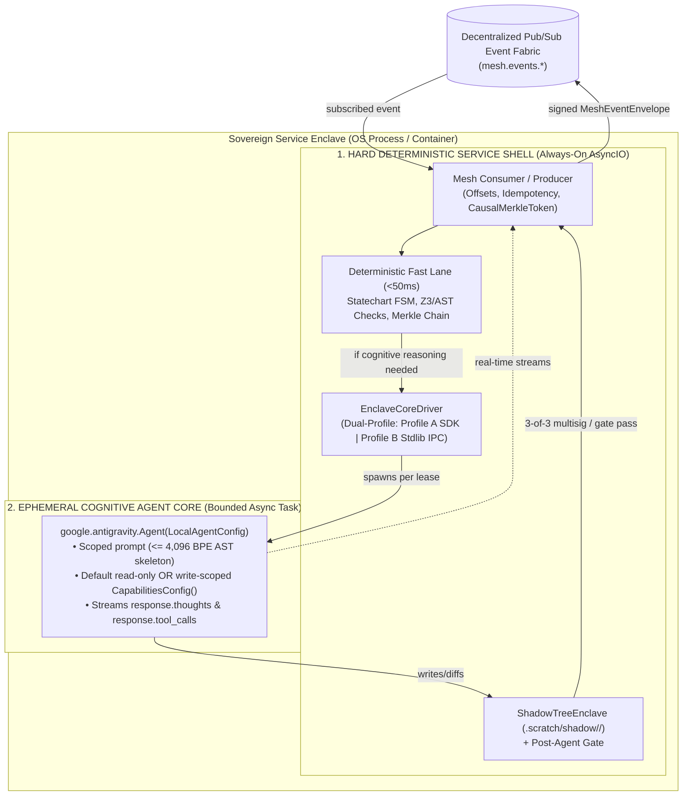

<!-- BEGIN G5_SYNC: g5-option2-hybrid-sdk-pubsub-mesh -->
# Generation 5 High-Level Architecture: Hybrid AGY Python SDK & Decentralized Pub/Sub Event Mesh (`option2_hybrid_sdk_mesh_architecture.md`)

> **Document Type:** Generational High-Level Architecture Specification (G5 Option 2)  
> **Target Scope:** General Generational (`generations/gen_05/`)  
> **Target Generation:** Generation 5 ($G_5$)  
> **Author:** Sovereign Research Service (`services/research/`, `192.168.40.10`)  
> **Created Date:** 2026-11-11  
> **Status:** APPROVED ARCHITECTURAL BASELINE (Option 2)  
> **Related URNs:** `urn:axioma:g5:arch:option2_hybrid_sdk_mesh`, `urn:axioma:g5:event_mesh:fabric`, `urn:axioma:g5:driver:enclave_core`, `urn:axioma:g5:g5-option2-hybrid-sdk-pubsub-mesh`  
> **Implementation Roadmap:** [`option2_g4b_implementation_roadmap.md`](option2_g4b_implementation_roadmap.md)

---

## 1. Context & Generation 4b Baseline

Generation 4b (`generations/gen_04b/`) cured the *"Builder Shortchanging Research"* pathology by separating Research, Builder, Audit, Telemetry, and Governance behind formal wire contracts (`ResearchDeliverableBundle`, `AcceptanceSpecIR`, `SpecAdjustmentRequest`, `MeshIPCTransport`). However, empirical audit of `886` micro-transactions in `telemetry_vault.db` and comparison against modern event-driven multi-agent patterns revealed four structural bottlenecks in Gen 4b:

1. **79.2% Ingress Sink Convergence:** Nearly four-fifths of all mesh transactions converge point-to-point on `services/telemetry`, creating a serialization ceiling under multi-host scaling.
2. **Ambient Observation Blindspots & Blocking Hooks:** `PostToolUse` hooks run synchronously and block agent turn execution while missing subprocess/background operations outside hook coverage.
3. **Bimodal Latency Contention:** Fast deterministic operations (`38.8ms` average WAL/transport) share synchronous control paths with `13.3s–15.5s` cognitive LLM deliberations.
4. **Shared Parent Context (`Single-Context Vulnerability`):** Interactive AGY subagents funnel through a single parent conversation harness, risking cooperative collusion bias across Builder and Adversarial QA roles.

**Generation 5 Option 2** resolves these bottlenecks without violating `AGENTS.md`'s zero-paid-API rule or incurring the `HDR ~0.85` rewrite debt of rebuilding an entire standalone agent harness (`Option 3`). It combines **decentralized pub/sub event streaming (`mesh.events.*`)** with **Meta-Axioma's formal axiomatic verification and deterministic service shells**.

---

## 2. Friction Points & Waterloo Tier 1 Situation of Concern (`[L1-G3B-000]`)

- **Macro Level (Ecosystem & Scaling):** `Human Systems Architect`, `Meta-Orchestrator`, and multi-process/multi-host enclaves require zero-overhead ambient observability, durable replay, and loose coupling without a centralized broker SPoF (`NEG-PRIMITIVE-001`) or paid external API keys (`AGENTS.md`).
- **Meso Level (Service vs. Agent Boundary & Latency Isolation):** Sovereign service kernels must sustain `<50ms` deterministic heartbeats, invariant verification, and telemetry appends while running `10s–30s` cognitive LLM tasks under strict capability scoping and zero shared LLM context.
- **Micro Level (Bootstrapping, Disk Atomicity, & Causal Ordering):** Ephemeral LLM workers must never leave half-written non-idempotent files on disk across consumer offset replays, must never trigger QA runs before physical disk grounding (`[NEG-G1B-001]`), and must boot cleanly in sandboxed `--smoke-test` subprocesses (`[NEG-G1B-002]`) when PyPI SDK wheels or external daemons are absent.

---

## 3. Core Architectural Pattern: "Hard Deterministic Service Shell, Ephemeral Cognitive Agent Core"

In Generation 5 Option 2, an enclave is **never** a free-running LLM loop holding network sockets or altering its own permissions. Every enclave separates cleanly into two asymmetric layers:



### 3.1 Dual-Profile `EnclaveCoreDriver` & `BootstrappingBridgeKernel`
Because `google-antigravity` depends on a compiled platform runtime binary while Meta-Axioma sandboxes block PyPI network installs (`[NEG-SANDBOX-001]`) and require fast offline subprocess smoke verification (`[NEG-G1B-002]`), services **never import `google.antigravity` at module top level**:
- **Profile A (Production Interactive / Host SDK):** Lazily binds `google.antigravity.Agent` (`LocalAgentConfig`). Real-time `response.thoughts` and `response.tool_calls` async iterators publish directly onto `mesh.events.<service>.*`, eliminating synchronous `PostToolUse` hook scraping.
- **Profile B (Hermetic Stdlib Bridge / `--smoke-test`):** Pure Python 3.14 stdlib core (`BootstrappingBridgeKernel`) communicating over framed JSON-RPC/IPC envelopes (`[CRIT-01]`, `[INV-PIPE-001]`). Guarantees `<50ms` exit-0 `--smoke-test` passes inside Gen 4b sandboxes and deterministic offline unit testing (`DeterministicRunner`).

### 3.2 Service-vs-Agent Boundary Matrix (All 9 Enclaves)

Per the Antigravity Python SDK contract, `LocalAgentConfig(system_instructions=...)` runs in **read-only mode by default**; write tools are enabled only when `capabilities=CapabilitiesConfig()` is explicitly supplied.

| Enclave & G5 URN | Deterministic Service Shell (Always-On) | Ephemeral Agent Core (`Agent`) | `LocalAgentConfig` Capability Profile | Primary Subscribed & Published Topics |
| :--- | :--- | :--- | :--- | :--- |
| **Telemetry**<br>`urn:axioma:g5:telemetry` | `SovereignTelemetryKernel`, `TelemetryVault` (SQLite WAL/Parquet), `CockpitServer` (WebSocket/SSE), `TelemetryMerkleWitnessEngine`, Landauer calorimeter | **None (100% Deterministic)** — zero cognitive latency or heat in sensory sink | N/A | **Sub:** `mesh.events.#`<br>**Pub:** `mesh.events.telemetry.merkle_anchored`, `cockpit.delta` |
| **Event Mesh**<br>`urn:axioma:g5:event_mesh` | `KernelBypassMeshFabric` (SPSC `mmap`/UDS rings locally + Noise/UDP gossip across hosts), bimodal queue router | **None (100% Deterministic)** — zero-broker-SPoF transport fabric (`NEG-PRIMITIVE-001`) | N/A | Manages topic routing, consumer offsets, DLQs, causal seals |
| **Governance**<br>`urn:axioma:g5:governance` | `GovernanceKernel`, `NegativeAxiomEnforcer`, `CircuitBreakerEnclave`, `HITLInterceptEngine`, `SuccessionGatekeeper`, traffic matrix prover ($\mathbf{A}_{i,j} \equiv 0$) | **Optional / Rare:** Socratic Red Team explainer or HITL proposal synthesizer | **Default Read-Only** (no `CapabilitiesConfig()` write tools) | **Sub:** `mesh.events.#` (audit/anomaly monitoring)<br>**Pub:** `mesh.events.governance.{veto_issued,quarantine,hitl_requested}` |
| **Research**<br>`urn:axioma:g5:research` | `SovereignResearchKernel`, `QFDEngine`, `MCDARanker`, `AcceptanceSpecEmitter`, `Z3ProverBridge`, `RFCProtocolBus` | **Dialectical Council:** `Domain Ontologist`, `Ergonomics Architect`, `Red Team` | **Default Read-Only** (`[L1-G4B-002]` Zero-Code Invariant enforced by SDK) | **Sub:** `mesh.events.research.soc_submitted`, `builder.rfc_submitted`, `qfd.friction_telemetry`<br>**Pub:** `mesh.events.research.{bundle_certified,rfc_amended,counter_proof}` |
| **Builder**<br>`urn:axioma:g5:builder` | `SovereignBuilderKernel`, `BoundedFractalOrchestrator` ($d \le 4, b \le 5$), `ASTSkeletonizer` ($\le 4,096$ BPE), `BudgetLeaseEngine`, `ShadowTreeEnclave`, `QuineCrucibleEngine` | **Leaf Muscle Pool:** `Core Engine Synthesizer`, `Dashboard Synthesizer` | **`CapabilitiesConfig()` Enabled**, jailed strictly inside `.scratch/shadow/<task_id>/` | **Sub:** `mesh.events.research.bundle_certified`, `audit.rejected`, `research.rfc_amended`<br>**Pub:** `mesh.events.builder.{leaf_emitted,grounding_verified,rfc_submitted}` |
| **Audit**<br>`urn:axioma:g5:audit` | `SovereignAuditKernel`, `ZeroTrustMicroAuditor`, `SMTModelChecker`, `AcceptanceGate` (`MutationFalsifier`), `SheafQuorumConsensusEngine`, subprocess smoke runner | **Blind QA & Red Team:** `Adversarial QA Engineer` (receives only `AcceptanceSpecIR` + public signatures) | **Default Read-Only** / sandboxed test runner (`bits_erased == 0`) | **Sub:** `mesh.events.builder.grounding_verified` (causal gate)<br>**Pub:** `mesh.events.audit.{passed,rejected,quorum_witness}` |
| **Deployer** *(Candidate)*<br>`urn:axioma:g5:deployer` | Canary router ($5\% \to 25\% \to 100\%$), Wasm/OCI packager, rollback circuit breaker | **Optional:** Canary Anomaly Analyst | Scoped deployment command profile (post-M4) | **Sub:** `mesh.events.audit.acceptance_gate_certified`<br>**Pub:** `mesh.events.deployer.{packaged,canary_promoted,rolled_back}` |
| **Simulator** *(Candidate)*<br>`urn:axioma:g5:simulator` | `HeadlessUIWalker`, concurrent load & chaos injector, accessibility/UX scorer | **Synthetic User Persona Swarms** (Novice, Fuzzer, Screen-Reader) | **Default Read-Only** against target app endpoints | **Sub:** `mesh.events.deployer.canary_promoted`<br>**Pub:** `mesh.events.qfd.friction_telemetry`, `simulator.defect_found` |
| **Knowledge Graph** *(Candidate)*<br>`urn:axioma:g5:kg` | Embedded graph store (Kùzu/SQLite Graph), AST/URN lineage indexer, `GraphTabooEngine` | **Optional:** Semantic Lineage Reasoner | **Default Read-Only** (deterministic graph ingestion) | **Sub:** `mesh.events.{research,builder,audit,governance}.*`<br>**Pub:** `mesh.events.kg.{taboo_warning,lineage_resolved}` |

---

## 4. Formal Invariants & Negative Constraints

- **`[L1-G5-ARCH-001]` Deterministic Shell Sovereignty:** No ephemeral `Agent` core may bypass its enclosing service statechart, alter its capability bounds, or publish unverified events directly to `mesh.events.*`.
- **`[L1-G5-CAUSAL-001]` CausalMerkleToken Barrier:** Downstream QA/Audit enclaves must reject or buffer phase execution until incoming envelopes present a verified Phase 2B physical disk grounding seal (`[INV-G4B-CAUSAL-001..003]`).
- **`[L1-G5-BOOT-001]` Dual-Profile Hermetic Bootstrapping:** Every Gen 5 service entrypoint (`run.py --smoke-test`) must execute cleanly in `<50ms` using stdlib Profile B without PyPI downloads or external broker daemons (`[NEG-G1B-002]`, `[NEG-SANDBOX-001]`).
- **`[L1-G5-THERM-002]` Zero-Heat Observer Invariant:** Verification and Research topics strictly enforce `bits_erased == 0`.
- **`[NEG-G5-001]` Zero-Direct-Disk-Mutation by Agents:** Write-enabled `Agent` workers mutate only `.scratch/shadow/<task_id>/` inside `ShadowTreeEnclave`; canonical files update atomically only upon 3-of-3 Multisig Commit Witness (`SIG_BUILDER`, `SIG_ADVERSARY`, `SIG_REALITY`).
- **`[NEG-G5-002]` Zero-Paid-External-API & HDR Ceiling:** Prohibits paid commercial model REST keys (`AGENTS.md`) and bespoke agent-runtime rewrites violating `HDR <= 0.15`.

---

## 5. Schema, Transport, & Bimodal Queue Specifications

### 5.1 `MeshEventEnvelope` (Evolving `protocols/ipc_transport.py`)

```python
@dataclass(frozen=True)
class MeshEventEnvelope:
    event_id: str                    # UUIDv4 deterministic event identifier
    topic: str                       # "mesh.events.<domain>.<verb>"
    source_urn: str                  # "urn:axioma:g5:<domain>:<entity>"
    target_urn: Optional[str]        # None for broadcast pub/sub; URN for unicast
    correlation_id: str              # Compilation run correlation ID
    causal_parent_id: Optional[str]  # Parent event ID in Merkle DAG
    logical_clock: int               # Monotonic Lamport logical clock
    causal_seal: str                 # PrerequisitePhaseSeal / SHA-256 Merkle witness
    payload_type: str                # Registered schema URN
    payload: Dict[str, Any]          # Schema-validated domain payload
    bpe_tokens_in: int               # Fresh/cached input tokens
    bpe_tokens_out: int              # Output tokens
    bits_erased: int                 # Landauer bit erasure (0 for audit/research)
    heat_dissipated_joules: float    # Hardware calorimetry or k_B * T * ln(2) * bits
    timestamp_unix_ns: int           # Monotonic nanosecond clock
    auth_signature: str              # Ed25519 / HMAC-SHA256 source enclave signature
```

### 5.2 Bimodal Queue Topology & Decentralized Ring Fabric
- **Zero-Broker Local Fabric (`KernelBypassMeshFabric`):** Each publisher owns an append-only `mmap` ring / short-path `AF_UNIX` log under `.scratch/bus/<enclave>.ring` (guarded by `fcntl.flock`, path `< 60` bytes per `[CRIT-01]`). Subscribers read lock-free and store their own consumer offsets locally (`NEG-PRIMITIVE-001`, `NEG-PRIMITIVE-005`).
- **Multi-Host Overlay (`192.168.50.0/24`):** Bridges local ring segments across machines over user-space encrypted UDP/Noise or libp2p tunnels without root `NET_ADMIN` privileges.
- **Deterministic Fast Lane (`< 50ms` SLA) vs. Cognitive Slow Lane (`10s–30s`):** Service control loops process heartbeats, circuit breakers, micro-audits, and WAL writes on the fast ring lane without ever blocking on async `Agent` coroutines.
- **Event-Sourced Cockpit Projection (`[L1-G5-TEL-005]`):** `TelemetryVault` stores delta events + periodic `O(1)` keyframes; Cockpit renders state strictly as $\mathcal{P}(E_{0..t})$ with zero synthetic bootstrap records.

---

## 6. Red-Team Hardening & Open Research Spikes

### Five Verified Red-Team Mitigations
1. `EnclaveCoreDriver` + `BootstrappingBridgeKernel` mitigates `VULN-OPT2-001` (offline PyPI/binary trap).
2. `ShadowTreeEnclave` mitigates `VULN-OPT2-002` (split-brain non-idempotent disk mutations on replay).
3. `KernelBypassMeshFabric` mitigates `VULN-OPT2-003` (broker SPoF & sandbox network/root violations).
4. `SocraticBountyBalancer` mitigates `VULN-OPT2-004` (Red Team starvation deadlock via executable falsification proofs + Formal Verification Dividend at `>= 95%` coverage).
5. `CausalMerkleToken` mitigates `VULN-OPT2-005` (async QA race ahead of disk grounding).

### Open Research Spikes (Pre-Milestone Deep Dives)
1. Benchmark `mmap` SPSC / `AF_UNIX` ring bridge throughput vs. SQLite WAL write contention at `50k+` events/sec in Gen 4b prior to M1 cutover.
2. Validate `google-antigravity` SDK `LocalAgentConfig` / `CapabilitiesConfig` streaming lifecycle in host integration harness vs. Profile B offline smoke harness.
3. Specify per-component Design, Implementation, and Testing docs across Milestones M0–M6 (`event_mesh`, `EnclaveCoreDriver`, `ShadowTreeEnclave`, `CausalMerkleToken`, the 5 ported cores, and the 3 candidate enclaves).
<!-- END G5_SYNC: g5-option2-hybrid-sdk-pubsub-mesh -->
