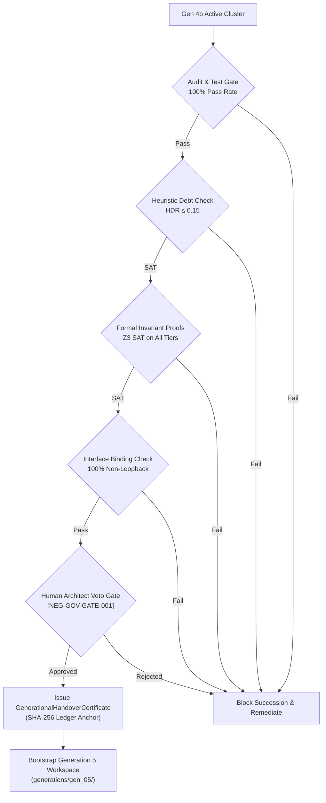

# Generation 5 Succession Triggers & Verification Gates (`general/succession_triggers.md`)

> **Document Type:** Formal Succession Protocol Specification  
> **Source Gatekeeper:** [`generations/gen_04b/services/governance/src/succession_gatekeeper.py`](../../services/governance/src/succession_gatekeeper.py)  
> **Enforcement Invariant:** [L1-G2B-002] Heuristic Debt Ratio, [L1-G3B-012] Anti-Loopback Interface, [L1-G4B-001..008] Mesh Standard  
> **Target:** Generation 5 Handover Certification  

---

## 1. Handover Architecture Overview

In Meta-Axioma, transitioning across generational boundaries is never informal or ad-hoc. Handover from Generation 4b to Generation 5 requires the formal issuance of a **`GenerationalHandoverCertificate`** cryptographically signed by the `SuccessionGatekeeper`.



---

## 2. Mandatory Verification Gates

To graduate Generation 4b and bootstrap Generation 5, the following five criteria must be strictly satisfied on the live substrate:

### Gate 1: Foundational Invariant Proofs (`REQUIRED_INVARIANT_GROUPS`)
The `SuccessionGatekeeper` must verify formal Z3 SMT proofs for all four invariant tiers:
1. `urn:axioma:core:l1_001_to_016`: Core generative invariants (functorial transitions, state reachability).
2. `urn:axioma:g3b:l1_g3b_000_to_019`: Waterloo SoC hierarchy, anti-loopback fidelity, fractal task stack, and micro-auditor intercepts.
3. `urn:axioma:g4b:l1_g4b_001_to_008`: Decoupled research sovereignty, zero-code boundary, hierarchical Merkle telemetry, and orchestrator witness reconciliation.
4. `urn:axioma:g4b:invariant:zero_loopback`: Every service endpoint binds strictly to non-loopback IPs in `192.168.40.0/24`.

### Gate 2: Heuristic Debt Ratio (HDR $\le 0.15$)
- **Constraint:** The ratio of unverified heuristic code or temporary mock workarounds to formally audited structural lines of code must not exceed $15\%$.
- **Formula:**
  $$\text{HDR} = \frac{\text{LOC}_{\text{heuristic}}}{\text{LOC}_{\text{formal}}} \le 0.15$$
- Any unprincipled hacks or mock-based unit test shortcuts must be purged before succession is permitted.

### Gate 3: Substrate Test Suite 100% Passing
- Generational tests (`python3 -m unittest discover -v -s generations/gen_04b/tests`) must execute with exit code 0 and non-zero passing assertions.
- Service-level unit tests for all 5 enclaves must pass 100%:
  - `services/research/tests`
  - `services/builder/tests`
  - `services/audit/tests`
  - `services/telemetry/tests`
  - `services/governance/tests`
- Subprocess entrypoint smoke tests (`[NEG-G1B-002]`) must prove that each service's `run.py` boots, binds, responds to healthchecks, and shuts down cleanly.

### Gate 4: Empirical Dogfooding & Production Applications
- At least 4 non-trivial production applications compiled by Generation 4b must be fully operational in `generations/gen_04b/apps/`:
  - `axioma_canvas`
  - `axioma_consensus`
  - `axioma_crucible`
  - `axioma_go`
- Each app must possess valid, verified standalone telemetry dashboards (`dashboard.html`).

### Gate 5: Human Governance Sign-Off (`[NEG-GOV-GATE-001]`)
- Succession must be formally proposed via a detailed proposal dossier.
- The human architect must explicitly approve the handover via `ask_question`.

---

## 3. Empirical Saturation Triggers for Generation 5

Beyond formal gates, succession to Generation 5 is triggered when any of the following empirical saturation conditions are met:

1. **SQLite WAL Single-Writer Ingestion Ceiling:**
   - Multi-agent concurrent write volume reaches or exceeds $100,000\text{ events/sec}$, or SQLite WAL write-lock contention causes transaction wait times to exceed $50\text{ms}$.
   - Mandates migration to a distributed append-only event stream (e.g., embedded NATS, ZeroMQ, or columnar DuckDB/Parquet segment stores).

2. **Hook-Based Ambient Telemetry Saturation:**
   - Observing multi-agent subtasks, compiler pipelines, or custom skills across disconnected OS processes or machines cannot be achieved reliably via point-to-point HTTP push or `PostToolUse` transcript scraping.
   - Mandates transition to the **Universal Pub/Sub Event Mesh (`mesh.events.*`)**.

3. **Event-Sourced Statechart Duality Saturation:**
   - The Telemetry Cockpit proves 100% mathematical event-sourced projection $\mathcal{P}(E_{0..t})$ from live event streams, permanently retiring all synthetic dummy bootstrap records.

4. **Continuous Subprocess Smoke Verification (`[NEG-G1B-002]`):**
   - Formal proof that 100% of sovereign service entrypoints (`run.py`) and event adapters boot, bind non-loopback network interfaces (with local development fallbacks), pass operational healthchecks, and cleanly terminate in independent OS subprocesses.

---

## 4. Handover Certificate Schema

Upon passing all gates, the `SuccessionGatekeeper` computes:
```python
certificate = GenerationalHandoverCertificate(
    certificate_id=f"cert_g4b_g5_{uuid.uuid4().hex[:12]}",
    source_generation="Generation 4b",
    target_generation="Generation 5",
    timestamp=time.time(),
    verified_invariants=gatekeeper.get_verified_invariant_urns(),
    heuristic_debt_ratio=current_hdr,
    governance_merkle_root=gatekeeper.compute_merkle_head(),
    human_approval_signature="Michael Lipski [APPROVED]",
    status=SuccessionGraduationStatus.CERTIFIED,
)
```
This certificate will be permanently embedded in `generations/gen_05/HANDOVER_CERTIFICATE.md`.
