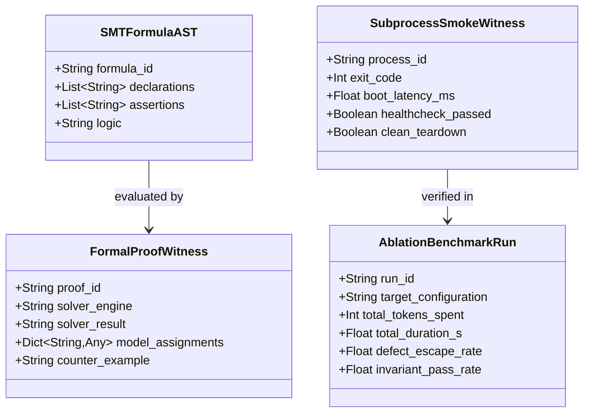
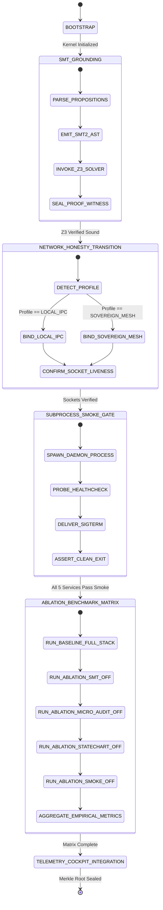
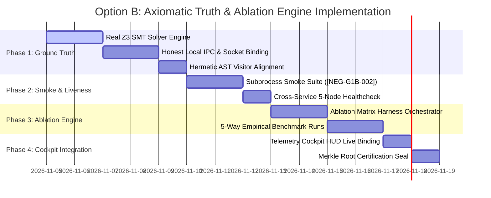

# Sovereign Research Specification: The Axiomatic Truth & Empirical Ablation Engine
## Generation 4b Research Deliverable (`urn:axioma:g4b:spec:axiomatic_truth_and_ablation_engine:v1`)

> **Issuing Authority:** Sovereign Research Service (`services/research/`, `192.168.40.10:8201`)  
> **Target Enclaves:** Builder Enclave (`192.168.40.20`), Audit Enclave (`192.168.40.30`), Telemetry Cockpit (`192.168.40.40`), Governance Enclave (`192.168.40.50`)  
> **Bundle URN:** `urn:axioma:g4b:bundle:bundle_g4b_axiomatic_truth_and_ablation_002`  
> **Governance Authorization:** Approved by Human Architect under Option B ([NEG-GOV-GATE-001])  
> **Operational Status:** Active Implementation Roadmap & Technical Specification  

---

## 1. Executive Summary & Epistemic Deconstruction

This specification defines the formal architecture and phased implementation plan for **Option B: The Axiomatic Truth & Empirical Ablation Engine**.

Meta-Axioma has reached a point where its conceptual language (Category-Theoretic Morphisms, Landauer Thermodynamic Dissipation, SMT Prover Entailment, Non-Loopback Network Topologies) outpaces the reality of its underlying Python substrate. To prevent the recursive compiler from degenerating into a self-referential theater of linters and string-checks:

1. **Epistemic Truth:** All declared invariants must correspond to physical, decidable, non-mocked execution semantics. SMT proofs must evaluate real AST formulas via `z3.Solver()`.
2. **Honest Networking & IPC:** Network bindings must stop catching `OSError` to secretly bind `127.0.0.1` while advertising `192.168.40.x`. The system must explicitly support a first-class Localhost/Unix Socket IPC profile for single-host development.
3. **Subprocess Empirical Smoke (`[NEG-G1B-002]`):** Every service and compiled application must prove operational liveness in an isolated OS subprocess before passing verification.
4. **Empirical Ablation Benchmarking (`/ablation-runner`):** A physical test harness must be built to measure the true marginal utility ($\Delta\text{defect escape}$, $\Delta\text{latency}$, $\Delta\text{tokens}$) of each architectural layer when systematically enabled and disabled.

---

## 2. Waterloo Tier 1 Situation of Concern (`[L1-G3B-000]`)

### 2.1 Macro Level (Systemic Integrity)
- **Problem:** When an architecture introduces elaborate verification layers, it incurs compute and latency overhead. Without empirical ablation, it is impossible to determine whether a given layer actively prevents software defects or merely adds friction.
- **Goal:** Provide mathematically defensible, empirical proof of each layer's marginal contribution, while eliminating all deceptive stubs from the codebase.

### 2.2 Meso Level (Service Mesh & Pipeline Protocol)
- **Problem:** Generation 4b services (`research`, `builder`, `audit`, `telemetry`, `governance`) advertise a distributed multi-node topology on `192.168.40.0/24`, but fall back silently to `127.0.0.1`. The SMT prover checks entailment using substring matching (`fact.startswith(goal)`).
- **Goal:**
  - Modernize `Z3ProverBridge` and `SMTModelChecker` with real proposition-to-SMT AST compilation.
  - Implement dual-profile networking: `Profile.LOCAL_IPC` (explicit local ports and Unix domain sockets) vs `Profile.SOVEREIGN_MESH` (explicit multi-host routing).
  - Enforce subprocess entrypoint smoke gates (`[NEG-G1B-002]`) on all services.

### 2.3 Micro Level (AST Node & Bytecode Invariants)
- Target Python 3.14 AST structures (`ast.FunctionDef`, `ast.Call`, `ast.With`, `ast.Try`).
- Replace string-scanning micro-auditors with semantic visitors that inspect variable bindings, exception types, and control-flow dominance.

---

## 3. Formal Domain Contracts (`ContractIR`)



### 3.1 Product Nouns
- `SMTFormulaAST`: AST representation of an SMT-LIB2 formula with typed declarations (Bool, BitVec, Int) and relational assertions.
- `FormalProofWitness`: Cryptographic witness of a Z3 solver invocation, recording SAT/UNSAT/UNKNOWN, model counterexamples, and execution latency.
- `SubprocessSmokeWitness`: Empirical record of an OS subprocess spawn, testing import integrity, socket binding, healthcheck probe response, and clean SIGTERM teardown.
- `AblationConfiguration`: Feature-flag descriptor specifying active layers:
  - `enable_smt_solver: bool`
  - `enable_ast_micro_auditors: bool`
  - `enable_hierarchical_statecharts: bool`
  - `enable_subprocess_smoke: bool`
  - `enable_dynamic_budget_calibration: bool`
- `AblationBenchmarkRun`: Empirical metric bundle comparing execution results across configurations.

### 3.2 Compositional Verbs
1. `CompilePropositionToSMT2`:
   - **Pre-condition:** `valid_proposition_syntax(conditions) == true`
   - **Post-condition:** `smt2_formula.is_well_formed() == true`
   - **Morphism:** Transforms high-level contract invariants (e.g., `balance >= amount`, `status == ACTIVE`) into typed SMT-LIB2 assertions.
2. `VerifyTheoremZ3`:
   - **Pre-condition:** `smt2_formula.has_assertions() == true`
   - **Post-condition:** `proof_witness.solver_result in ['UNSAT', 'SAT', 'UNKNOWN']`
   - **Morphism:** Executes `z3.Solver.check()`; if SAT, extracts satisfying model as concrete counterexample; if UNSAT, certifies theorem validity.
3. `BindHonestEndpoint`:
   - **Pre-condition:** `runtime_profile in ['LOCAL_IPC', 'SOVEREIGN_MESH']`
   - **Post-condition:** `socket.is_bound() == true`
   - **Morphism:** Binds either to explicit local Unix socket / 127.0.0.1 port without deceptive logs, or to verified host interface without catch-all fallback.
4. `SpawnSubprocessSmokeSession`:
   - **Pre-condition:** `os.path.exists(entrypoint_script) == true`
   - **Post-condition:** `smoke_witness.healthcheck_passed == true and smoke_witness.clean_teardown == true`
   - **Morphism:** Boots target service via `subprocess.Popen`, executes HTTP GET `/healthz` probe, delivers `SIGTERM`, asserts zero zombie processes.
5. `ExecuteAblationBenchmark`:
   - **Pre-condition:** `test_application_suite.is_ready() == true`
   - **Post-condition:** `ablation_matrix.is_complete() == true`
   - **Morphism:** Synthesizes test applications under each ablation permutation, compiling empirical comparison table into SQLite telemetry vault.

---

## 4. Hierarchical Statechart Specification (`StatechartIR`)



---

## 5. Decoupled Topology Specification (`TopologyIR`)

### Dual-Profile Network Routing

```
Profile A: Localhost / Local IPC Profile (Default for Single-Machine Dev)
┌────────────────────────────────────────────────────────────────────────┐
│ Local Host Environment                                                 │
│                                                                        │
│   Research Service   ──►  Unix Socket: .scratch/sockets/research.sock   │
│                           TCP Port: 127.0.0.1:8440                     │
│                                                                        │
│   Builder Enclave    ──►  Unix Socket: .scratch/sockets/builder.sock    │
│                           TCP Port: 127.0.0.1:8442                     │
│                                                                        │
│   Audit Service      ──►  Unix Socket: .scratch/sockets/audit.sock      │
│                           TCP Port: 127.0.0.1:8444                     │
│                                                                        │
│   Telemetry Cockpit  ──►  Unix Socket: .scratch/sockets/telemetry.sock  │
│                           TCP Port: 127.0.0.1:8446 / HTTP 8447         │
│                                                                        │
│   Governance Enclave ──►  Unix Socket: .scratch/sockets/governance.sock │
│                           TCP Port: 127.0.0.1:8448                     │
└────────────────────────────────────────────────────────────────────────┘

Profile B: Sovereign Distributed Mesh Profile (Multi-Host / Container Overlay)
┌────────────────────────────────────────────────────────────────────────┐
│ Distributed Container Network (192.168.40.0/24)                        │
│ Requires explicit bridged TAP interface or Docker overlay network.    │
│ Silent OSError catch-all is HARD-PROHIBITED.                           │
└────────────────────────────────────────────────────────────────────────┘
```

---

## 6. Phased Implementation Roadmap & Enclave Work Breakdown



### Phase 1: Real Z3 SMT Solver & Honest Network IPC
- **Deliverables:**
  1. `generations/gen_04b/services/research/src/z3_prover_bridge.py`: Refactor `_is_entailed` and `check_proposition_satisfiability` to build genuine Z3 expression trees (`z3.Bool`, `z3.Int`, `z3.Solver`).
  2. `generations/gen_04b/services/audit/src/smt_model_checker.py`: Eliminate string checks; emit concrete counterexample assignments for invalid states.
  3. `generations/gen_04b/services/telemetry/src/cockpit_server.py`: Remove silent `OSError` catch-all; introduce explicit `Profile.LOCAL_IPC` with clean port/socket management.
  4. `generations/gen_04b/services/audit/src/zero_trust_micro_auditor.py`: Update AST visitor rules to permit authorized local development endpoints without evasion.

### Phase 2: Anti-Mock Subprocess Entrypoint Smoke Suite (`[NEG-G1B-002]`)
- **Deliverables:**
  1. `generations/gen_04b/tests/test_service_subprocess_smoke.py`:
     - Spawns each of the 5 services in independent OS subprocesses via `python3 run.py`.
     - Validates: Zero top-level import crashes, socket binding confirmation, HTTP `/healthz` JSON response within 3.0s, and clean teardown on `SIGTERM` with exit code 0.

### Phase 3: The Empirical 5-Way Ablation Benchmark Engine
- **Deliverables:**
  1. `benchmarks/ablation/ablation_orchestrator.py`: The test harness that programmatically compiles sample benchmark tasks with isolated feature flags.
  2. Implement the 5 ablation runs:
     - Run 0: Full Stack Baseline
     - Run 1: Minus Z3 SMT Solver (Measures logic bug escape rate)
     - Run 2: Minus Zero-Trust AST Micro-Auditors (Measures syntax/hermetic violation escape rate)
     - Run 3: Minus Subprocess Smoke Gate (Measures startup crash escape rate)
     - Run 4: Minus Hierarchical Statecharts (Measures invalid transition deadlocks)
  3. Wire execution into `.agents/skills/ablation-runner/`.

### Phase 4: Telemetry Cockpit & Empirical Comparison Matrix
- **Deliverables:**
  1. Aggregate real execution metrics (Token spend, duration, defect escape rate, invariant pass rate) into `telemetry_vault.db`.
  2. Render the live, verified empirical comparison table into `telemetry_dashboard.html` / `dashboard.html`.
  3. Seal the final Merkle witness under `[L1-G4B-003]`.

---

## 7. Downstream Enclave Handoff Protocol

With Option B approved by the Human Architect:
- The Sovereign Research Service has emitted this complete architectural specification.
- Next step for execution: The Human Architect can direct the Builder Enclave via `/latest-compiler` or execute the phases using developer pair-programming (`/ask-antigravity`).
