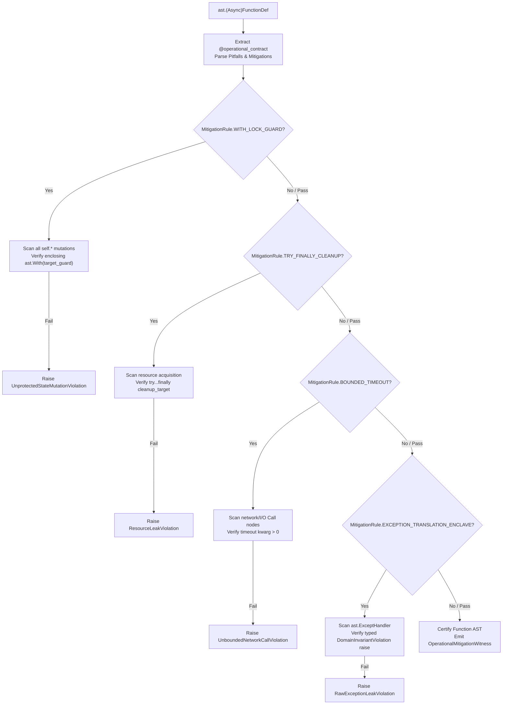

# Sovereign Research Specification: Bijective Contract Verification & Operational Pitfall AST Micro-Auditing
## Generation 4b Research Deliverable (`urn:axioma:g4b:spec:bijective_contract_verification:v1`)

> **Issuing Authority:** Sovereign Research Service (`services/research/`, `192.168.40.10:8201`)  
> **Target Enclaves:** Builder Enclave (`192.168.40.20`), Audit Enclave (`192.168.40.30`), Governance Enclave (`192.168.40.50`)  
> **Bundle URN:** `urn:axioma:g4b:bundle:bundle_g4b_bijective_contract_verification_001`  
> **Reference Architecture Hash:** `6ed72ccc72c96ae48ca1b59fa6eca5ed217ce3b127bc9700982ab0e2513fa899`  
> **Merkle Root:** `d965b7f35d968ba6443ed06fb804043191ed38ee961d1e2cbd7515e75c09a2e3`  
> **Certification:** `CERTIFIED_SAT` under [L1-G4B-001..003]  
> **Governance Authorization:** Approved by Human Architect under Option 1 ([NEG-GOV-GATE-001])  

---

## 1. Executive Summary & Epistemic Deconstruction

This specification defines the formal mathematical foundation and AST visitor mechanics to resolve two systemic failure modes in AI-synthesized software:
1. **The Specification Drift Friction:** Stochastically generated code diverges from declarative contract specifications, omitting required contract verbs while introducing unauthorized "phantom" helper functions.
2. **The Superficial AST Inspection Friction:** Static AST auditors traditionally inspect trivial string literals or banned built-in calls (e.g. `eval`), ignoring predictable operational traps (unprotected concurrency races, unclosed socket handles, missing timeout bounds, and raw unhandled system exceptions).

By introducing **Bijective Contract Verification** ($\Phi: \text{ContractIR} \longleftrightarrow \text{AST}$) and **Operational Pitfall & Invariant AST Micro-Auditing** into the pre-disk verification intercept (Phase 2B of the 3-Phase Causal Reactive Pipeline), Meta-Axioma guarantees that zero bytes are emitted to disk unless the implementation is mathematically proved to bijectively match the contract and contain physical AST mitigations for all declared operational failure modes.

---

## 2. Waterloo Tier 1 Situation of Concern (`[L1-G3B-000]`)

### 2.1 Macro Level (Systemic Landscape)
- Autonomous synthesis agents operate with high linguistic expressiveness but low structural determinism.
- While prompt-level instructions specify behavior, physical code is generated via probabilistic sampling, leading to subtle divergence between the declared interface specification and the emitted AST.
- Post-hoc testing with stochastically generated test cases fails to guarantee coverage of edge-case operational traps, leading to cascading failures in production distributed networks.

### 2.2 Meso Level (Generation 4b Architecture)
- The Generation 4b service mesh decomposes operations into decoupled microservices (`research`, `builder`, `audit`, `telemetry`, `governance`) bound to `192.168.40.0/24`.
- The `ResearchDeliverableBundle` and `ContractIR` (`DomainNoun`, `DomainVerb`, `ComposedVerb`) declare what entities and operations must exist.
- However, the `Audit` enclave's `ZeroTrustMicroAuditor` currently enforces only five hermetic rules (`HERM-001` to `HERM-005`): banning loopbacks, `sys.path` tampering, `/tmp` leaks, `eval`/`exec`, and placeholder UUIDs.
- There is no automated, formal verification gate asserting bidirectional bijectivity between `ContractIR` and physical code ASTs, nor any semantic verification of operational risk mitigations before disk emission.

### 2.3 Micro Level (AST Node & Bytecode Invariants)
- Target Python 3.14 AST structures (`ast.FunctionDef`, `ast.AsyncFunctionDef`, `ast.ClassDef`, `ast.With`, `ast.Try`, `ast.Call`).
- Method-level metadata: docstring specification hashes (`@spec_hash: <sha256>`) and risk decorators (`@operational_contract`).
- Intra-procedural CFG traversal to ensure that designated lock guards dominate mutable state access, `finally` blocks guarantee handle cleanup, and explicit timeouts bound all asynchronous I/O calls.

---

## 3. Mathematical Specification of Bijective Contract Verification

### 3.1 Universe Definitions
Let a formal domain contract be defined as:
$$\mathcal{C} = \langle \mathcal{N}, \mathcal{V}, \mathcal{I} \rangle$$
where:
- $\mathcal{N} = \{n_1, n_2, \dots, n_k\}$ is the finite set of declared `DomainNoun` entities.
- $\mathcal{V} = \{v_1, v_2, \dots, v_m\}$ is the finite set of declared `DomainVerb` operations.
- $\mathcal{I} = \{i_1, i_2, \dots, i_p\}$ is the finite set of domain invariant predicates.

Let $\mathcal{A}$ be the parsed Python AST of the candidate implementation leaf:
$$\mathcal{A} = \text{ast.parse}(\text{source\_code})$$

We partition the exported (public) AST symbols into classes and functions:
$$\mathcal{K}_{\text{exp}}(\mathcal{A}) = \{C \in \mathcal{A} \mid C \text{ is } \texttt{ast.ClassDef} \land \neg C.\text{name}.\text{startswith}('\_')\}$$
$$\mathcal{F}_{\text{exp}}(\mathcal{A}) = \{F \in \mathcal{A} \mid F \text{ is } \texttt{ast.(Async)FunctionDef} \land \neg F.\text{name}.\text{startswith}('\_')\}$$

### 3.2 The Morphism $\Phi: \mathcal{C} \longleftrightarrow \mathcal{A}$

#### Rule BIJ-001: Strict Bijective Symbol Mapping
The morphism $\Phi$ must be a true bijection:

1. **Verb Bijectivity ($\Phi_{\mathcal{V}}: \mathcal{V} \leftrightarrow \mathcal{F}_{\text{exp}}(\mathcal{A})$):**
   - **Injectivity (Completeness):**
     $$\forall v_a, v_b \in \mathcal{V}, \quad v_a \neq v_b \implies \Phi_{\mathcal{V}}(v_a) \neq \Phi_{\mathcal{V}}(v_b)$$
     $$\forall v \in \mathcal{V}, \quad \exists! F \in \mathcal{F}_{\text{exp}}(\mathcal{A}) \quad \text{such that } F.\text{name} = v.\text{name}$$
     *Violation if any verb is unimplemented: raises `UnimplementedVerbViolation(BIJ-001)`.*
   - **Surjectivity (Anti-Phantom / Zero-Rogue Invariant):**
     $$\forall F \in \mathcal{F}_{\text{exp}}(\mathcal{A}), \quad \exists! v \in \mathcal{V} \quad \text{such that } v.\text{name} = F.\text{name}$$
     *Violation if any undeclared public function exists: raises `RogueSymbolViolation(BIJ-001)`.*

2. **Noun Bijectivity ($\Phi_{\mathcal{N}}: \mathcal{N} \leftrightarrow \mathcal{K}_{\text{exp}}(\mathcal{A})$):**
   $$\forall n \in \mathcal{N}, \quad \exists! C \in \mathcal{K}_{\text{exp}}(\mathcal{A}) \quad \text{such that } C.\text{name} = n.\text{name}$$
   $$\forall C \in \mathcal{K}_{\text{exp}}(\mathcal{A}), \quad \exists! n \in \mathcal{N} \quad \text{such that } n.\text{name} = C.\text{name}$$
   *Violation raises `NounDiscrepancyViolation(BIJ-001)`.*

#### Rule BIJ-002: Cryptographic Docstring & Specification Synchronization
Every public function $F = \Phi_{\mathcal{V}}(v)$ must have a synchronized, tamper-evident docstring:
1. $F.\text{body}[0]$ must be an `ast.Expr` whose value is an `ast.Constant(value=str)`.
2. The docstring must parse into canonical contract clauses:
   - Parameters: $\forall p \in v.\text{parameters}, \quad \texttt{:param } p.\text{name} \in \text{docstring}$
   - Return type: $\texttt{:return: } v.\text{return\_type} \in \text{docstring}$
   - Pre-conditions: $\forall \text{pre} \in v.\text{pre\_conditions}, \quad \texttt{:pre } \text{pre} \in \text{docstring}$
   - Post-conditions: $\forall \text{post} \in v.\text{post\_conditions}, \quad \texttt{:post } \text{post} \in \text{docstring}$
3. **Spec Hash Verification:**
   The docstring must conclude with the tag:
   $$\texttt{@spec\_hash: } \mathcal{H}_{\text{spec}}(v)$$
   where:
   $$\mathcal{H}_{\text{spec}}(v) = \text{SHA-256}\Big(\text{CanonicalJSON}\big(v.\text{name}, v.\text{parameters}, v.\text{return\_type}, v.\text{pre\_conditions}, v.\text{post\_conditions}\big)\Big)$$
   The micro-auditor extracts `@spec_hash`, computes the hash directly from `ContractIR`, and asserts exact match. Any mismatch raises `SpecificationDriftViolation(BIJ-002)`.

#### Rule BIJ-003: Type-Signature Morphism
Let:
$$\text{Sig}(v) = \langle (p_1: \tau_1, \dots, p_k: \tau_k) \to \tau_{\text{ret}} \rangle$$
$$\text{Sig}(F) = \langle (a_1: \sigma_1, \dots, a_k: \sigma_k) \to \sigma_{\text{ret}} \rangle$$
The micro-auditor verifies:
$$\forall j \in \{1, \dots, k\}: \quad a_j = p_j \land \text{IsomorphicType}(\sigma_j, \tau_j)$$
$$\text{IsomorphicType}(\sigma_{\text{ret}}, \tau_{\text{ret}}) = \text{True}$$
*Violation raises `SignatureMismatchViolation(BIJ-003)`.*

---

## 4. Schema & Verification Semantics for Operational Pitfall Metadata

### 4.1 Foundational Pitfall Taxonomies
```python
class OperationalPitfall(str, Enum):
    CONCURRENCY_STATE_RACE = "CONCURRENCY_STATE_RACE"
    RESOURCE_LEAK_UNCLOSED = "RESOURCE_LEAK_UNCLOSED"
    TRANSIENT_NETWORK_FAILURE = "TRANSIENT_NETWORK_FAILURE"
    UNHANDLED_BOUNDARY_EXCEPTION = "UNHANDLED_BOUNDARY_EXCEPTION"
    UNBOUNDED_QUEUE_BACKPRESSURE = "UNBOUNDED_QUEUE_BACKPRESSURE"
    DEADLOCK_CIRCULAR_WAIT = "DEADLOCK_CIRCULAR_WAIT"

class MitigationRule(str, Enum):
    WITH_LOCK_GUARD = "WITH_LOCK_GUARD"
    TRY_FINALLY_CLEANUP = "TRY_FINALLY_CLEANUP"
    BOUNDED_TIMEOUT = "BOUNDED_TIMEOUT"
    EXPONENTIAL_BACKOFF_RETRY = "EXPONENTIAL_BACKOFF_RETRY"
    EXCEPTION_TRANSLATION_ENCLAVE = "EXCEPTION_TRANSLATION_ENCLAVE"
    BOUNDED_BUFFER_LIMIT = "BOUNDED_BUFFER_LIMIT"
```

### 4.2 Function Risk Declaration Syntax
Functions declare risks and mitigation requirements via the `@operational_contract` decorator:
```python
@operational_contract(
    pitfalls=[
        OperationalPitfall.CONCURRENCY_STATE_RACE,
        OperationalPitfall.RESOURCE_LEAK_UNCLOSED,
        OperationalPitfall.TRANSIENT_NETWORK_FAILURE,
    ],
    mitigations=[
        MitigationPattern(
            pitfall=OperationalPitfall.CONCURRENCY_STATE_RACE,
            rule=MitigationRule.WITH_LOCK_GUARD,
            target_guard="self._state_lock",
        ),
        MitigationPattern(
            pitfall=OperationalPitfall.RESOURCE_LEAK_UNCLOSED,
            rule=MitigationRule.TRY_FINALLY_CLEANUP,
            cleanup_target="channel.close",
        ),
        MitigationPattern(
            pitfall=OperationalPitfall.TRANSIENT_NETWORK_FAILURE,
            rule=MitigationRule.BOUNDED_TIMEOUT,
            max_timeout_sec=5.0,
        ),
    ]
)
async def dispatch_transaction(self, tx: Transaction) -> Receipt:
    ...
```

### 4.3 AST Visitor Verification Passes (`OperationalPitfallAuditor`)



#### Pass OP-001 (`WITH_LOCK_GUARD`) Mechanics
- AST visitor finds all `ast.Assign` and `ast.AugAssign` nodes whose target is an `ast.Attribute` on `self` (`target.value.id == "self"`).
- For each assignment node, checks AST ancestor stack for `ast.With` or `ast.AsyncWith`.
- Extracts context manager items (`with_node.items`). Matches expression against `target_guard`.
- If an un-guarded mutation occurs, raises `UnprotectedStateMutationViolation(OP-001)`.

#### Pass OP-002 (`TRY_FINALLY_CLEANUP`) Mechanics
- Identifies resource allocation expressions (e.g. `connect()`, `open_session()`, `acquire()`).
- Asserts that allocation is immediately followed or enclosed by `ast.Try`.
- Checks `try_node.finalbody` statements for a call or await matching `cleanup_target`.
- If missing, raises `ResourceLeakViolation(OP-002)`.

#### Pass OP-003 (`BOUNDED_TIMEOUT`) Mechanics
- Identifies network/I/O call nodes (`.read()`, `.write()`, `.get()`, `.post()`, `.request()`, `.send()`).
- Asserts presence of `timeout` in `call_node.keywords`.
- Asserts `keyword.value` is an `ast.Constant` with `float(value) > 0.0` or a bound timeout parameter $\le \text{max\_timeout\_sec}$.
- If missing or $\le 0$, raises `UnboundedNetworkCallViolation(OP-003)`.

#### Pass OP-004 (`EXCEPTION_TRANSLATION_ENCLAVE`) Mechanics
- Inspects all `ast.ExceptHandler` nodes in function body.
- Hard rejects bare `except:` statements (`HERM-008`).
- Checks handler body for `ast.Raise(exc=...)`. Verifies that raised exception class is a subclass of `DomainInvariantViolation`.
- Verifies exception chaining (`raise ... from e`).
- If missing, raises `RawExceptionLeakViolation(OP-004)`.

---

## 5. Downstream Ingestion Protocol for Service Enclaves

Downstream enclaves ingest this deliverable as follows:
1. **Audit Enclave (`services/audit/`, `192.168.40.30`):**
   - Synthesizes `services/audit/src/bijective_verifier.py` implementing `BijectiveVerifier`.
   - Synthesizes `services/audit/src/operational_pitfall_auditor.py` implementing `OperationalPitfallAuditor`.
   - Extends `ZeroTrustMicroAuditor.audit_source()` to execute `HERM-001..005`, `BIJ-001..003`, and `OP-001..004`.
2. **Builder Enclave (`services/builder/`, `192.168.40.20`):**
   - Updates `ASTSkeletonizer` and leaf synthesizers to include `@operational_contract` annotations and synchronized docstrings on all emitted code.
   - Enforces Phase 2B micro-auditor verification before disk emission.
3. **Telemetry Enclave (`services/telemetry/`, `192.168.40.40`):**
   - Ingests `ContractBijectivityWitness` and `OperationalPitfallAuditReport` into `telemetry_vault.db`.
   - Reflects bijective coverage and operational mitigation metrics in `dashboard.html`.
4. **Governance Enclave (`services/governance/`, `192.168.40.50`):**
   - Integrates `BIJ-001..003` into `SuccessionGatekeeper.verify_succession_gates()`, fulfilling Generation 5 Handover Gate 1 and Gate 2.

---
*Certified by Sovereign Research Service (192.168.40.10:8201) under URN `urn:axioma:g4b:spec:bijective_contract_verification:v1`.*
