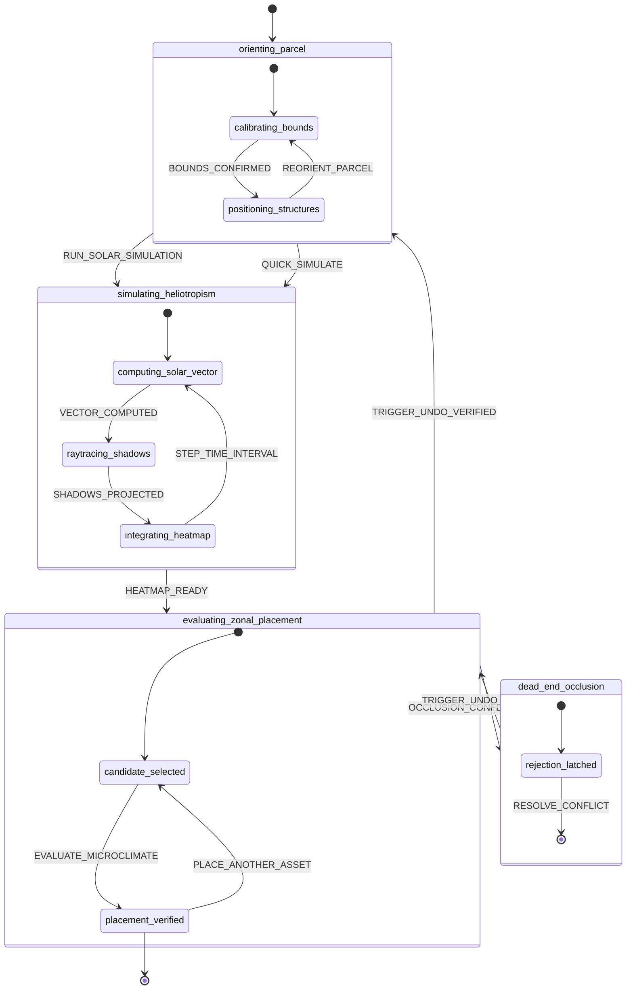

# Flow: Axioma Heliotrope Workflow (`flow_heliotropic_choreography`)

- **Domain:** [`trace/domains/axioma_heliotrope.domain.md`](../domains/axioma_heliotrope.domain.md)
- **Primary Persona:** Elena, Permaculture Designer & Heliotropic Landscaper
- **Steps to Value:** $\le 3$

## 1. Flow Diagram

## 2. Interaction Steps (The 3-Step Journey)
1. **Step 1 — Orient & Inspect (Default State):**
   - Elena opens the studio on port `8080`.
   - The $30\text{m} \times 20\text{m}$ parcel renders immediately with the 2-story home (pitched gable ridge), garage, mature conical cedar tree, and boundary fence at Portland coordinates ($45.5152^\circ\text{ N}, -122.6784^\circ\text{ W}$).
2. **Step 2 — Scrub Solar Path & Project Heatmap:**
   - Elena drags the diurnal time scrubber (06:00 to 20:00) or toggles between Summer Solstice, Winter Solstice, and Equinox.
   - Ground shadow polygons sweep across the yard in real time ($\le 16\text{ms}$).
   - Elena toggles the **Cumulative Insolation Heatmap** overlay, revealing direct sun hours across all 600 discrete $1\text{m}^2$ cells (Deep Shade $<2\text{h}$, Partial Shade $2\text{--}5\text{h}$, Full Sun $\ge 6\text{h}$).
3. **Step 3 — Qualify Asset Placement & Functorial Reversibility:**
   - Elena selects a Raised Vegetable Bed from the asset palette and clicks on the yard.
   - The microclimate qualification engine inspects the cell's cumulative sunlight:
     - Full Sun ($\ge 6\text{h}$): Pill displays `OPTIMAL (8.2 hrs direct sun)`.
     - Shaded ($< 6\text{h}$): Pill alerts `OCCLUDED (-2.3 hrs below threshold)`.
   - Elena taps `Cmd+Z` (or the Functorial Undo button), instantly rolling back the layout state to prior snapshot without reload.
